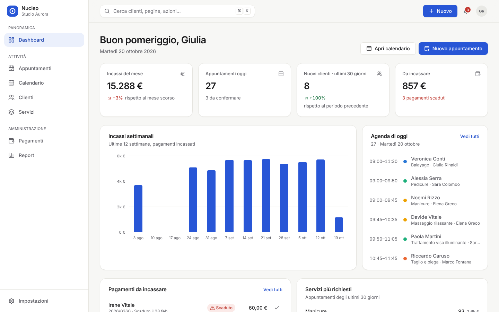
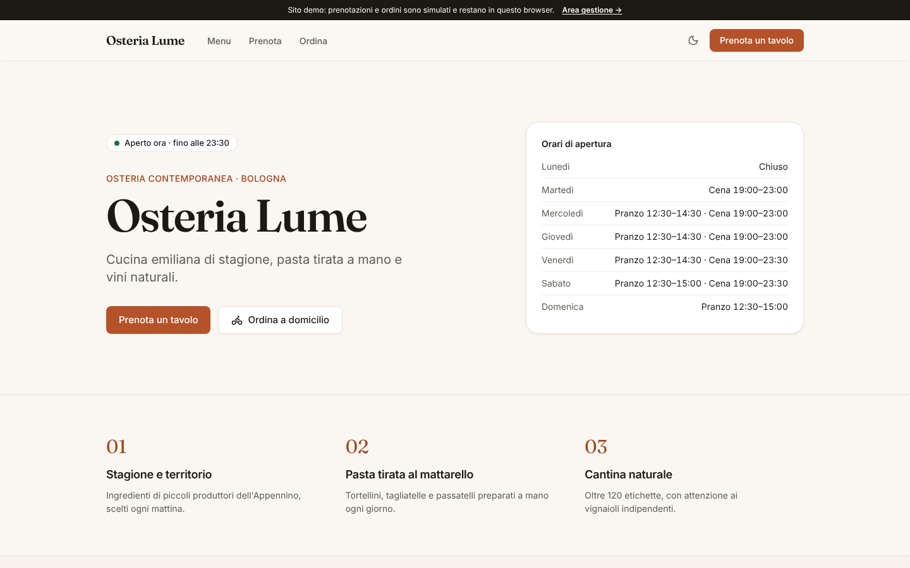
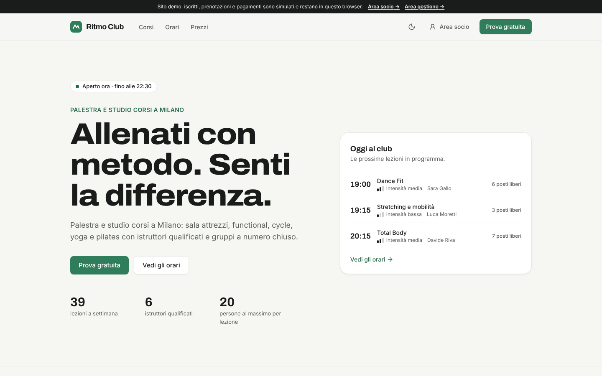
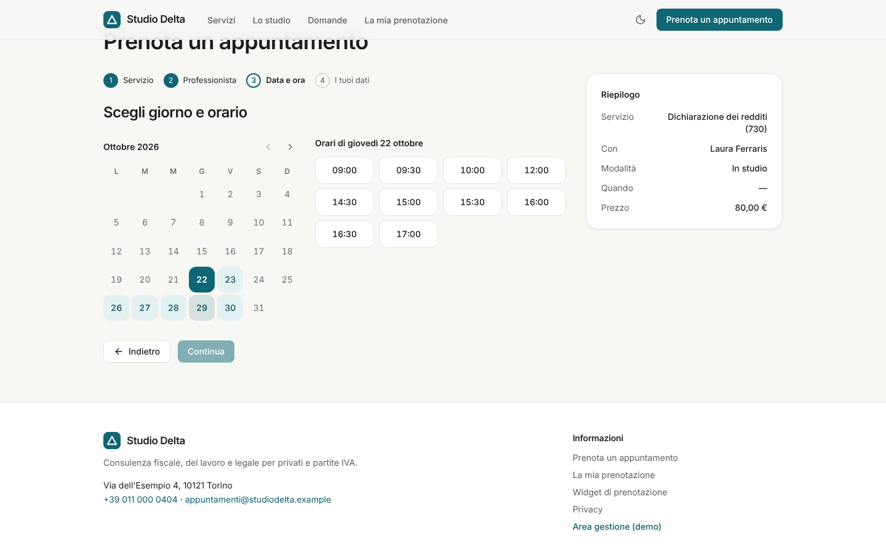
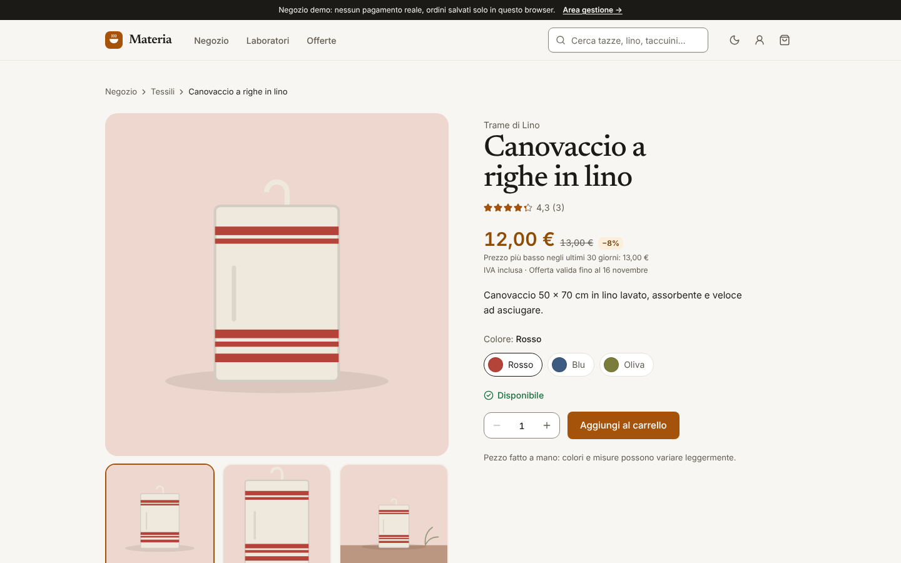
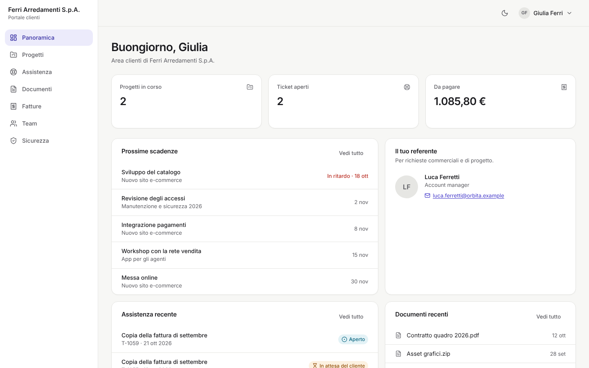
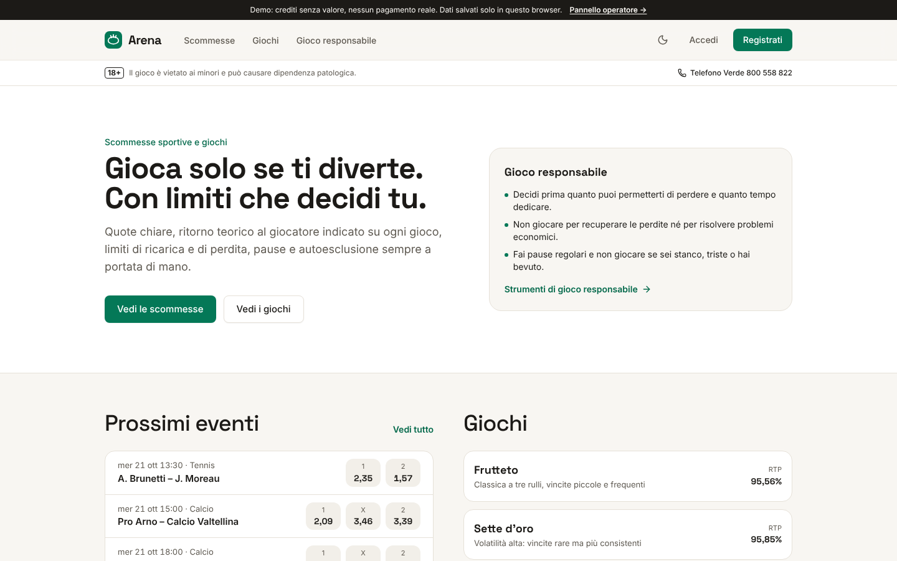

# idee — libreria di template per app e siti web

Template professionali e riutilizzabili per i nostri progetti: design minimale e premium, accessibili (WCAG 2.2 AA), responsive, documentati e pronti per il deploy su **Vercel** dal repository GitHub.

Ogni template è un'**app autonoma** nella cartella `templates/<nome>`: si copia, si installa e si pubblica da sola, senza dipendere dagli altri. Tutti condividono gli stessi standard di UX, qualità e rilascio.

## Template

| # | Template | Cartella | Settore | Accento | Stato |
| - | --- | --- | --- | --- | --- |
| 1 | **Nucleo** | [`templates/gestionale`](templates/gestionale) | Gestionale e CRM: dashboard, clienti, servizi, appuntamenti, calendario, pagamenti, report | Blu cobalto | ✅ v1.0 |
| 2 | **Tavola** | [`templates/ristorante`](templates/ristorante) | Ristoranti: menu con allergeni, prenotazione tavoli, ordini d'asporto e consegna, pannello per sala e cucina | Terracotta | ✅ v1.0 |
| 3 | **Forma** | [`templates/fitness`](templates/fitness) | Palestre e centri fitness: corsi, orari, prezzi, prova gratuita, area socio con prenotazioni e lista d'attesa, reception con check-in | Verde salvia | ✅ v1.0 |
| 4 | **Agenda** | [`templates/prenotazioni`](templates/prenotazioni) | Studi e attività su appuntamento: prenotazione online in 4 passi, widget incorporabile, gestione del cliente con codice, agenda dello studio con orari, assenze e servizi | Petrolio | ✅ v1.0 |
| 5 | **Bottega** | [`templates/ecommerce`](templates/ecommerce) | E-commerce e marketplace: catalogo con filtri, schede prodotto con varianti e recensioni, carrello, checkout in una pagina, resi online, pannello con ordini, scorte, promozioni (regola Omnibus) e venditori | Ambra | ✅ v1.0 |
| 6 | **Portale** | [`templates/portale`](templates/portale) | Area clienti e amministrazione B2B: accesso in due passaggi, progetti, documenti, ticket con SLA e note interne, fatture, team con 5 ruoli, registro attività, impostazioni | Indaco | ✅ v1.0 |
| 7 | **Arena** | [`templates/gioco`](templates/gioco) | Scommesse e giochi con gioco responsabile: verifica dell'età, quote e schedina, slot con RTP calcolato, limiti, promemoria, pause, autoesclusione, pannello operatore con segnali di rischio | Smeraldo | ✅ v1.0 |
| 8 | Vetrina | `templates/landing` | Landing page, siti vetrina e SaaS | Configurabile | Pianificato |

Sintesi e note legali di ogni template sono in [`docs/roadmap.md`](docs/roadmap.md). Si procede un template alla volta, a partire da **Nucleo**, che è la base condivisa di design system e componenti.

<table>
  <tr>
    <td></td>
    <td></td>
  </tr>
  <tr>
    <td></td>
    <td></td>
  </tr>
  <tr>
    <td></td>
    <td></td>
  </tr>
  <tr>
    <td></td>
    <td></td>
  </tr>
</table>

## Standard comuni

- **Design:** neutri caldi, un solo colore d'accento per settore, tipografia leggibile, ampio spazio bianco, profondità discreta, tema chiaro e scuro. Dettagli in [`docs/standard-ux.md`](docs/standard-ux.md).
- **Movimento:** animazioni rapide (120–260 ms) e funzionali, disattivate con `prefers-reduced-motion`.
- **Accessibilità:** WCAG 2.2 AA verificata con axe-core in CI, in entrambi i temi.
- **Codice:** Next.js 16, React 19, TypeScript strict, Tailwind CSS 4, componenti accessibili Radix, logica di dominio pura e testata.
- **Qualità:** Prettier, ESLint (con regole di accessibilità), controllo dei tipi, test unitari, test end-to-end, build di produzione. Tutto gira in [GitHub Actions](.github/workflows/ci.yml).
- **Contenuti:** testi UI in italiano raccolti in un unico file per template; dati demo inventati (email su `example.com`, telefoni con `000`).
- **Sicurezza:** header e CSP, nessun segreto nel repository, `.env.example` documentato, Dependabot attivo.

## Usare un template in un nuovo progetto

```bash
# 1. Copia il template in una nuova cartella (o in un nuovo repository)
npx degit mykytakarpenko-debug/idee/templates/gestionale mio-progetto
cd mio-progetto

# 2. Installa e avvia
npm ci
cp .env.example .env.local
npm run dev
```

Poi segui la guida alla personalizzazione del template, ad esempio [`templates/gestionale/docs/personalizzazione.md`](templates/gestionale/docs/personalizzazione.md), per nome, logo, colori, testi e dati.

## Deploy e revisione su Vercel

1. Su [vercel.com/new](https://vercel.com/new) importa questo repository.
2. Imposta **Root Directory** sulla cartella del template, ad esempio `templates/gestionale`. Crea un progetto Vercel per ogni template.
3. Ogni pull request genera una **preview pubblica** per la revisione; il branch di produzione aggiorna la demo definitiva.

La pubblicazione definitiva avviene solo dopo la checklist di [`docs/rilascio.md`](docs/rilascio.md): verifica funzionale, grafica, responsive e di accessibilità.

## Struttura del repository

```text
.
├── templates/
│   ├── gestionale/          # Nucleo (app Next.js autonoma)
│   ├── ristorante/          # Tavola
│   ├── fitness/             # Forma
│   ├── prenotazioni/        # Agenda
│   ├── ecommerce/           # Bottega
│   ├── portale/             # Portale
│   └── gioco/               # Arena
├── docs/
│   ├── roadmap.md           # Gli 8 template: sintesi, palette, note legali
│   ├── standard-ux.md       # Principi di design e UX condivisi
│   └── rilascio.md          # Processo preview → verifica → produzione
├── .github/                 # CI, Dependabot, template delle pull request
├── LICENSE                  # MIT
└── SECURITY.md              # Segnalazione delle vulnerabilità
```

## Licenza

[MIT](LICENSE). I template si possono usare anche in progetti commerciali. Loghi e marchi dei clienti restano dei rispettivi titolari; i template non includono asset proprietari di terzi.
