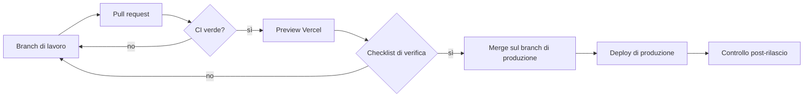

# Processo di rilascio

Ogni modifica passa da **preview → verifica → produzione**. Nessun template viene pubblicato in modo definitivo senza superare tutti i controlli qui sotto.

## 1. Preparazione

1. Crea un branch dal branch principale e lavora nella cartella del template.
2. In locale esegui `npm run check`, che lancia formattazione, lint, tipi, test unitari e build.
3. Esegui anche `npm run test:e2e` per i test end-to-end e di accessibilità.

## 2. Pull request e preview

1. Apri la pull request: il modello include la checklist.
2. GitHub Actions ripete tutti i controlli; la PR non si unisce se qualcosa fallisce.
3. Vercel pubblica una **preview** con URL dedicato. Condividila per la revisione: chi revisiona può lasciare commenti direttamente sulla pagina con la toolbar di Vercel, attiva solo sulle preview.

## 3. Checklist di verifica (sulla preview)

### Funzionale
- [ ] I flussi principali del template funzionano dall'inizio alla fine (per Nucleo: cliente → appuntamento → completamento → pagamento → report; per Tavola: prenotazione dal sito → pannello, ordine → cucina → tracking; per Forma: prova gratuita → pannello, prenotazione e lista d'attesa → check-in).
- [ ] Stati vuoti, errori di validazione, conferme e annullamenti si comportano come previsto.
- [ ] I dati demo si ripristinano correttamente.

### Grafica
- [ ] Tema chiaro e scuro coerenti, senza testi illeggibili o elementi fuori tono.
- [ ] Allineamenti, spaziature e stati hover/focus/attivo corretti.
- [ ] Animazioni rapide e discrete; con "Riduci movimento" attivo non ci sono animazioni.

### Responsive
- [ ] 375 px (smartphone), 768 px (tablet verticale), 1024 px (tablet orizzontale), 1440 px (desktop).
- [ ] Nessuno scroll orizzontale indesiderato; tabelle e calendario scorrono nel loro contenitore.
- [ ] Target touch comodi; tastiera virtuale senza zoom indesiderati.

### Accessibilità
- [ ] Test axe in CI verdi.
- [ ] Percorso completo solo da tastiera.
- [ ] Prova con screen reader (VoiceOver o NVDA) sulle pagine modificate.
- [ ] Zoom al 200% senza perdita di contenuti.

### Prestazioni e sicurezza
- [ ] Lighthouse sulla preview: prestazioni ≥ 90, accessibilità 100, best practice ≥ 95.
- [ ] Nessun errore in console; header di sicurezza presenti (verifica con DevTools → Network).
- [ ] Nessun segreto o dato reale nel codice; nuove variabili documentate in `.env.example`.

### Contenuti e legale
- [ ] Testi rivisti (refusi, tono, coerenza dei termini).
- [ ] Dati demo inventati; nessun marchio o asset di terzi.
- [ ] Note legali del settore rispettate (vedi [roadmap](roadmap.md)).

## 4. Produzione

1. Unisci la pull request sul branch di produzione: Vercel esegue il deploy automatico.
2. Controlla la demo di produzione (pagine principali, console, tema, mobile).
3. Crea un tag di versione (es. `gestionale-v1.1.0`) con le note di rilascio.
4. In caso di problemi usa **Instant Rollback** di Vercel per tornare al deploy precedente, poi correggi con una nuova pull request.

## Configurazione dei progetti Vercel

| Template | Root Directory | Progetto Vercel suggerito |
| --- | --- | --- |
| Nucleo | `templates/gestionale` | `nucleo-gestionale` |
| Tavola | `templates/ristorante` | `tavola-ristorante` |
| Forma | `templates/fitness` | `forma-fitness` |

Ogni `vercel.json` di template imposta install, build, regione `fra1` e `ignoreCommand`, così un commit che non tocca il template non lo ricompila.
