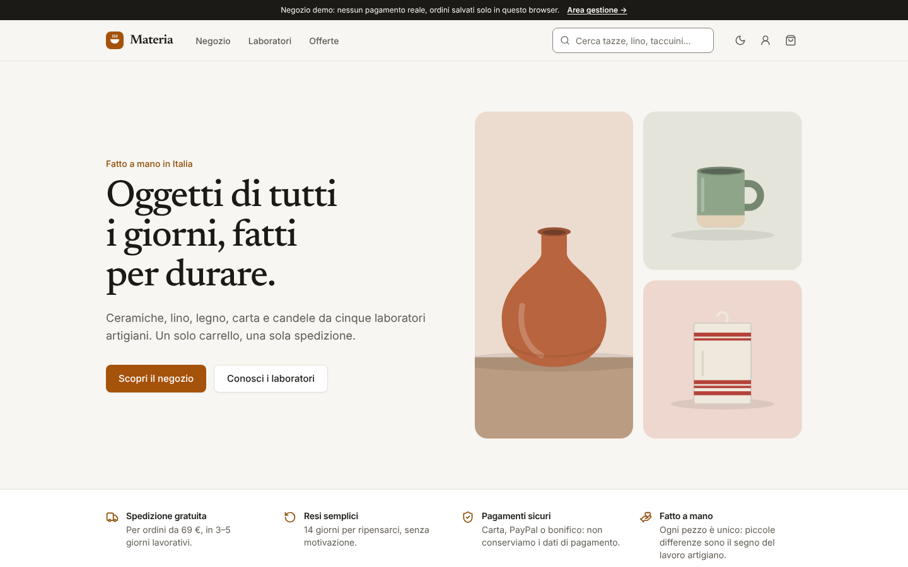
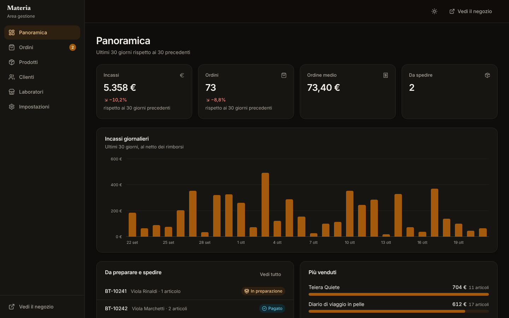
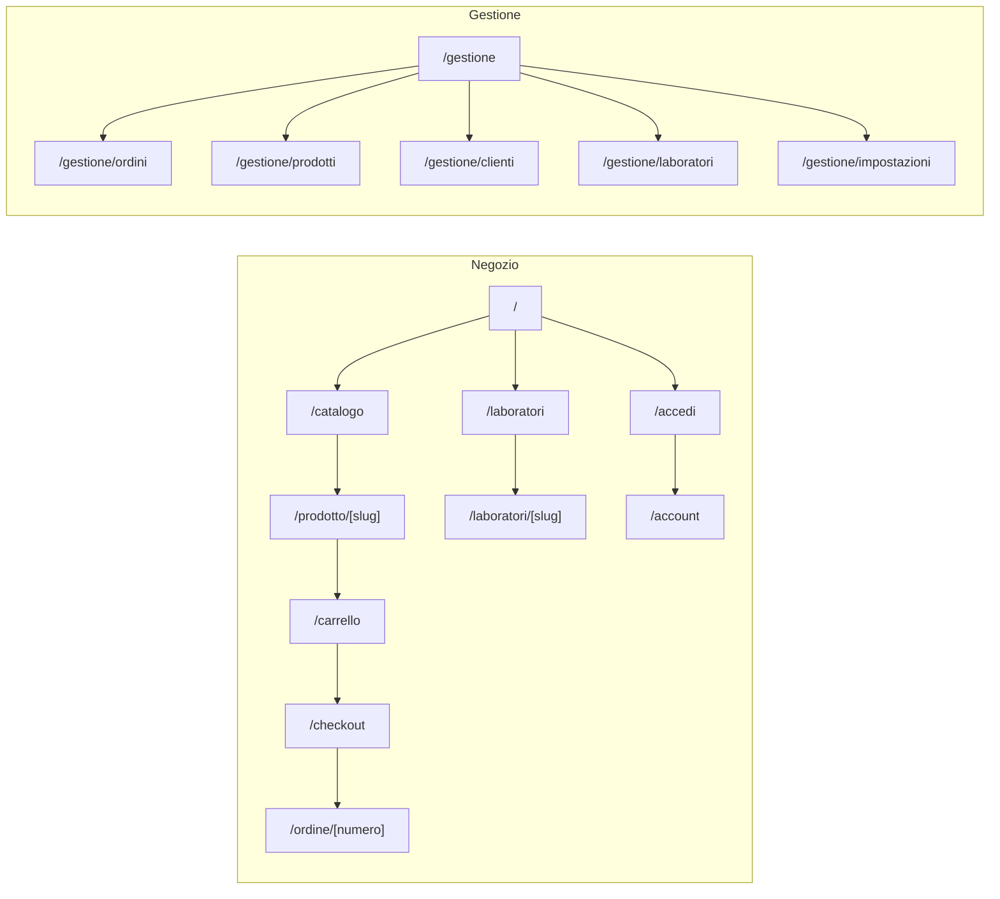

# Bottega — negozio online e marketplace

Template per **e-commerce di prodotti fisici**, pronto anche per il modello **marketplace** con più venditori. Comprende:

- **negozio:** catalogo con ricerca e filtri, schede prodotto con varianti e recensioni, carrello, checkout in una pagina;
- **area cliente:** ordini, tracciamento, reso online (diritto di recesso), dati personali ed esportazione GDPR;
- **pannello:** vendite, ordini e resi, prodotti, scorte e promozioni, clienti, venditori con commissioni, spedizioni e codici sconto.

Prezzi e promozioni rispettano la **regola Omnibus**. Il sito è accessibile (WCAG 2.2 AA), responsive e pronto per il deploy su Vercel.



<table>
  <tr>
    <td></td>
    <td></td>
  </tr>
</table>

> **Demo pubblica:** dopo il primo deploy su Vercel inserisci qui il link della preview, es. `https://bottega-ecommerce.vercel.app`.

---

## Indice

1. [Concept e pubblico](#concept-e-pubblico)
2. [Funzionalità](#funzionalità)
3. [Pagine e navigazione](#pagine-e-navigazione)
4. [Stack tecnico](#stack-tecnico)
5. [Avvio rapido](#avvio-rapido)
6. [Script](#script)
7. [Struttura del progetto](#struttura-del-progetto)
8. [Variabili d'ambiente](#variabili-dambiente)
9. [Deploy su Vercel](#deploy-su-vercel)
10. [Qualità, test e accessibilità](#qualità-test-e-accessibilità)
11. [Prima di andare in produzione](#prima-di-andare-in-produzione)
12. [Documentazione](#documentazione)

## Concept e pubblico

**Bottega** mette il prodotto al centro e porta all'acquisto con pochi passaggi chiari:

- prezzi IVA inclusa e spese di spedizione visibili prima del checkout;
- disponibilità aggiornata per variante;
- un solo modulo di checkout, con il riepilogo sempre visibile;
- resi semplici, richiesti dall'area personale.

| Pubblico                      | Cosa offre                                                                                                         |
| ----------------------------- | ------------------------------------------------------------------------------------------------------------------ |
| **Cliente**                   | Trova, confronta, compra anche senza registrarsi, segue la spedizione e restituisce senza telefonare.              |
| **Gestore**                   | Prepara e spedisce gli ordini, gestisce scorte, promozioni, codici sconto e resi, vede l'andamento delle vendite.  |
| **Venditori del marketplace** | Hanno una pagina con i propri dati identificativi; il gestore calcola venduto, commissioni e importi da liquidare. |

La demo è _Materia_, negozio inventato di oggetti artigianali. Comprende:

- 5 laboratori e 21 prodotti in 5 categorie, con 2–3 varianti di colore;
- recensioni (in maggioranza da acquisti verificati);
- 3 promozioni in corso, più una che per la regola Omnibus non può essere presentata come sconto;
- circa tre mesi di ordini, con resi e pagamenti con bonifico.

## Funzionalità

| Area                                  | Cosa offre                                                                                                                                                                                                                                                                                                                              |
| ------------------------------------- | --------------------------------------------------------------------------------------------------------------------------------------------------------------------------------------------------------------------------------------------------------------------------------------------------------------------------------------- |
| **Home**                              | Valori del negozio (spedizione, resi, pagamenti), categorie, prodotti in evidenza, offerte, laboratori; dati strutturati `OnlineStore` e `SearchAction`.                                                                                                                                                                                |
| **Catalogo**                          | Ricerca senza accenti su più parole; filtri per categoria, laboratorio, prezzo massimo, disponibilità e offerte; 5 ordinamenti. I filtri sono nell'URL (link condivisibili); l'HTML statico contiene già tutti i prodotti.                                                                                                              |
| **Scheda prodotto**                   | Galleria con 3 viste, varianti di colore con disponibilità, quantità limitata alle scorte. Prezzo con sconto e prezzo più basso a 30 giorni, scadenza dell'offerta. Dettagli, spedizione e resi, venditore, recensioni con distribuzione e "Acquisto verificato", correlati; dati strutturati `Product` con `Offer` e politica di reso. |
| **Carrello**                          | Carrello laterale e pagina dedicata, avanzamento verso la spedizione gratuita, codice sconto con messaggi chiari (sconosciuto, scaduto, ordine minimo), avvisi sulle scorte.                                                                                                                                                            |
| **Checkout**                          | Contatti e indirizzo con autocompletamento, spedizione standard, espressa o ritiro con costo. Pagamento con carta, PayPal o bonifico (nessun dato di carta raccolto), condizioni e recesso da accettare, consenso marketing separato. Pulsante finale **"Ordine con obbligo di pagamento"**.                                            |
| **Ordine**                            | Conferma, istruzioni per il bonifico, articoli e totali con IVA, indirizzo, tracciamento, cronologia.                                                                                                                                                                                                                                   |
| **Area personale**                    | Ordini con richiesta di reso entro il termine (quantità per articolo, rimborso stimato). Dati e indirizzo, esportazione JSON, richiesta di cancellazione.                                                                                                                                                                               |
| **Laboratori**                        | Pagina per ogni venditore con racconto, dati identificativi (ragione sociale, P. IVA, indirizzo, contatti) e prodotti.                                                                                                                                                                                                                  |
| **Pagine legali**                     | Condizioni di vendita, diritto di recesso con modulo tipo, spedizioni e resi, informativa privacy (testi di esempio).                                                                                                                                                                                                                   |
| **Panoramica** (pannello)             | Incassi, ordini e ordine medio rispetto ai 30 giorni precedenti, ordini da spedire, grafico giornaliero, più venduti, scorte basse, resi da gestire.                                                                                                                                                                                    |
| **Ordini**                            | Ricerca, filtro per stato e resi aperti, esportazione CSV. Scheda con avanzamento (pagato → preparazione → spedito → consegnato), codice di tracciamento, annullamento con ripristino delle scorte, gestione del reso (approva, rifiuta, rimborsa).                                                                                     |
| **Prodotti**                          | Elenco con prezzo, scorte e stato. Modulo con varianti e scorte, promozione con date e **anteprima dello sconto secondo la regola Omnibus**; lo storico dei prezzi si aggiorna da solo.                                                                                                                                                 |
| **Clienti, laboratori, impostazioni** | Clienti con spesa e consensi. Venduto, commissioni e importi da liquidare per laboratorio, con commissione modificabile. Dati legali, spedizioni, ritiro, giorni di recesso, codici sconto, ripristino della demo.                                                                                                                      |

## Pagine e navigazione



| Schermo               | Negozio                                                                           | Pannello                                                       |
| --------------------- | --------------------------------------------------------------------------------- | -------------------------------------------------------------- |
| Desktop (≥ 1024 px)   | Ricerca nell'intestazione, filtri laterali, riepilogo del checkout fisso a destra | Sidebar con contatore degli ordini da spedire                  |
| Tablet (768–1023 px)  | Filtri in un pannello laterale                                                    | Sidebar; tabelle complete                                      |
| Smartphone (< 768 px) | Menu con ricerca, filtri a scomparsa, 2 prodotti per riga                         | Barra inferiore e menu "Altro"; elenchi al posto delle tabelle |

Il brief completo è in [docs/brief.md](docs/brief.md).

## Stack tecnico

| Ambito                 | Scelta                                                                                       | Perché                                                                   |
| ---------------------- | -------------------------------------------------------------------------------------------- | ------------------------------------------------------------------------ |
| Framework              | [Next.js 16](https://nextjs.org) (App Router, Cache Components, Turbopack)                   | Schede prodotto e catalogo prerenderizzati con dati strutturati          |
| UI                     | React 19, TypeScript (strict)                                                                | Tipi su tutto il dominio                                                 |
| Stile                  | Tailwind CSS 4 con design token; Inter + Newsreader (titoli)                                 | Tema chiaro/scuro e branding da un unico file                            |
| Immagini               | Illustrazioni SVG generate dal codice                                                        | Nessuna foto di terzi, peso minimo; sostituibili con le foto reali       |
| Componenti accessibili | [Radix UI](https://www.radix-ui.com)                                                         | Focus, tastiera e ARIA corretti                                          |
| Stato                  | [Zustand](https://zustand.docs.pmnd.rs) con salvataggio locale e sincronizzazione tra schede | Negozio, area cliente e pannello condividono i dati                      |
| Validazione            | [Zod 4](https://zod.dev)                                                                     | Stessi schemi riutilizzabili lato server                                 |
| Qualità                | ESLint (Next + jsx-a11y), Prettier, Vitest, Playwright + axe-core                            | Formattazione, analisi statica, test unitari, end-to-end e accessibilità |

## Avvio rapido

Requisiti: **Node.js 22** (vedi `.nvmrc`) e npm.

```bash
cd templates/ecommerce
npm ci
cp .env.example .env.local   # facoltativo
npm run dev
```

- Negozio: <http://localhost:3000>.
- Area personale: <http://localhost:3000/accedi>. In demo le credenziali sono già inserite.
- Pannello: <http://localhost:3000/gestione>.
- Codici sconto demo: `BENVENUTO10`, `SPEDIZIONEGRATIS`, `GRAZIE5` (da 50 €), `ESTATE15` (scaduto).

I dati demo restano **solo nel browser** e si ripristinano da _Impostazioni → Dati demo_.

## Script

| Comando                           | Descrizione                                                                                                                          |
| --------------------------------- | ------------------------------------------------------------------------------------------------------------------------------------ |
| `npm run dev`                     | Server di sviluppo                                                                                                                   |
| `npm run build` / `start`         | Build di produzione e avvio                                                                                                          |
| `npm run lint` / `lint:fix`       | ESLint (regole Next.js, React Hooks e accessibilità jsx-a11y)                                                                        |
| `npm run typecheck`               | Genera i tipi delle rotte e controlla TypeScript                                                                                     |
| `npm run format` / `format:check` | Prettier (con ordinamento delle classi Tailwind)                                                                                     |
| `npm test`                        | Test unitari della logica di dominio (Vitest)                                                                                        |
| `npm run test:e2e`                | Test end-to-end e di accessibilità su desktop e mobile. Esegui prima `npm run build`; al primo uso `npx playwright install chromium` |
| `npm run check`                   | Tutti i controlli in sequenza, come in CI                                                                                            |

## Struttura del progetto

```text
src/
├── app/
│   ├── (negozio)/             # Home, catalogo, prodotto, laboratori, carrello, checkout, ordine,
│   │                          # accesso, area personale, pagine legali
│   ├── gestione/              # Panoramica, ordini, prodotti, clienti, laboratori, impostazioni
│   └── globals.css, layout.tsx, manifest.ts, robots.ts, sitemap.ts, icon.svg
├── components/
│   ├── ui/                    # Libreria di componenti condivisa con gli altri template
│   ├── product/               # Illustrazioni SVG, prezzo (Omnibus), stelle, disponibilità, scheda
│   ├── shop/                  # Carrello laterale, righe e totali, quantità, riepiloghi d'ordine
│   ├── site/, panel/, layout/ # Strutture del negozio e del pannello, catalogo prerenderizzato
│   └── status-badges.tsx      # Stato di ordini e resi
├── features/shop | account | panel
├── lib/
│   ├── domain/
│   │   ├── pricing.ts         # Prezzo del giorno, storico, riferimento a 30 giorni, IVA inclusa
│   │   ├── cart.ts            # Righe, codici sconto, spedizione, totali
│   │   ├── inventory.ts       # Disponibilità, problemi di scorta, aggiornamento delle scorte
│   │   ├── orders.ts          # Stati, recesso, rimborsi, ripartizione per venditore
│   │   ├── catalog.ts         # Ricerca, filtri, ordinamenti, recensioni, correlati, filtri ↔ URL
│   │   └── analytics.ts, dates.ts, schemas.ts, types.ts
│   ├── demo/seed.ts           # Dati demo deterministici
│   ├── catalog-server.ts      # Catalogo per il prerendering ("use cache")
│   └── seo.ts, format.ts, csv.ts
├── store/                     # Dati, carrello, sessione demo, interfaccia
└── content/it.ts              # Tutti i testi dell'interfaccia
tests/unit, tests/e2e
```

## Variabili d'ambiente

Tutte facoltative; riferimento in [`.env.example`](.env.example). Nessun segreto va mai nel repository.

| Variabile                    | Predefinito                                            | Uso                                                                                    |
| ---------------------------- | ------------------------------------------------------ | -------------------------------------------------------------------------------------- |
| `NEXT_PUBLIC_SITE_URL`       | dominio di produzione Vercel o `http://localhost:3000` | URL assoluti, sitemap, dati strutturati                                                |
| `NEXT_PUBLIC_DEMO_MODE`      | `true`                                                 | Banner demo, credenziali precompilate                                                  |
| `NEXT_PUBLIC_ALLOW_INDEXING` | `false`                                                | Indicizzazione del negozio (carrello, checkout, ordini, area personale e pannello mai) |

## Deploy su Vercel

1. Su [vercel.com/new](https://vercel.com/new) importa il repository.
2. In **Root Directory** seleziona `templates/ecommerce`.
3. `vercel.json` imposta `npm ci`, `npm run build`, regione `fra1` e `ignoreCommand`. Premi **Deploy**.

Ogni pull request genera una **preview**; il branch di produzione aggiorna la demo definitiva.

[](https://vercel.com/new/clone?repository-url=https%3A%2F%2Fgithub.com%2Fmykytakarpenko-debug%2Fidee&root-directory=templates%2Fecommerce&project-name=bottega-ecommerce&repository-name=bottega-ecommerce)

La procedura di rilascio è in [`docs/rilascio.md`](../../docs/rilascio.md).

## Qualità, test e accessibilità

- **53 test unitari:**
  - prezzo del giorno e storico dei prezzi;
  - riferimento a 30 giorni, compreso il caso di uno sconto non annunciabile;
  - IVA inclusa, carrello e scorte;
  - codici sconto (tutti i motivi di rifiuto), spedizione con soglia, ritiro ed espressa;
  - ciclo dell'ordine, termine di recesso e rimborsi con quota di sconto e spedizione standard;
  - ripartizione per venditore al netto dei resi;
  - ricerca, filtri, ordinamenti e conversione dei filtri nell'URL;
  - coerenza dei dati demo, schemi dei moduli, dati strutturati.
- **Test end-to-end su desktop e mobile:**
  - navigazione e 404; SEO (prezzo e JSON-LD nell'HTML, sitemap) e `noindex`;
  - acquisto completo con validazione, codice sconto ed espressa, fino all'ordine spedito con tracciamento;
  - limiti di scorta e prodotto esaurito dopo l'ordine; bonifico;
  - catalogo filtrato da URL, varianti e galleria;
  - reso dall'area personale fino al rimborso nel pannello, dati personali ed esportazione;
  - promozione con sconto calcolato secondo Omnibus, nuovo prodotto, nuovo codice sconto, commissioni.
- **Accessibilità:** axe-core con le regole WCAG 2.2 AA su tutte le pagine, sul carrello aperto, sul checkout con errori e sulle schede del pannello, in tema chiaro e scuro, più `prefers-reduced-motion`.
- **CI GitHub Actions** a ogni push e pull request.

## Prima di andare in produzione

- [ ] **Catalogo e ordini su database** o piattaforma headless (es. Medusa, Shopify Storefront API, Saleor): vedi [docs/architettura.md](docs/architettura.md#collegare-un-backend). Totali, sconti e scorte vanno **ricalcolati sul server**, con prenotazione atomica delle scorte.
- [ ] **Pagamenti** con un PSP conforme PCI-DSS (Stripe, Nexi, PayPal) con 3-D Secure; conferma dell'ordine solo dal webhook di pagamento.
- [ ] **Autenticazione** per clienti e staff (con ruoli) e link agli ordini con token non indovinabile.
- [ ] **Email transazionali:** conferma, spedizione, reso, rimborso.
- [ ] **Fatturazione elettronica** e corrispettivi; per il marketplace, contratti e fatture di commissione con i venditori.
- [ ] **Foto reali** dei prodotti al posto delle illustrazioni ([docs/personalizzazione.md](docs/personalizzazione.md)).
- [ ] **Revisione legale** di condizioni di vendita, recesso e privacy. Se aggiungi strumenti di marketing o analisi, serve un banner per i cookie conforme alle linee guida del Garante. Vedi [docs/sicurezza-privacy.md](docs/sicurezza-privacy.md).
- [ ] Imposta `NEXT_PUBLIC_DEMO_MODE=false` e completa [`docs/rilascio.md`](../../docs/rilascio.md).

## Documentazione

| Documento                                              | Contenuto                                                                                          |
| ------------------------------------------------------ | -------------------------------------------------------------------------------------------------- |
| [docs/brief.md](docs/brief.md)                         | Concept, pubblico, pagine, flussi d'acquisto, ordine e reso, regole di prezzo                      |
| [docs/design-system.md](docs/design-system.md)         | Palette ambra e contrasti, tipografia, illustrazioni, componenti di prodotto, stati                |
| [docs/architettura.md](docs/architettura.md)           | Catalogo prerenderizzato e store, regole di dominio, collegamento a backend e pagamenti            |
| [docs/personalizzazione.md](docs/personalizzazione.md) | Negozio, prodotti, foto, spedizioni, codici, marketplace o negozio singolo                         |
| [docs/sicurezza-privacy.md](docs/sicurezza-privacy.md) | Sicurezza dei pagamenti, GDPR, Codice del Consumo, Omnibus, marketplace (DSA), accessibilità (EAA) |

## Licenza

[MIT](LICENSE). Il negozio, i laboratori, le persone e i dati demo sono interamente inventati.
