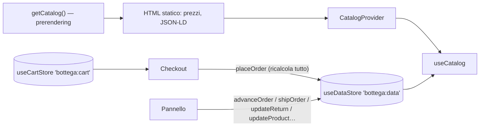

# Architettura — Bottega

## Panoramica

Un'unica app Next.js 16 con due aree:

| Area     | Cartella         | Rendering                                                                                                                                                                                        | Indicizzazione                                                                                   |
| -------- | ---------------- | ------------------------------------------------------------------------------------------------------------------------------------------------------------------------------------------------ | ------------------------------------------------------------------------------------------------ |
| Negozio  | `app/(negozio)/` | Home, catalogo, schede prodotto e laboratori prerenderizzati dal catalogo (`lib/catalog-server.ts`, `"use cache"`, rigenerati ogni ora); carrello, checkout, ordini e area personale nel browser | Solo su richiesta (`NEXT_PUBLIC_ALLOW_INDEXING`); mai carrello, checkout, ordini, area personale |
| Pannello | `app/gestione/`  | Guscio statico con sidebar, dati nel browser                                                                                                                                                     | Mai                                                                                              |

- **Catalogo:** `useCatalog()` restituisce il catalogo prerenderizzato finché i dati del browser non sono pronti, poi quelli dello store. L'HTML contiene quindi prezzi, disponibilità e dati strutturati, e la pagina non "salta" all'idratazione.
- **Carrello:** contiene solo riferimenti (prodotto, variante, quantità) e il codice sconto. Prezzi, sconti e disponibilità si ricalcolano sempre dal catalogo.
- **Ordine:** `placeOrder` ricontrolla righe, prezzi del giorno, codice, scorte e spedizione. Poi crea l'ordine e scala le scorte nello stesso aggiornamento: è la funzione da portare sul server.

## Logica di dominio (`lib/domain/`)

Funzioni pure, senza React, coperte da test unitari:

| Modulo         | Responsabilità                                                                                                         |
| -------------- | ---------------------------------------------------------------------------------------------------------------------- |
| `pricing.ts`   | Prezzo in vigore, storico, prezzo più basso nei 30 giorni prima della promozione, percentuale di sconto, IVA inclusa   |
| `cart.ts`      | Prezzi delle righe, aggiunta con limite di scorta, codici sconto con motivo del rifiuto, spedizione, totali            |
| `inventory.ts` | Livelli di disponibilità, problemi di scorta prima della conferma, aggiornamento immutabile delle scorte, scorte basse |
| `orders.ts`    | Flusso degli stati, annullabilità, termine di recesso, rimborso, incasso netto, ripartizione per venditore             |
| `catalog.ts`   | Ricerca normalizzata, filtri, ordinamenti, recensioni, correlati, filtri ↔ parametri URL                               |
| `analytics.ts` | Incassi giornalieri, indicatori a 30 giorni con confronto, più venduti, statistiche cliente                            |

## Note pratiche su Next.js 16

- **Rotte dinamiche:** le pagine con parametri leggono `params` dentro `<Suspense>`. I prodotti noti sono generati con `generateStaticParams`; quelli creati nel pannello (solo nel browser, in demo) usano la stessa vista con `noindex`.
- **Catalogo:** usa un fallback statico con tutti i prodotti; i filtri dell'URL si applicano nel componente che legge `useSearchParams`.
- **Date:** nessun `new Date()` durante il rendering. `useToday()` usa la data del prerendering sul server e quella reale nel browser.
- **Selettori dello store:** non creano array nuovi; i filtri si fanno fuori, con `useMemo`.

## Collegare un backend

1. **Catalogo e ordini:**
   - Postgres in UE o una piattaforma headless (Medusa, Saleor, Shopify Storefront API, Commerce Layer);
   - `getCatalog()` legge dal database con un tag e il pannello chiama `revalidateTag` quando cambia un prodotto.
2. **Ordine lato server:**
   - una Server Action o una route riceve solo le righe del carrello, il codice e i dati del cliente;
   - ricalcola tutto con le funzioni di `lib/domain`;
   - in una transazione prenota le scorte (`UPDATE … SET stock = stock - n WHERE stock >= n`) e crea l'ordine in stato "in attesa di pagamento".
3. **Pagamenti:**
   - sessione di pagamento con il PSP (es. Stripe Checkout o Payment Element con 3-D Secure, Nexi XPay, PayPal);
   - il **webhook** di pagamento riuscito porta l'ordine a "Pagato" e invia la conferma. Senza pagamento entro un tempo massimo l'ordine si annulla e le scorte tornano disponibili;
   - aggiorna la CSP con i domini del PSP e consenti `payment=(self)` nel `Permissions-Policy` se usi Apple Pay o Google Pay.
4. **Autenticazione:**
   - clienti con magic link o password, sessione in cookie `HttpOnly`;
   - staff con ruoli: magazzino (ordini), catalogo (prodotti), amministrazione (impostazioni, liquidazioni);
   - `proxy.ts` protegge `/account` e `/gestione`, con controllo dei permessi in ogni azione.
5. **Link all'ordine:** il link nell'email contiene un token casuale lungo, salvato come hash; in demo basta il numero.
6. **Email:** conferma, istruzioni per il bonifico, spedizione con tracciamento, reso ricevuto e rimborso (es. Resend, Postmark).
7. **Spedizioni:**
   - etichette e tracciamento via API dei corrieri o di un aggregatore;
   - il webhook di consegna imposta `deliveredAt`, da cui parte il recesso.
8. **Fatturazione:** emissione e conservazione delle fatture elettroniche (SDI) o dei corrispettivi telematici, con il commercialista.
9. **Marketplace:**
   - onboarding dei venditori con verifica dei dati (DSA, art. 30);
   - pagamenti suddivisi (es. Stripe Connect) o liquidazioni periodiche dal pannello;
   - fatture delle commissioni.
10. **Recensioni:** invito a recensire dopo la consegna, collegato all'ordine, per mantenere la dicitura "Acquisto verificato"; moderazione senza filtrare le negative.
