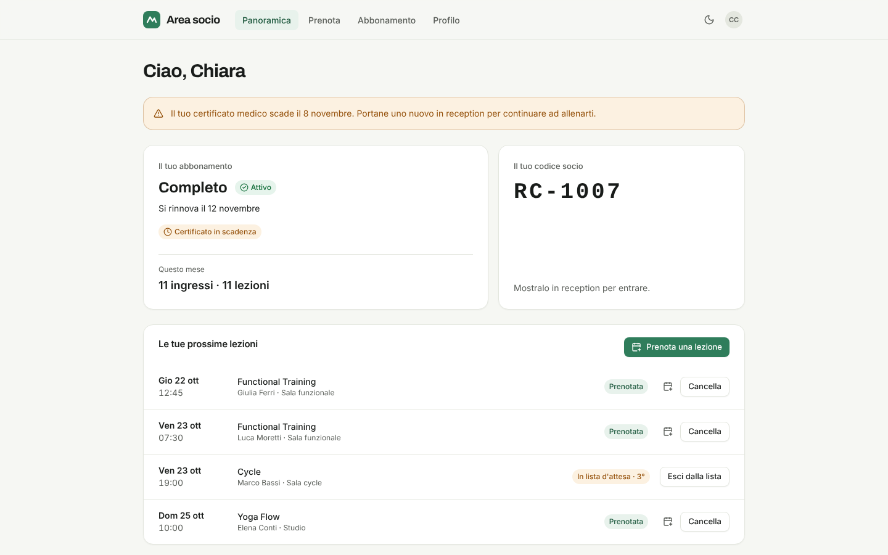
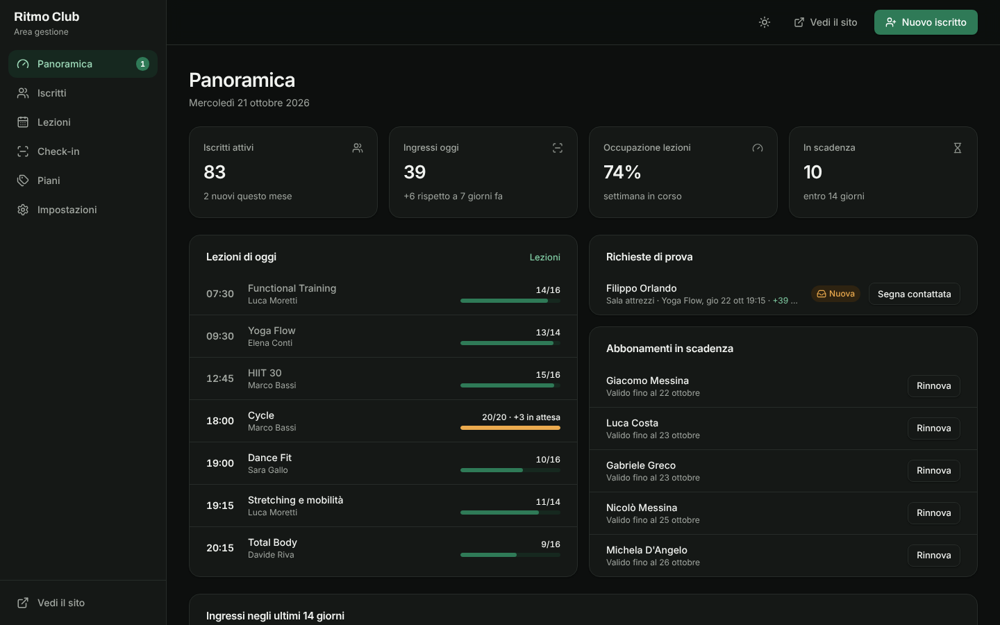
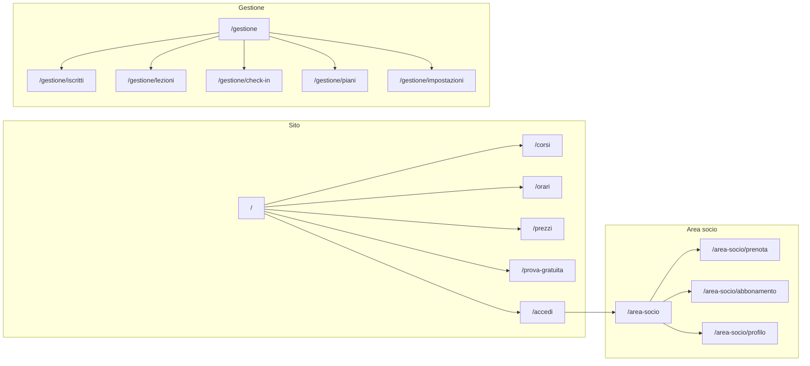

# Forma — sito, area socio e gestione per palestre

Template per **palestre, centri fitness, studi di yoga e pilates e centri wellness** con tre aree collegate:

- **sito pubblico** (corsi, orari, prezzi, prova gratuita);
- **area socio** (prenotazione delle lezioni con lista d'attesa, abbonamento e disdetta, profilo e consensi);
- **pannello** per la reception (iscritti, lezioni e presenze, check-in con controlli, piani, regole).

Accessibile (WCAG 2.2 AA), responsive e pronto per il deploy su Vercel.


<table>
  <tr>
    <td></td>
    <td></td>
  </tr>
</table>

> **Demo pubblica:** dopo il primo deploy su Vercel inserisci qui il link della preview, es. `https://forma-fitness.vercel.app`.

---

## Indice

1. [Concept e pubblico](#concept-e-pubblico)
2. [Funzionalità](#funzionalità)
3. [Pagine e navigazione](#pagine-e-navigazione)
4. [Stack tecnico](#stack-tecnico)
5. [Avvio rapido](#avvio-rapido)
6. [Script](#script)
7. [Struttura del progetto](#struttura-del-progetto)
8. [Variabili d'ambiente](#variabili-dambiente)
9. [Deploy su Vercel](#deploy-su-vercel)
10. [Qualità, test e accessibilità](#qualità-test-e-accessibilità)
11. [Prima di andare in produzione](#prima-di-andare-in-produzione)
12. [Documentazione](#documentazione)

## Concept e pubblico

**Forma** porta nuovi iscritti dal sito con la **prova gratuita** e fa risparmiare tempo alla reception: i soci prenotano da soli le lezioni a numero chiuso, la lista d'attesa assegna i posti liberati, il check-in controlla in un colpo d'occhio abbonamento, carnet e certificato medico.

- **Chi cerca una palestra:** confronta corsi, orari e prezzi chiari, prenota una prova senza impegno.
- **Socio:** prenota e cancella lezioni dal telefono, vede quando scade l'abbonamento, disattiva il rinnovo in autonomia.
- **Reception e titolare:** vedono ingressi, occupazione delle lezioni, scadenze e richieste di prova; registrano presenze e rinnovi.

La demo usa un club inventato di Milano, _Ritmo Club_. Comprende:

- 11 corsi in 4 categorie e un palinsesto di 39 lezioni settimanali;
- 6 istruttori, 4 piani e 96 iscritti;
- 5 settimane di prenotazioni, ingressi e pagamenti.

## Funzionalità

| Area                      | Cosa offre                                                                                                                                                                                                                |
| ------------------------- | ------------------------------------------------------------------------------------------------------------------------------------------------------------------------------------------------------------------------- |
| **Home**                  | Stato "aperto ora", lezioni di oggi con posti liberi in tempo reale, categorie di corsi, piani, istruttori, invito alla prova; dati strutturati `schema.org/ExerciseGym`                                                  |
| **Corsi**                 | Schede per categoria con intensità (barre + testo), durata, adatto ai principianti, istruttori e frequenza settimanale                                                                                                    |
| **Orari**                 | Palinsesto settimanale (giorno per giorno su mobile) con filtro per categoria; oggi evidenziato                                                                                                                           |
| **Prezzi**                | Mensile/annuale (12 mesi al prezzo di 10), carnet a ingressi, tabella di confronto, FAQ su rinnovo, recesso, certificato e sospensione                                                                                    |
| **Prova gratuita**        | Interesse, scelta di una lezione con posti liberi (il posto viene riservato), dichiarazione di maggiore età, consensi separati, file `.ics`                                                                               |
| **Area socio**            | Panoramica (abbonamento, codice socio, avvisi su certificato e scadenza, prossime lezioni), prenotazione con lista d'attesa e motivi espliciti quando non si può, abbonamento e pagamenti, profilo, consensi, export GDPR |
| **Panoramica** (pannello) | Iscritti attivi, ingressi di oggi rispetto alla settimana scorsa, occupazione delle lezioni, scadenze; lezioni di oggi con riempimento, richieste di prova, rinnovi rapidi, grafico degli ingressi                        |
| **Iscritti**              | Ricerca, filtri per stato e certificato, tabella (elenco su mobile), scheda con attività, prenotazioni, pagamenti, rinnovo, sospensione, check-in ed export dati                                                          |
| **Lezioni**               | Settimana per giorno con posti e lista d'attesa; per ogni lezione prenotati, presenze, assegnazione dalla lista d'attesa, capienza, annullamento con conferma                                                             |
| **Check-in**              | Ricerca per nome o codice, esito chiaro (consentito/non consentito) con motivi e avvisi, ingressi di oggi                                                                                                                 |
| **Piani e impostazioni**  | Piani mensili e carnet (prezzo, ingressi, validità, vantaggi, in vendita), dati del club, orari, regole di prenotazione e cancellazione, certificato obbligatorio, preavviso scadenze, prove dal sito                     |

## Pagine e navigazione



| Schermo               | Sito                                        | Area socio                       | Pannello                                       |
| --------------------- | ------------------------------------------- | -------------------------------- | ---------------------------------------------- |
| Desktop (≥ 1024 px)   | Barra superiore, palinsesto a 7 colonne     | Barra superiore con le 4 sezioni | Sidebar con contatore delle richieste di prova |
| Tablet (768–1023 px)  | Barra superiore; orari un giorno alla volta | Come desktop                     | Sidebar; lezioni un giorno alla volta          |
| Smartphone (< 768 px) | Menu a scomparsa                            | Barra inferiore a 4 voci         | Barra inferiore e menu "Altro"                 |

Il brief completo è in [docs/brief.md](docs/brief.md).

## Stack tecnico

| Ambito                 | Scelta                                                                                       | Perché                                                                   |
| ---------------------- | -------------------------------------------------------------------------------------------- | ------------------------------------------------------------------------ |
| Framework              | [Next.js 16](https://nextjs.org) (App Router, Cache Components, Turbopack)                   | Sito prerenderizzato con contenuti nell'HTML, deploy nativo su Vercel    |
| UI                     | React 19, TypeScript (strict)                                                                | Tipi su tutto il dominio                                                 |
| Stile                  | Tailwind CSS 4 con design token; Inter + Archivo (titoli)                                    | Tema chiaro/scuro e branding da un unico file                            |
| Componenti accessibili | [Radix UI](https://www.radix-ui.com)                                                         | Focus, tastiera e ARIA corretti                                          |
| Stato                  | [Zustand](https://zustand.docs.pmnd.rs) con salvataggio locale e sincronizzazione tra schede | Sito, area socio e pannello condividono i dati                           |
| Validazione            | [Zod 4](https://zod.dev)                                                                     | Stessi schemi riutilizzabili lato server                                 |
| Qualità                | ESLint (Next + jsx-a11y), Prettier, Vitest, Playwright + axe-core                            | Formattazione, analisi statica, test unitari, end-to-end e accessibilità |

## Avvio rapido

Requisiti: **Node.js 22** (vedi `.nvmrc`) e npm.

```bash
cd templates/fitness
npm ci
cp .env.example .env.local   # facoltativo
npm run dev
```

- Sito: <http://localhost:3000>.
- Area socio: <http://localhost:3000/accedi>. In demo le credenziali sono già inserite.
- Pannello: <http://localhost:3000/gestione>.

I dati demo restano **solo nel browser** e si ripristinano da _Impostazioni → Dati demo_.

## Script

| Comando                           | Descrizione                                                                                                                          |
| --------------------------------- | ------------------------------------------------------------------------------------------------------------------------------------ |
| `npm run dev`                     | Server di sviluppo                                                                                                                   |
| `npm run build` / `start`         | Build di produzione e avvio                                                                                                          |
| `npm run lint` / `lint:fix`       | ESLint (regole Next.js, React Hooks e accessibilità jsx-a11y)                                                                        |
| `npm run typecheck`               | Genera i tipi delle rotte e controlla TypeScript                                                                                     |
| `npm run format` / `format:check` | Prettier (con ordinamento delle classi Tailwind)                                                                                     |
| `npm test`                        | Test unitari della logica di dominio (Vitest)                                                                                        |
| `npm run test:e2e`                | Test end-to-end e di accessibilità su desktop e mobile. Esegui prima `npm run build`; al primo uso `npx playwright install chromium` |
| `npm run check`                   | Tutti i controlli in sequenza, come in CI                                                                                            |

## Struttura del progetto

```text
src/
├── app/
│   ├── (sito)/                # Home, corsi, orari, prezzi, prova gratuita, accesso, privacy
│   ├── area-socio/            # Panoramica, prenota, abbonamento, profilo
│   ├── gestione/              # Panoramica, iscritti, lezioni, check-in, piani, impostazioni
│   └── globals.css, layout.tsx, manifest.ts, robots.ts, sitemap.ts, icon.svg
├── components/
│   ├── ui/                    # Libreria di componenti condivisa con gli altri template
│   ├── site/, member/, panel/ # Strutture delle tre aree
│   ├── course-badges.tsx      # Categoria (colore + testo) e intensità (barre + testo)
│   └── status-badges.tsx      # Abbonamento, certificato, prenotazione, pagamento, prova
├── features/site | member | panel
├── lib/
│   ├── domain/                # Tipi, schemi Zod e logica pura testata
│   │   ├── membership.ts      # Stato abbonamento e certificato, prezzi, rinnovi
│   │   ├── booking.ts         # Posti, lista d'attesa, regole di prenotazione e cancellazione
│   │   ├── checkin.ts         # Controlli all'ingresso
│   │   ├── schedule.ts        # Dal palinsesto settimanale alle lezioni
│   │   └── analytics.ts, dates.ts, schemas.ts, types.ts
│   ├── demo/seed.ts           # Dati demo deterministici
│   └── ics.ts, seo.ts, format.ts
├── store/                     # Dati (persistiti e sincronizzati), sessione demo, UI
└── content/it.ts              # Tutti i testi dell'interfaccia
tests/unit, tests/e2e
```

## Variabili d'ambiente

Tutte facoltative; riferimento in [`.env.example`](.env.example). Nessun segreto va mai nel repository.

| Variabile                    | Predefinito                                            | Uso                                                                      |
| ---------------------------- | ------------------------------------------------------ | ------------------------------------------------------------------------ |
| `NEXT_PUBLIC_SITE_URL`       | dominio di produzione Vercel o `http://localhost:3000` | URL assoluti, sitemap, dati strutturati                                  |
| `NEXT_PUBLIC_DEMO_MODE`      | `true`                                                 | Banner demo, credenziali precompilate                                    |
| `NEXT_PUBLIC_ALLOW_INDEXING` | `false`                                                | Indicizzazione del sito pubblico (area socio e pannello mai indicizzati) |

## Deploy su Vercel

1. Su [vercel.com/new](https://vercel.com/new) importa il repository.
2. In **Root Directory** seleziona `templates/fitness`.
3. `vercel.json` imposta `npm ci`, `npm run build`, regione `fra1` e `ignoreCommand`. Premi **Deploy**.

Ogni pull request genera una **preview**; il branch di produzione aggiorna la demo definitiva.

[](https://vercel.com/new/clone?repository-url=https%3A%2F%2Fgithub.com%2Fmykytakarpenko-debug%2Fidee&root-directory=templates%2Ffitness&project-name=forma-fitness&repository-name=forma-fitness)

La procedura di rilascio è in [`docs/rilascio.md`](../../docs/rilascio.md).

## Qualità, test e accessibilità

- **62 test unitari:**
  - date e orari;
  - stato di abbonamento e certificato, prezzi annuali e rinnovi;
  - regole di prenotazione (tutti i motivi di blocco), lista d'attesa e cancellazioni tardive;
  - check-in, palinsesto e indicatori;
  - schemi dei moduli, coerenza dei dati demo, `.ics` e JSON-LD.
- **Test end-to-end su desktop e mobile:**
  - navigazione di tutte le pagine, 404, SEO e `noindex`;
  - rimando al login, filtri, tema;
  - prenotazione e cancellazione, disdetta del rinnovo, consensi;
  - prova gratuita che arriva al pannello;
  - check-in con avvisi, nuovo iscritto bloccato per certificato mancante;
  - presenze, impostazioni che cambiano il sito.
- **Accessibilità:** axe-core con le regole WCAG 2.2 AA su tutte le pagine, sulla scheda iscritto e sulla scheda lezione, in tema chiaro e scuro, più `prefers-reduced-motion`.
- **CI GitHub Actions** a ogni push e pull request.

## Prima di andare in produzione

- [ ] **Autenticazione** per area socio e pannello, con ruoli (reception, istruttore, titolare): vedi [docs/architettura.md](docs/architettura.md#collegare-un-backend).
- [ ] **Database e API** al posto dello store locale. Ricalcola **lato server** posti, regole e prezzi, con un vincolo che impedisca prenotazioni oltre la capienza.
- [ ] **Pagamenti ricorrenti** con un PSP (es. Stripe Billing, addebito SEPA). Servono anche notifiche di rinnovo e un link per la gestione dell'abbonamento.
- [ ] **Notifiche** per posto liberato dalla lista d'attesa, promemoria delle lezioni e scadenze (email, push o SMS).
- [ ] **Verifiche legali:** condizioni di abbonamento, recesso e rinnovo, certificato medico, minori, regime ASD/SSD. Vedi [docs/sicurezza-privacy.md](docs/sicurezza-privacy.md).
- [ ] Imposta `NEXT_PUBLIC_DEMO_MODE=false` e completa [`docs/rilascio.md`](../../docs/rilascio.md).

## Documentazione

| Documento                                              | Contenuto                                                                     |
| ------------------------------------------------------ | ----------------------------------------------------------------------------- |
| [docs/brief.md](docs/brief.md)                         | Concept, pubblico, pagine, flussi e regole di business                        |
| [docs/design-system.md](docs/design-system.md)         | Palette salvia e contrasti, tipografia, componenti specifici, stati           |
| [docs/architettura.md](docs/architettura.md)           | Tre aree sullo stesso store, regole di dominio, collegamento a un backend     |
| [docs/personalizzazione.md](docs/personalizzazione.md) | Club, corsi, palinsesto, piani, regole, adattamento a yoga, crossfit, piscina |
| [docs/sicurezza-privacy.md](docs/sicurezza-privacy.md) | Sicurezza, GDPR e certificato medico, contratti e rinnovi, accessibilità      |

## Licenza

[MIT](LICENSE). Il club, le persone e i dati demo sono interamente inventati.
