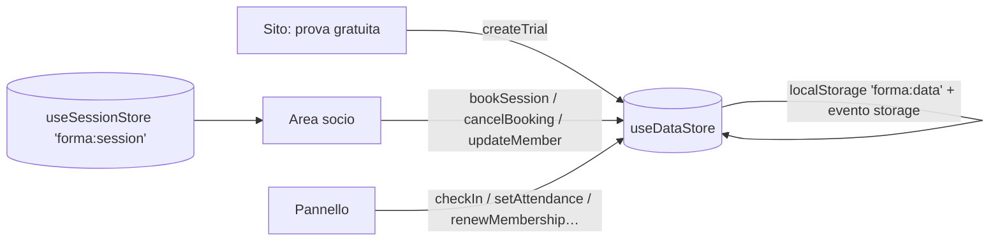

# Architettura — Forma

## Panoramica

Un'unica app Next.js 16 con tre aree:

| Area       | Cartella          | Rendering                                                            | Indicizzazione                                   |
| ---------- | ----------------- | -------------------------------------------------------------------- | ------------------------------------------------ |
| Sito       | `app/(sito)/`     | Prerenderizzato; corsi, orari, piani e orari del club nell'HTML      | Solo su richiesta (`NEXT_PUBLIC_ALLOW_INDEXING`) |
| Area socio | `app/area-socio/` | Guscio statico, dati nel browser; senza sessione rimanda a `/accedi` | Mai                                              |
| Pannello   | `app/gestione/`   | Guscio statico con sidebar, dati nel browser                         | Mai                                              |

Tutte e tre leggono e scrivono lo **stesso store** (`store/data-store.ts`), sincronizzato tra le schede aperte. Il socio che prenota nell'area socio e la reception che apre la scheda della lezione vedono la stessa lista.

## Logica di dominio (`lib/domain/`)

Funzioni pure, senza React, coperte da test unitari:

| Modulo          | Responsabilità                                                                                                           |
| --------------- | ------------------------------------------------------------------------------------------------------------------------ |
| `dates.ts`      | Date di calendario locali (`YYYY-MM-DD`), settimane da lunedì, apertura del club                                         |
| `membership.ts` | Stato dell'abbonamento (attivo, in scadenza, scaduto, sospeso), certificato, prezzo annuale, periodo di rinnovo          |
| `booking.ts`    | Posti occupati (comprese le prove gratuite), lista d'attesa, `checkBooking` con motivo del blocco, cancellazione tardiva |
| `checkin.ts`    | Esito dell'ingresso con blocchi e avvisi                                                                                 |
| `schedule.ts`   | Generazione delle lezioni dal palinsesto settimanale (ID stabili `slot_data`, nessun duplicato)                          |
| `analytics.ts`  | Iscritti attivi, scadenze, ingressi per giorno, occupazione, presenze, conversione delle prove                           |

L'ordine dei controlli in `checkBooking` va dal più generale al più specifico, così al socio arriva sempre il messaggio più utile. Ad esempio il carnet esaurito viene segnalato come tale e non come generico "abbonamento non attivo".

## Flusso dei dati in demo

1. `DataBootstrap` (in tutti i layout) reidrata lo store o genera i dati con l'ora corrente.
2. Genera poi le lezioni mancanti fino a `windowDays + 7` giorni: il calendario non si "svuota" se si torna sulla demo dopo qualche giorno.
3. Le azioni aggiornano lo stato in modo immutabile. Il salvataggio è differito (150 ms) e le altre schede si aggiornano tramite l'evento `storage`.
4. La sessione dell'area socio è un piccolo store separato (`forma:session`) con il solo ID del socio. **È solo per la demo**: vedi sotto.

### Next.js 16: note pratiche

- Nessuna lettura di `new Date()` durante il rendering: `useNow()` restituisce `null` sul server e l'ora reale nel browser.
- I selettori dello store non creano array nuovi (`filter`/`map` si fanno fuori dal selettore, con `useMemo`), per evitare render infiniti con `useShallow`.
- Componenti con `usePathname` dentro `<Suspense>`; ID con `useId` (Activity mantiene montate le pagine recenti).

## Collegare un backend

1. **Database** in UE (Postgres) con tabelle per: club, corsi, istruttori, palinsesto, lezioni, piani, iscritti, abbonamenti, prenotazioni, ingressi, pagamenti e richieste di prova.
2. **Autenticazione:**
   - soci con email + magic link o password, sessione in cookie `HttpOnly`;
   - staff con ruoli: reception (check-in, iscritti), istruttore (le proprie lezioni e presenze), titolare (tutto, piani, impostazioni);
   - `proxy.ts` per proteggere `/area-socio` e `/gestione`, e controllo dei permessi in **ogni** Server Action.
3. **Prenotazioni concorrenti:** esegui `checkBooking` lato server dentro una transazione. Blocca la riga della lezione (`SELECT … FOR UPDATE`) o usa un contatore con vincolo `taken <= capacity`: due soci non devono ottenere l'ultimo posto. La promozione dalla lista d'attesa avviene nella stessa transazione della cancellazione.
4. **Pagamenti ricorrenti:**
   - Stripe Billing (carta o addebito SEPA) con il Customer Portal per cambiare metodo e disdire;
   - il webhook `invoice.paid` estende `membershipEnd`, `invoice.payment_failed` segna il pagamento e avvisa.
5. **Notifiche:**
   - posto assegnato dalla lista d'attesa;
   - promemoria della lezione;
   - scadenza di abbonamento e certificato (email, push o SMS);
   - con preferenze del socio e link di disiscrizione.
6. **Check-in:** il codice socio può diventare un QR firmato (ID + scadenza + HMAC) letto da un tablet in reception o da un tornello.
7. **Calendario:** in `DataBootstrap` la generazione delle lezioni diventa un job pianificato (es. Vercel Cron) che crea le lezioni delle prossime settimane dal palinsesto.
