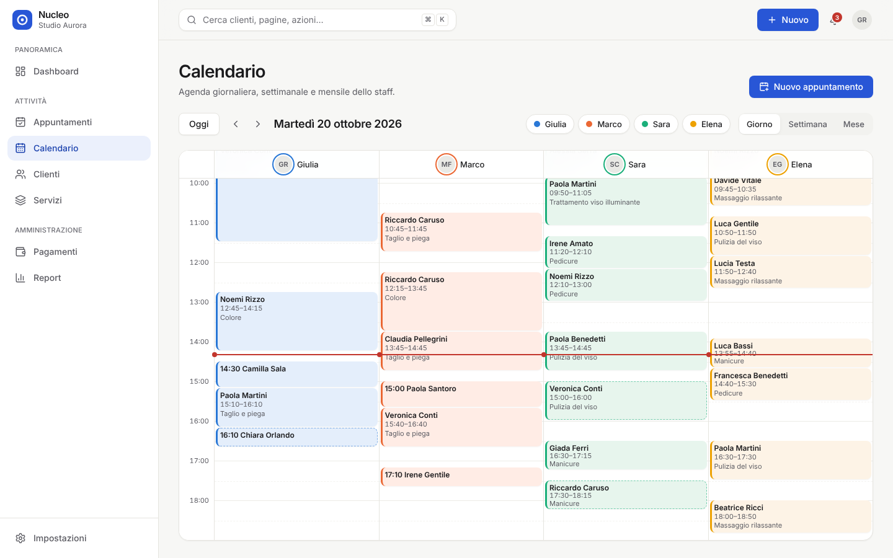
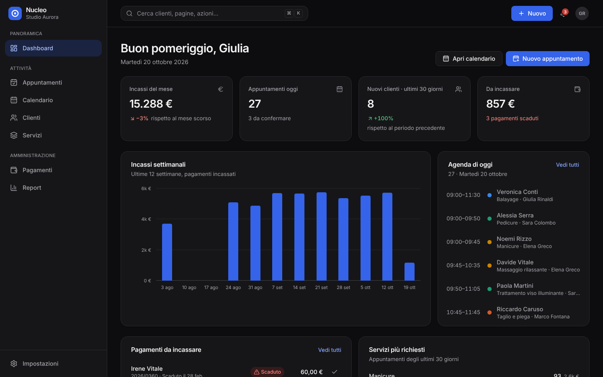
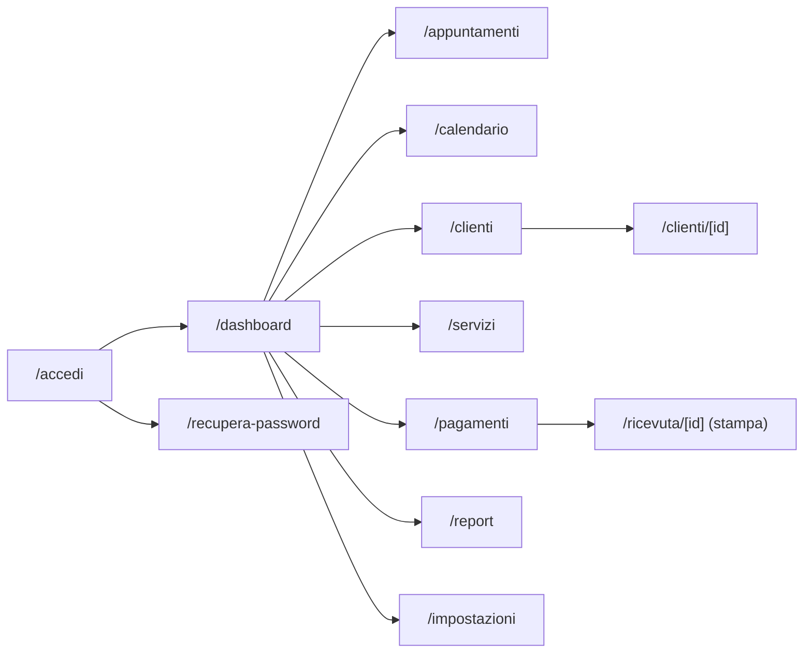

# Nucleo — gestionale per attività di servizi

Template professionale di gestionale con **dashboard, clienti, servizi, appuntamenti, calendario, pagamenti e report**. È la base generale della libreria `idee`: moderno, accessibile (WCAG 2.2 AA), responsive e pronto per il deploy su Vercel.


<table>
  <tr>
    <td></td>
    <td></td>
  </tr>
</table>

> **Demo pubblica:** dopo il primo deploy su Vercel inserisci qui il link della preview, es. `https://nucleo-gestionale.vercel.app`.

---

## Indice

1. [Concept e pubblico](#concept-e-pubblico)
2. [Funzionalità](#funzionalità)
3. [Pagine e navigazione](#pagine-e-navigazione)
4. [Stack tecnico](#stack-tecnico)
5. [Avvio rapido](#avvio-rapido)
6. [Script](#script)
7. [Struttura del progetto](#struttura-del-progetto)
8. [Variabili d'ambiente](#variabili-dambiente)
9. [Deploy su Vercel](#deploy-su-vercel)
10. [Qualità, test e accessibilità](#qualità-test-e-accessibilità)
11. [Prima di andare in produzione](#prima-di-andare-in-produzione)
12. [Documentazione](#documentazione)

## Concept e pubblico

**Nucleo** dà a una piccola o media attività di servizi un unico posto per clienti, agenda, incassi e andamento economico. È pensato per titolari e staff di **saloni, centri estetici, studi professionali, consulenti, agenzie e attività su appuntamento** con 1–30 persone. Si usa ogni giorno in sede su desktop e in mobilità su smartphone.

Principi guida:

- **Chiarezza prima di tutto:** ogni schermata risponde a una domanda (_chi viene oggi? chi deve pagare? come sta andando?_).
- **Azioni sempre a portata:** il pulsante "Nuovo" e la ricerca rapida (⌘K) funzionano da ogni pagina.
- **Errori impossibili o recuperabili:** validazione immediata, conferma per le azioni distruttive, annullamento per i cambi di stato.

La demo usa un salone fittizio, _Studio Aurora_, con 4 operatori, 14 servizi, 72 clienti e un anno di storico.

## Funzionalità

| Area             | Cosa offre                                                                                                                                                                                                    |
| ---------------- | ------------------------------------------------------------------------------------------------------------------------------------------------------------------------------------------------------------- |
| **Dashboard**    | KPI del mese (incassi con confronto, appuntamenti di oggi, nuovi clienti, crediti), incassi settimanali, agenda del giorno, pagamenti da incassare con azione rapida, servizi più richiesti                   |
| **Clienti**      | Ricerca (anche senza accenti), filtri per stato ed etichette, ordinamento, paginazione, export CSV, scheda cliente con KPI, storico appuntamenti e pagamenti, contatti, consensi privacy, export GDPR in JSON |
| **Servizi**      | Listino per categoria, durata, prezzo, prenotazioni a 30 giorni, attivazione/disattivazione, duplicazione, eliminazione sicura (archiviazione se presente nello storico)                                      |
| **Appuntamenti** | Elenco per giorno (prossimi, oggi, settimana, passati), filtri per stato e operatore, cambi di stato con annullamento, registrazione del pagamento                                                            |
| **Calendario**   | Vista giorno (colonne per operatore), settimana e mese; linea dell'ora attuale; clic su uno slot per prenotare; gestione delle sovrapposizioni; filtro operatori                                              |
| **Pagamenti**    | KPI (incassato, in attesa, scaduti, scontrino medio), stato "scaduto" calcolato automaticamente, filtri per stato, metodo e periodo, incasso e rimborso, ricevuta di cortesia stampabile, export CSV          |
| **Report**       | Periodi 30/90 giorni e 12 mesi con confronto sul periodo precedente: ricavi nel tempo, ricavi per servizio, esito degli appuntamenti, tasso di presenza, occupazione dello staff, clienti principali          |
| **Impostazioni** | Dati dell'attività, orari di apertura, intervallo agenda, team con colori, tema, promemoria, esportazione/ripristino/cancellazione dei dati                                                                   |
| **Trasversali**  | Ricerca rapida ⌘K, menu "Nuovo", notifiche, tema chiaro/scuro/sistema, avviso di sovrapposizione e fuori orario, toast con annullamento, schermate di accesso e recupero password                             |

## Pagine e navigazione



La navigazione cambia con lo schermo:

| Schermo               | Navigazione                                                                                                               |
| --------------------- | ------------------------------------------------------------------------------------------------------------------------- |
| Desktop (≥ 1024 px)   | Sidebar con gruppi (Panoramica, Attività, Amministrazione) e barra superiore con ricerca, "Nuovo", notifiche e account    |
| Tablet (768–1023 px)  | Barra laterale compatta a icone con suggerimenti                                                                          |
| Smartphone (< 768 px) | Barra inferiore (Home, Calendario, Clienti, Pagamenti, Altro) e menu completo a scomparsa; modali come pannelli dal basso |

Il brief completo, con flussi e criteri, è in [docs/brief.md](docs/brief.md).

## Stack tecnico

| Ambito                 | Scelta                                                                                                                    | Perché                                                                      |
| ---------------------- | ------------------------------------------------------------------------------------------------------------------------- | --------------------------------------------------------------------------- |
| Framework              | [Next.js 16](https://nextjs.org) (App Router, Cache Components, Turbopack)                                                | Pagine prerenderizzate staticamente, deploy nativo su Vercel                |
| UI                     | React 19, TypeScript (strict)                                                                                             | Tipi su tutto il dominio                                                    |
| Stile                  | Tailwind CSS 4 con design token in CSS                                                                                    | Tema chiaro/scuro e branding da un unico file                               |
| Componenti accessibili | [Radix UI](https://www.radix-ui.com) (dialog, menu, popover, tabs, toast, switch, tooltip) e [cmdk](https://cmdk.paco.me) | Focus, tastiera e ARIA corretti e collaudati                                |
| Stato                  | [Zustand](https://zustand.docs.pmnd.rs) con salvataggio locale differito                                                  | Azioni con firme stabili, facili da collegare a un backend                  |
| Validazione            | [Zod 4](https://zod.dev)                                                                                                  | Stessi schemi riutilizzabili lato server                                    |
| Date e icone           | date-fns (italiano), lucide-react                                                                                         | Leggere e affidabili                                                        |
| Grafici                | Componenti HTML/CSS su misura                                                                                             | Nessuna libreria pesante, accessibili da tastiera                           |
| Qualità                | ESLint (Next + jsx-a11y), Prettier, Vitest, Playwright + axe-core                                                         | Formattazione, analisi statica, test unitari, end-to-end e di accessibilità |

## Avvio rapido

Requisiti: **Node.js 22** (vedi `.nvmrc`) e npm.

```bash
cd templates/gestionale
npm ci
cp .env.example .env.local   # facoltativo: i valori predefiniti vanno già bene
npm run dev
```

Apri <http://localhost:3000>. Al primo avvio i dati demo vengono generati e salvati **solo nel browser**; puoi ripristinarli da _Impostazioni → Dati e privacy_ o dal banner demo.

## Script

| Comando                           | Descrizione                                                                                                                                             |
| --------------------------------- | ------------------------------------------------------------------------------------------------------------------------------------------------------- |
| `npm run dev`                     | Server di sviluppo                                                                                                                                      |
| `npm run build`                   | Build di produzione (include il controllo dei tipi)                                                                                                     |
| `npm run start`                   | Avvia la build di produzione                                                                                                                            |
| `npm run lint` / `lint:fix`       | ESLint (regole Next.js, React Hooks e accessibilità jsx-a11y)                                                                                           |
| `npm run typecheck`               | Genera i tipi delle rotte e controlla TypeScript                                                                                                        |
| `npm run format` / `format:check` | Prettier (con ordinamento delle classi Tailwind)                                                                                                        |
| `npm test`                        | Test unitari della logica di dominio (Vitest)                                                                                                           |
| `npm run test:e2e`                | Test end-to-end e di accessibilità su desktop e mobile (Playwright + axe). Esegui prima `npm run build`; al primo uso `npx playwright install chromium` |
| `npm run check`                   | Tutti i controlli in sequenza, come in CI                                                                                                               |

## Struttura del progetto

```text
src/
├── app/                      # Rotte (App Router)
│   ├── (app)/                # Area riservata con shell: dashboard, clienti, …
│   ├── (auth)/               # Accesso e recupero password
│   ├── (print)/ricevuta/     # Documenti stampabili
│   ├── globals.css           # Design token (colori, raggi, movimento) e stili base
│   ├── layout.tsx            # Font, metadati, tema senza lampeggio
│   └── manifest.ts, robots.ts, icon.svg, apple-icon.png
├── components/
│   ├── ui/                   # Libreria di componenti riutilizzabili
│   ├── charts/               # Istogramma, classifiche, misuratori, barra a segmenti
│   ├── layout/               # Shell: sidebar, topbar, navigazione mobile, ⌘K, notifiche
│   └── status-badges.tsx     # Stati con colore + icona + testo
├── features/                 # Una cartella per area: viste, moduli e azioni
├── lib/
│   ├── domain/               # Tipi, schemi Zod e logica pura (testata)
│   ├── demo/                 # Generatore deterministico dei dati demo
│   ├── format.ts             # Lingua, valuta e date in un solo punto
│   └── csv.ts, theme.ts, utils.ts
├── store/                    # Stato dati (persistito), UI e preferenze
├── hooks/                    # useNow, useZodForm, useData, useMediaQuery
├── config/                   # Brand, navigazione, variabili d'ambiente
└── content/it.ts             # Tutti i testi dell'interfaccia
tests/
├── unit/                     # Vitest: formattazione, agenda, pagamenti, report, dati demo
└── e2e/                      # Playwright: navigazione, flussi, accessibilità
```

## Variabili d'ambiente

Tutte facoltative; il file di riferimento è [`.env.example`](.env.example). Nessun segreto va mai nel repository.

| Variabile                    | Predefinito                                            | Uso                                                                     |
| ---------------------------- | ------------------------------------------------------ | ----------------------------------------------------------------------- |
| `NEXT_PUBLIC_SITE_URL`       | dominio di produzione Vercel o `http://localhost:3000` | URL assoluti e metadati                                                 |
| `NEXT_PUBLIC_DEMO_MODE`      | `true`                                                 | Banner demo, accesso senza credenziali, nota sui promemoria             |
| `NEXT_PUBLIC_ALLOW_INDEXING` | `false`                                                | Indicizzazione nei motori di ricerca (un gestionale non va indicizzato) |

## Deploy su Vercel

Il template è un'app Next.js autonoma dentro un repository che ne contiene altre: Vercel deve sapere quale cartella usare.

1. Su [vercel.com/new](https://vercel.com/new) importa il repository GitHub.
2. In **Root Directory** seleziona `templates/gestionale` (framework rilevato: Next.js).
3. Lascia i comandi predefiniti: `vercel.json` imposta `npm ci`, `npm run build` e la regione `fra1` (Francoforte, vicina all'Italia).
4. Aggiungi le variabili d'ambiente se vuoi cambiare i predefiniti, poi **Deploy**.

Da quel momento:

- ogni **pull request** genera una **preview** con URL dedicato, utile per revisione e test (la toolbar dei commenti di Vercel è abilitata solo sulle preview);
- ogni push sul branch di produzione aggiorna la **produzione**;
- `ignoreCommand` evita build inutili quando il commit non tocca questa cartella.

In alternativa crea una copia indipendente con un clic:

[](https://vercel.com/new/clone?repository-url=https%3A%2F%2Fgithub.com%2Fmykytakarpenko-debug%2Fidee&root-directory=templates%2Fgestionale&project-name=nucleo-gestionale&repository-name=nucleo-gestionale)

La procedura di rilascio (preview → verifica → produzione) è descritta in [`docs/rilascio.md`](../../docs/rilascio.md).

## Qualità, test e accessibilità

- **49 test unitari** sulla logica di dominio: parsing degli importi, sovrapposizioni, orari, layout del calendario, stati dei pagamenti, report, CSV e validazione.
- **Test end-to-end** su desktop e mobile (Pixel 7): navigazione, 404, ricerca rapida, tema, creazione cliente con validazione, avviso di sovrapposizione, incasso, persistenza dei dati.
- **Accessibilità automatica:** axe-core su ogni pagina e sulla modale principale, in tema chiaro e scuro, con le regole **WCAG 2.2 AA**. Il test verifica anche `prefers-reduced-motion`.
- **CI GitHub Actions:** formattazione, lint, tipi, unit test, build, e2e e accessibilità a ogni push e pull request.

La checklist manuale (tastiera, screen reader, zoom al 200%) è in [docs/sicurezza-privacy.md](docs/sicurezza-privacy.md#accessibilità).

## Prima di andare in produzione

La demo salva i dati nel browser. Per un uso reale:

- [ ] Collega **autenticazione** e **ruoli** (titolare, staff, amministrazione): vedi [docs/architettura.md](docs/architettura.md#collegare-un-backend).
- [ ] Sostituisci lo store locale con **database e API** (le azioni hanno già le firme giuste) e riusa gli schemi Zod lato server.
- [ ] Imposta `NEXT_PUBLIC_DEMO_MODE=false`.
- [ ] Prepara **informativa privacy**, registro dei trattamenti e nomine dei fornitori (GDPR).
- [ ] Per scontrini e fatture elettroniche (SDI) collega un **provider certificato**; per i pagamenti online un **PSP** (es. Stripe) senza gestire dati di carta.
- [ ] Completa la checklist di rilascio in [`docs/rilascio.md`](../../docs/rilascio.md).

## Documentazione

| Documento                                              | Contenuto                                                                         |
| ------------------------------------------------------ | --------------------------------------------------------------------------------- |
| [docs/brief.md](docs/brief.md)                         | Concept, pubblico, pagine, funzionalità, flussi e mappa di navigazione            |
| [docs/design-system.md](docs/design-system.md)         | Colori e contrasti, tipografia, spaziature, componenti, stati, movimento, grafici |
| [docs/architettura.md](docs/architettura.md)           | Struttura, flusso dei dati, Next.js 16, collegamento a un backend                 |
| [docs/personalizzazione.md](docs/personalizzazione.md) | Branding, colori, testi, dati demo, animazioni, nuove funzionalità                |
| [docs/sicurezza-privacy.md](docs/sicurezza-privacy.md) | Sicurezza, GDPR e obblighi fiscali, accessibilità, prestazioni                    |

## Licenza

[MIT](LICENSE): puoi usare, modificare e distribuire il template anche in progetti commerciali. I dati demo sono interamente inventati.
