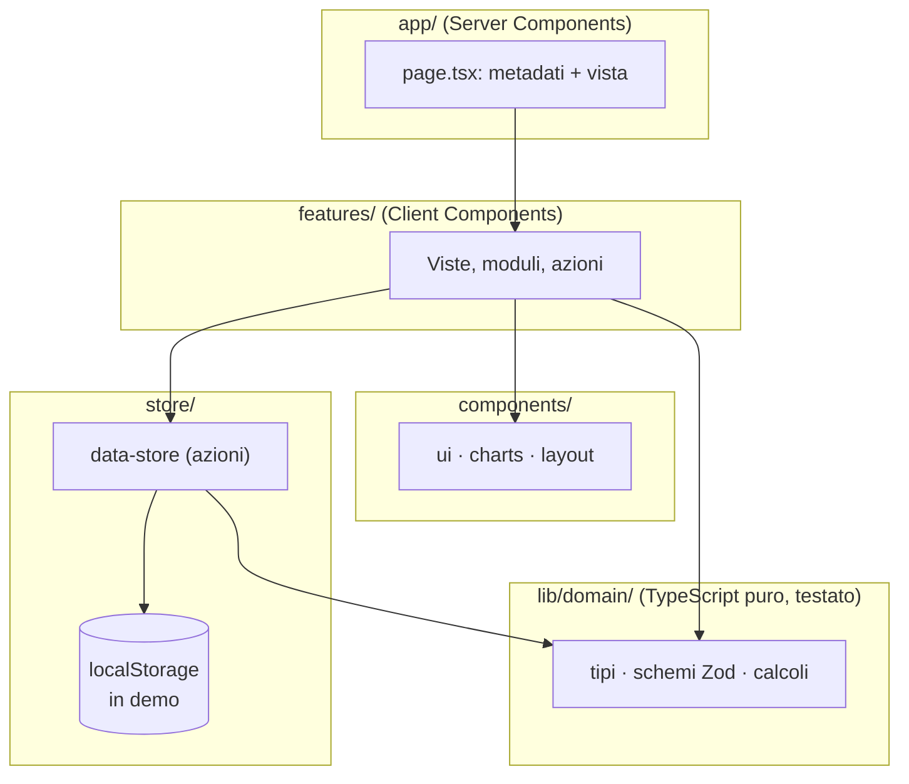

# Architettura — Nucleo

## Livelli

- **`app/`** contiene solo il routing: ogni `page.tsx` esporta i metadati e rende una vista.
- **`features/`** contiene le viste di ogni area con moduli e azioni. Le pagine leggono i dati con `useData(selector)` e li modificano con le azioni dello store.
- **`lib/domain/`** raccoglie la logica pura (sovrapposizioni, stato "scaduto", report, layout del calendario) senza dipendenze da React. È coperta da test unitari e si può riusare lato server.
- **`components/`** è la libreria di interfaccia, indipendente dai dati.
- **`store/`** comprende tre store Zustand: dati dell'attività (persistito), interfaccia (modali, ricerca rapida, menu mobile) e preferenze del dispositivo.

## Flusso dei dati in modalità demo

1. Il layout dell'area riservata monta `AppShell`, che chiama `useDataStore.getState().init()`.
2. `init()` legge `localStorage`. Se non trova nulla, genera i dati demo con `createDemoData(new Date())`, che è deterministico rispetto alla data.
3. Finché i dati non sono pronti (`ready === false`), le viste mostrano scheletri. Il server non genera mai dati che dipendono dall'ora.
4. Ogni azione aggiorna lo store; il salvataggio su `localStorage` è **differito** (400 ms) e forzato quando la scheda viene nascosta, perché il dataset demo pesa circa 2 MB.
5. Se il browser rifiuta il salvataggio (quota, navigazione privata), compare un avviso e l'app continua in memoria.

## Note su Next.js 16

- **Cache Components** e **Partial Prefetching** sono attivi. Le pagine sono prerenderizzate come guscio statico; le schede dinamiche (`/clienti/[id]`, `/ricevuta/[id]`) leggono `params` dentro un `<Suspense>`.
- **Ora corrente:** durante il prerender non si può leggere `Date.now()`. L'hook `useNow()` usa `useSyncExternalStore` e restituisce `null` sul server: i componenti che dipendono dall'ora attendono il client.
- **URL nei componenti client:** `usePathname()` nella shell è dentro un `<Suspense>` con un fallback senza voce attiva, perché sulle rotte dinamiche l'URL è noto solo a runtime.
- **Activity:** le ultime pagine visitate restano montate e nascoste; filtri e scroll sopravvivono alla navigazione. Le modali sono globali (`GlobalDialogs`), così non restano aperte su pagine nascoste. Gli ID sono generati con `useId()`, mai statici.
- **Regole React Compiler** (`eslint-plugin-react-hooks` v7): niente `setState` negli effetti, niente letture di ref o funzioni impure durante il render. I moduli si reinizializzano con una `key`, non con effetti.

## Collegare un backend

Le azioni dello store (`createClient`, `updateAppointment`, `markPaymentPaid`, …) sono l'unico punto in cui i dati cambiano. Per passare da demo a produzione:

### 1. Database

Mappa i tipi di [`lib/domain/types.ts`](../src/lib/domain/types.ts) sulle tabelle `clients`, `services`, `staff`, `appointments`, `payments`, `notifications` e `business_settings`, aggiungendo `organization_id` a ogni riga per il multi-attività. Gli importi restano in centesimi (interi); le date in `timestamptz`. Opzioni consigliate: Postgres (Neon, Supabase o Vercel Marketplace) con Drizzle o Prisma.

### 2. API e validazione

Crea Server Actions o Route Handlers che:

- verificano la sessione e il ruolo;
- rivalidano l'input con gli **stessi schemi** di [`lib/domain/schemas.ts`](../src/lib/domain/schemas.ts);
- applicano le regole di dominio lato server (sovrapposizioni con un vincolo di esclusione o in una transazione, numerazione progressiva atomica dei pagamenti);
- scrivono un **audit log** (chi, cosa, quando) per le operazioni su pagamenti e dati personali.

### 3. Store come cache del client

Sostituisci il corpo delle azioni con le chiamate al server e aggiorna lo stato con la risposta (eventualmente con un aggiornamento ottimistico). In alternativa adotta TanStack Query: le viste si basano su `useData(selector)`, quindi basta modificare quel livello. Rimuovi `createDebouncedStorage` e la generazione della demo.

### 4. Autenticazione e ruoli

- Provider consigliati: Auth.js, Clerk, Supabase Auth o WorkOS.
- Proteggi le rotte dell'area riservata con `proxy.ts` (il nuovo nome del middleware in Next.js 16) e verifica la sessione anche in ogni azione server.
- Ruoli suggeriti: **titolare** (tutto), **staff** (agenda propria, clienti in lettura, nessun report economico), **amministrazione** (pagamenti e report).
- Logout con navigazione completa (`window.location.href`) per svuotare lo stato client.

### 5. Integrazioni

| Funzione                 | Integrazione suggerita                                                  |
| ------------------------ | ----------------------------------------------------------------------- |
| Promemoria email/SMS     | Resend, Postmark, Twilio, con job programmati (Vercel Cron)             |
| Pagamenti online         | Stripe Checkout o Payment Links con webhook firmati                     |
| Fatturazione elettronica | Provider SDI certificato (API per fatture e corrispettivi)              |
| Monitoraggio errori      | Sentry o equivalente, collegato in `app/(app)/error.tsx`                |
| Analytics                | Vercel Analytics o una soluzione cookieless, previa valutazione privacy |

## Scalabilità dell'interfaccia

- La ricerca e i filtri lavorano in memoria, adatti a qualche migliaio di record. Oltre, sposta ricerca e paginazione sul server (query con `limit/offset` o cursori) e aggiungi un ritardo di 250 ms alla ricerca.
- Il calendario carica solo l'intervallo visibile; con un backend, interroga per intervallo e operatore.
- Report di grandi volumi: aggregazioni nel database (viste materializzate o tabelle di riepilogo giornaliere).
