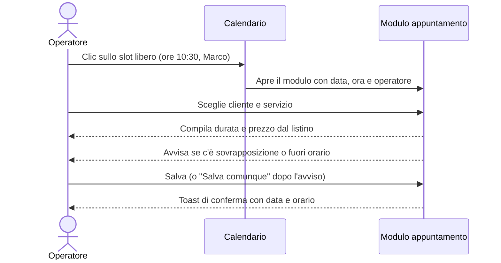
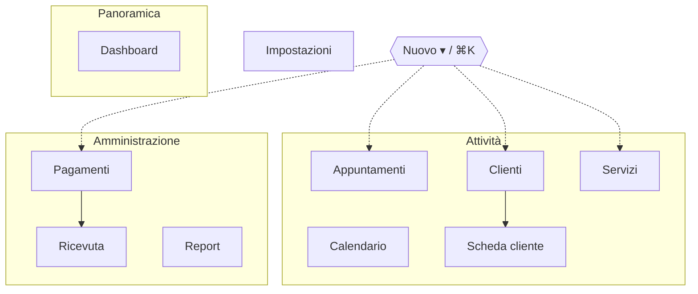

# Brief di prodotto — Nucleo

## Sintesi

| Voce                     | Descrizione                                                                                                                                                         |
| ------------------------ | ------------------------------------------------------------------------------------------------------------------------------------------------------------------- |
| **Nome**                 | Nucleo — gestionale per attività di servizi                                                                                                                         |
| **Obiettivo**            | Un unico strumento per clienti, servizi, agenda, incassi e andamento, chiaro dal primo giorno e veloce nell'uso quotidiano                                          |
| **Pubblico**             | Titolari, staff di sala e amministrazione di attività su appuntamento (1–30 persone): saloni, centri estetici e benessere, studi professionali, consulenti, agenzie |
| **Contesto d'uso**       | Desktop in sede (reception, ufficio), tablet al banco, smartphone in mobilità                                                                                       |
| **Stile**                | Premium e minimale: neutri caldi, un accento blu cobalto, tipografia Inter, profondità discreta                                                                     |
| **Ruolo nella libreria** | Template base: shell, componenti, design system e pattern riusati dagli altri template                                                                              |

## Obiettivi e metriche di successo

| Obiettivo                  | Come lo misuriamo                                                                                                                 |
| -------------------------- | --------------------------------------------------------------------------------------------------------------------------------- |
| Prenotare in pochi secondi | Un nuovo appuntamento richiede al massimo 5 campi (cliente, servizio, operatore, data, ora); durata e prezzo si compilano da soli |
| Ridurre errori in agenda   | Avviso in tempo reale di sovrapposizioni e orari fuori apertura; salvataggio forzato solo con conferma esplicita                  |
| Incassare puntualmente     | Scaduti calcolati automaticamente ed evidenziati in dashboard; incasso in un clic                                                 |
| Capire l'andamento         | KPI con confronto sul periodo precedente; report su ricavi, servizi, presenze, occupazione                                        |
| Accessibile a tutti        | Zero violazioni axe WCAG 2.2 AA su ogni pagina, uso completo da tastiera                                                          |

## Persona di riferimento

- **Giulia, titolare (42 anni):** controlla la dashboard al mattino, segue incassi e report a fine mese. Usa il desktop in sede e lo smartphone la sera.
- **Marco, operatore (29 anni):** consulta la propria agenda, conferma e completa gli appuntamenti, registra l'incasso al termine del servizio. Usa il tablet al banco.
- **Laura, amministrazione part-time:** gestisce scadenze e rimborsi, esporta CSV per il commercialista.

## Pagine e funzionalità

### Accesso (`/accedi`, `/recupera-password`)

Form email/password con validazione, mostra/nascondi password, "Ricordami", recupero password con messaggio neutro (non rivela se l'email esiste). In demo: accesso diretto con "Entra con l'account demo".

### Dashboard (`/dashboard`)

Saluto contestuale e data; KPI (incassi del mese vs mese scorso, appuntamenti oggi e da confermare, nuovi clienti a 30 giorni, crediti e scaduti); incassi delle ultime 12 settimane; agenda di oggi con appuntamenti in corso evidenziati; pagamenti da incassare con azione rapida; servizi più richiesti.

### Clienti (`/clienti`, `/clienti/[id]`)

Elenco con ricerca su nome, email e telefono (anche senza accenti), filtri per stato (attivi, potenziali, inattivi) ed etichetta, ordinamento per nome, data di inserimento, ultima visita e spesa; paginazione; export CSV compatibile con Excel. La scheda cliente mostra KPI (spesa, visite, ultima visita, prossimo appuntamento), storico in schede, contatti cliccabili, consenso marketing, note interne ed export GDPR.

### Servizi (`/servizi`)

Card raggruppate per categoria con prezzo, durata e prenotazioni a 30 giorni; interruttore "prenotabile"; modifica, duplicazione, eliminazione sicura.

### Appuntamenti (`/appuntamenti`)

Elenco raggruppato per giorno con viste Prossimi, Oggi, Questa settimana, Passati; filtri per stato e operatore; azioni contestuali (conferma, completa, non presentato, annulla, ripristina, registra pagamento, modifica, elimina) con annullamento immediato del cambio di stato.

### Calendario (`/calendario`)

- **Giorno** (predefinita): una colonna per operatore, la vista più leggibile per chi lavora su appuntamento.
- **Settimana:** sette colonne; il contenuto dei blocchi si adatta alla larghezza disponibile.
- **Mese:** fino a tre appuntamenti per giorno, con "+N altri" che apre la giornata.

Comprende linea dell'ora attuale, giorni di chiusura tratteggiati, clic sullo slot libero per prenotare con data, ora e operatore già impostati, filtro operatori e preferenza della vista salvata.

### Pagamenti (`/pagamenti`, `/ricevuta/[id]`)

KPI di incasso; filtri per stato (pagati, in attesa, scaduti, rimborsati), metodo e periodo (gli scaduti restano sempre visibili); tabella ordinabile; azioni per incassare, rimborsare, modificare ed eliminare; ricevuta di cortesia **non fiscale** stampabile; export CSV.

### Report (`/report`)

Periodo di 30 o 90 giorni oppure 12 mesi, con confronto sul periodo precedente di pari durata. Mostra ricavi nel tempo, ricavi per servizio (oltre 6 voci il resto confluisce in "Altro"), esito degli appuntamenti con tasso di presenza, occupazione dello staff rispetto agli orari di apertura e clienti principali. Si può esportare in CSV.

### Impostazioni (`/impostazioni`)

Dati dell'attività (anche per le ricevute), orari settimanali con validazione, intervallo dell'agenda, team con colore identità, tema, promemoria automatici, esportazione completa dei dati in JSON, ripristino della demo, cancellazione dei dati.

## Flussi principali

1. **Fine servizio:** Appuntamenti → "Segna come completato" → "Registra pagamento" (cliente, importo e descrizione già compilati) → toast con il numero di ricevuta.
2. **Recupero crediti:** Dashboard → "Pagamenti da incassare" → spunta "Segna come pagato" sullo scaduto.
3. **Richiesta GDPR:** Clienti → scheda → "Esporta dati (GDPR)" oppure "Elimina" (i pagamenti restano per obbligo fiscale).

## Mappa della navigazione

Il menu "Nuovo" e la ricerca rapida ⌘K sono disponibili su ogni pagina e aprono le stesse modali globali.

## Fuori perimetro (estensioni previste)

- Prenotazione online lato cliente (vedi il template "Servizi e prenotazioni" della roadmap).
- Invio reale di promemoria email/SMS, fatturazione elettronica SDI, pagamenti online: integrazioni con fornitori esterni.
- Multi-sede e permessi granulari: richiedono il backend (vedi [architettura](architettura.md)).
