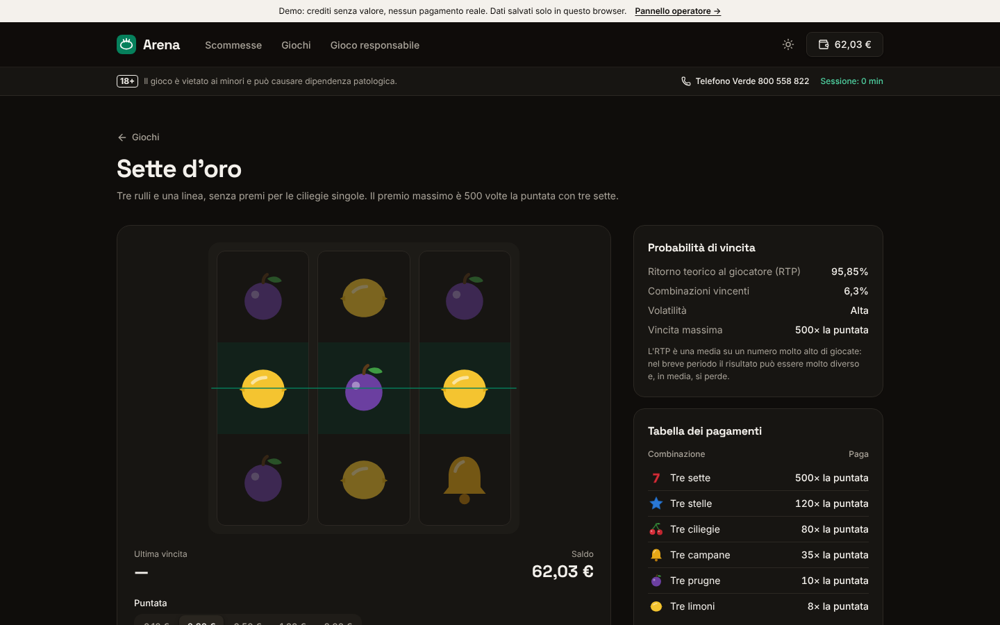
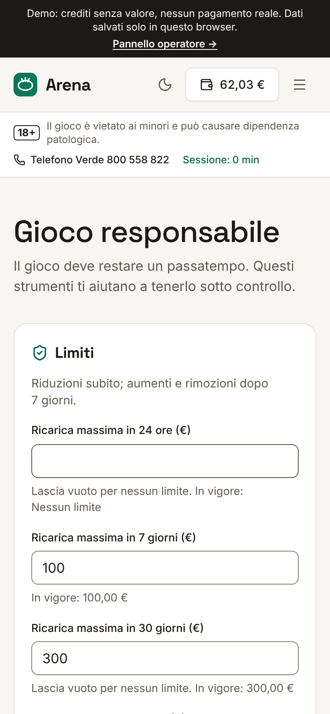
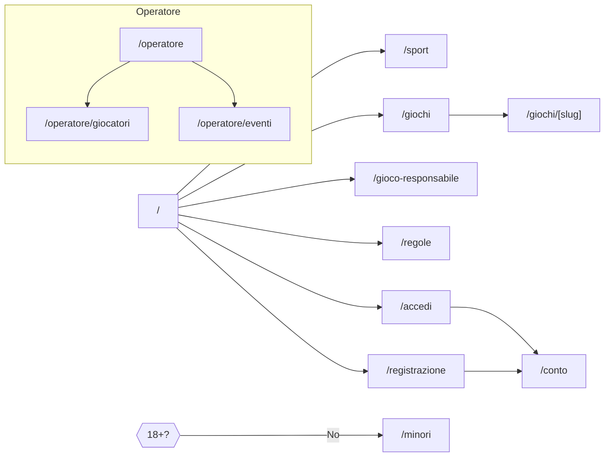

# Arena — scommesse e giochi con gioco responsabile

Template per **operatori di gioco pubblico** (scommesse sportive a quota fissa e giochi) costruito attorno alla tutela del giocatore. Comprende:

- **sito:** prossimi eventi con quote, schedina singola e multipla, slot demo con ritorno teorico (RTP) calcolato e mostrato, regole e probabilità di vincita;
- **conto di gioco:** registrazione con controllo di età e codice fiscale, limite di ricarica obbligatorio, saldo, ricariche e prelievi demo, movimenti, scommesse, sessioni;
- **gioco responsabile:** limiti di ricarica e di perdita, durata massima della sessione, promemoria del tempo di gioco, pausa, autoesclusione, test di autovalutazione, numero di aiuto;
- **pannello operatore:** raccolta, giocatori da seguire con i segnali di rischio, verifica dei documenti, refertazione degli eventi con liquidazione delle scommesse.

Avvertenze (18+, rischio di dipendenza, Telefono Verde) sempre visibili; **nessun bonus né promozione**. Il sito è accessibile (WCAG 2.2 AA), responsive e pronto per il deploy su Vercel.

> **Attenzione:** è un template dimostrativo con crediti senza valore. Per offrire gioco con vincita in denaro in Italia serve una **concessione ADM** e il rispetto dei relativi obblighi tecnici e normativi (vedi [docs/sicurezza-privacy.md](docs/sicurezza-privacy.md)).


<table>
  <tr>
    <td></td>
    <td></td>
  </tr>
</table>

> **Demo pubblica:** dopo il primo deploy su Vercel inserisci qui il link della preview, es. `https://arena-gioco.vercel.app`.

---

## Indice

1. [Concept e principi](#concept-e-principi)
2. [Funzionalità](#funzionalità)
3. [Pagine e navigazione](#pagine-e-navigazione)
4. [Stack tecnico](#stack-tecnico)
5. [Avvio rapido](#avvio-rapido)
6. [Script](#script)
7. [Struttura del progetto](#struttura-del-progetto)
8. [Variabili d'ambiente](#variabili-dambiente)
9. [Deploy su Vercel](#deploy-su-vercel)
10. [Qualità, test e accessibilità](#qualità-test-e-accessibilità)
11. [Prima di andare in produzione](#prima-di-andare-in-produzione)
12. [Documentazione](#documentazione)

## Concept e principi

**Arena** è progettato perché giocare resti un passatempo:

- **trasparenza:** quote fisse, probabilità implicite spiegate, RTP e frequenza di vincita calcolati su tutte le combinazioni dei rulli;
- **limiti di default:** il limite di ricarica settimanale è obbligatorio alla registrazione; ridurre è immediato, aumentare richiede 7 giorni;
- **frizione dove serve:** niente giocate automatiche o rapide (ogni giocata dura almeno 2,5 secondi), promemoria del tempo di gioco con il saldo della sessione, pausa forzata dopo il limite di sessione;
- **linguaggio neutro:** nessun invito a giocare, nessuna promessa di vincita, nessun bonus (D.L. 87/2018, "Decreto Dignità").

| Pubblico      | Cosa offre                                                                                               |
| ------------- | -------------------------------------------------------------------------------------------------------- |
| **Giocatore** | Quote e regole chiare, conto con movimenti e sessioni, strumenti per limitarsi e chiedere aiuto.         |
| **Operatore** | Andamento della raccolta, segnali di gioco a rischio, verifica dell'identità, refertazione degli eventi. |

La demo è un operatore inventato con squadre e giocatori inventati, circa 3 settimane di eventi, 31 giocatori (3 documenti da verificare, una pausa, un'autoesclusione, segnali di rischio) e un conto demo con scommesse aperte e concluse.

## Funzionalità

| Area                   | Cosa offre                                                                                                                                                                                                                                                                              |
| ---------------------- | --------------------------------------------------------------------------------------------------------------------------------------------------------------------------------------------------------------------------------------------------------------------------------------- |
| **Verifica dell'età**  | Domanda alla prima visita; chi risponde "No" va a una pagina dedicata senza accesso al gioco. L'età reale si verifica con codice fiscale e documento.                                                                                                                                   |
| **Scommesse**          | Eventi per giorno e sport, mercati 1X2, Under/Over 2,5, Goal/No goal e testa a testa. Schedina laterale (desktop) o in un pannello (mobile): singola o multipla, quota totale, vincita potenziale con tetto, controlli su importo, saldo, eventi iniziati ed esiti dello stesso evento. |
| **Giochi**             | Due slot a 3 rulli (volatilità bassa e alta) con RTP 95,56% e 95,85%, frequenza di vincita, vincita massima e tabella dei pagamenti. Risultato annunciato ai lettori di schermo.                                                                                                        |
| **Conto**              | Saldo, ricarica entro i limiti, prelievo solo con identità verificata, movimenti, scommesse con dettaglio degli esiti, sessioni con durata e saldo.                                                                                                                                     |
| **Registrazione**      | Dati anagrafici, codice fiscale con carattere di controllo e coerenza con la data di nascita, maggiore età, documento non scaduto, limite di ricarica obbligatorio, consensi.                                                                                                           |
| **Gioco responsabile** | Limiti di ricarica (24 ore, 7 e 30 giorni), perdita massima in 24 ore, durata della sessione, promemoria ogni 15/30/60 minuti, pausa di 1/7/30 giorni, autoesclusione, test Lie/Bet, Telefono Verde.                                                                                    |
| **Pannello operatore** | Giocatori attivi, raccolta e margine, scommesse aperte con esposizione, grafico giornaliero, giocatori con segnali di rischio, documenti da verificare, nota interna, refertazione e annullamento degli eventi.                                                                         |

## Pagine e navigazione



| Schermo               | Sito                                                                | Pannello                 |
| --------------------- | ------------------------------------------------------------------- | ------------------------ |
| Desktop (≥ 1024 px)   | Schedina fissa a destra, scheda della slot con dati a lato          | Sidebar                  |
| Tablet (768–1023 px)  | Schedina in un pannello                                             | Sidebar; tabelle ridotte |
| Smartphone (< 768 px) | Menu a scomparsa, barra "Apri la schedina", avvertenze su due righe | Barra inferiore          |

Il brief completo è in [docs/brief.md](docs/brief.md).

## Stack tecnico

| Ambito                 | Scelta                                                                     | Perché                                                    |
| ---------------------- | -------------------------------------------------------------------------- | --------------------------------------------------------- |
| Framework              | [Next.js 16](https://nextjs.org) (App Router, Cache Components, Turbopack) | Pagine informative statiche, giochi prerenderizzati       |
| UI                     | React 19, TypeScript (strict)                                              | Tipi su quote, limiti e movimenti                         |
| Stile                  | Tailwind CSS 4 con design token; Inter + Space Grotesk (titoli e quote)    | Tema chiaro/scuro e branding da un unico file             |
| Componenti accessibili | [Radix UI](https://www.radix-ui.com)                                       | Modali, conferme e schede accessibili                     |
| Stato                  | [Zustand](https://zustand.docs.pmnd.rs) con salvataggio locale             | Sito, conto e pannello condividono i dati demo            |
| Validazione            | [Zod 4](https://zod.dev)                                                   | Stessi schemi riutilizzabili lato server                  |
| Qualità                | ESLint (Next + jsx-a11y), Prettier, Vitest, Playwright + axe-core          | Analisi statica, test unitari, end-to-end e accessibilità |

## Avvio rapido

Requisiti: **Node.js 22** (vedi `.nvmrc`) e npm.

```bash
cd templates/gioco
npm ci
cp .env.example .env.local   # facoltativo
npm run dev
```

- Sito: <http://localhost:3000> (conferma i 18 anni alla prima visita).
- Conto demo: <http://localhost:3000/accedi>, credenziali già inserite (`davide.conti@example.com`).
- Pannello operatore: <http://localhost:3000/operatore>.

I dati demo restano **solo nel browser**; i crediti non hanno valore.

## Script

| Comando                           | Descrizione                                                                                                                          |
| --------------------------------- | ------------------------------------------------------------------------------------------------------------------------------------ |
| `npm run dev`                     | Server di sviluppo                                                                                                                   |
| `npm run build` / `start`         | Build di produzione e avvio                                                                                                          |
| `npm run lint` / `lint:fix`       | ESLint (regole Next.js, React Hooks e accessibilità jsx-a11y)                                                                        |
| `npm run typecheck`               | Genera i tipi delle rotte e controlla TypeScript                                                                                     |
| `npm run format` / `format:check` | Prettier (con ordinamento delle classi Tailwind)                                                                                     |
| `npm test`                        | Test unitari della logica di dominio (Vitest)                                                                                        |
| `npm run test:e2e`                | Test end-to-end e di accessibilità su desktop e mobile. Esegui prima `npm run build`; al primo uso `npx playwright install chromium` |
| `npm run check`                   | Tutti i controlli in sequenza, come in CI                                                                                            |

## Struttura del progetto

```text
src/
├── app/
│   ├── (sito)/                # Home, scommesse, giochi, gioco responsabile, regole, conto,
│   │                          # accesso, registrazione, termini, privacy, minori
│   ├── operatore/             # Panoramica, giocatori, eventi
│   └── globals.css, layout.tsx, manifest.ts, robots.ts, icon.svg
├── components/
│   ├── ui/, charts/           # Libreria di componenti condivisa con gli altri template
│   ├── site/                  # Intestazione, barra delle avvertenze, verifica dell'età, piè di pagina
│   ├── play/                  # Controlli di sessione e promemoria, avviso di blocco, simboli delle slot
│   └── panel/panel-shell.tsx  # Struttura del pannello
├── features/home | sport | games | account | responsible | panel
├── lib/
│   ├── domain/
│   │   ├── betting.ts         # Quote, schedina, vincita massima, liquidazione
│   │   ├── slots.ts           # Rulli, tabella dei pagamenti, RTP esatto, estrazione senza distorsione
│   │   ├── responsible.ts     # Limiti, perdite, pause, autoesclusione, sessione, segnali di rischio
│   │   ├── kyc.ts             # Maggiore età, codice fiscale (controllo e data di nascita)
│   │   └── analytics.ts, dates.ts, schemas.ts, types.ts
│   ├── demo/seed.ts           # Dati demo deterministici
│   └── format.ts, csv.ts
├── store/                     # Dati, sessione, schedina, interfaccia
└── content/it.ts              # Tutti i testi dell'interfaccia
tests/unit, tests/e2e
```

## Variabili d'ambiente

Tutte facoltative; riferimento in [`.env.example`](.env.example). Nessun segreto va mai nel repository.

| Variabile                    | Predefinito                                            | Uso                                                                          |
| ---------------------------- | ------------------------------------------------------ | ---------------------------------------------------------------------------- |
| `NEXT_PUBLIC_SITE_URL`       | dominio di produzione Vercel o `http://localhost:3000` | URL assoluti nei metadata                                                    |
| `NEXT_PUBLIC_DEMO_MODE`      | `true`                                                 | Banner demo, credenziali precompilate, compilazione demo della registrazione |
| `NEXT_PUBLIC_ALLOW_INDEXING` | `false`                                                | Indicizzazione delle pagine pubbliche (conto e pannello mai)                 |

## Deploy su Vercel

1. Su [vercel.com/new](https://vercel.com/new) importa il repository.
2. In **Root Directory** seleziona `templates/gioco`.
3. `vercel.json` imposta `npm ci`, `npm run build`, regione `fra1` e `ignoreCommand`. Premi **Deploy**.

[](https://vercel.com/new/clone?repository-url=https%3A%2F%2Fgithub.com%2Fmykytakarpenko-debug%2Fidee&root-directory=templates%2Fgioco&project-name=arena-gioco&repository-name=arena-gioco)

La procedura di rilascio è in [`docs/rilascio.md`](../../docs/rilascio.md).

## Qualità, test e accessibilità

- **52 test unitari:**
  - quote combinate senza errori di arrotondamento, margine, vincita massima;
  - controlli della schedina, esiti di ogni mercato, liquidazione con eventi annullati;
  - RTP esatto delle slot tra 90% e 97%, pagamenti, estrazione uniforme;
  - limiti di ricarica sulle tre finestre, perdita netta, riduzioni immediate e aumenti dopo 7 giorni;
  - pause, autoesclusione, pausa dopo la sessione, promemoria, segnali di rischio, test Lie/Bet;
  - maggiore età, codice fiscale (controllo e data di nascita, anche per le donne);
  - coerenza dei dati demo e schemi dei moduli.
- **Test end-to-end su desktop e mobile:**
  - avvertenze su ogni pagina, verifica dell'età con uscita per i minori;
  - singola e multipla, sostituzione dell'esito dello stesso evento, limite di perdita;
  - giocata alla slot con durata minima e annuncio del risultato;
  - limiti (riduzione immediata, aumento in attesa), pausa, autoesclusione, test di autovalutazione;
  - promemoria del tempo di gioco e chiusura al limite di sessione con orologio simulato;
  - registrazione con errori e conto provvisorio, ricarica oltre il limite, prelievo;
  - refertazione con liquidazione, verifica dei documenti, nota interna.
- **Accessibilità:** axe-core con le regole WCAG 2.2 AA su tutte le pagine, sulla verifica dell'età, sulle pagine con accesso, sulla schedina, sulla ricarica e sulla scheda del giocatore, in tema chiaro e scuro.
- **CI GitHub Actions** a ogni push e pull request.

## Prima di andare in produzione

- [ ] **Concessione ADM** e collegamento ai sistemi dell'Agenzia (conto di gioco, palinsesto, trasmissione delle giocate, Registro unico delle autoesclusioni).
- [ ] **Server autorevole** per saldo, limiti, giocate e liquidazioni, con transazioni atomiche: vedi [docs/architettura.md](docs/architettura.md).
- [ ] **Generatore casuale certificato** da un laboratorio accreditato e giochi omologati.
- [ ] **Verifica dell'identità** (codice fiscale con l'Anagrafe tributaria, documento con un fornitore KYC) e controlli antiriciclaggio.
- [ ] **Pagamenti** con strumenti intestati al titolare, tracciabili.
- [ ] **Procedure di gioco responsabile** per gli operatori (contatto dei giocatori con segnali di rischio, formazione).
- [ ] **Revisione legale** di termini, informativa, regolamenti e comunicazioni (divieto di pubblicità).
- [ ] Imposta `NEXT_PUBLIC_DEMO_MODE=false` e completa [`docs/rilascio.md`](../../docs/rilascio.md).

## Documentazione

| Documento                                              | Contenuto                                                                             |
| ------------------------------------------------------ | ------------------------------------------------------------------------------------- |
| [docs/brief.md](docs/brief.md)                         | Concept, pubblico, pagine, flussi di gioco, conto e gioco responsabile                |
| [docs/design-system.md](docs/design-system.md)         | Palette smeraldo e contrasti, tipografia, quote, slot, avvertenze, stati              |
| [docs/architettura.md](docs/architettura.md)           | Store e regole di dominio, controlli lato server, RNG, integrazione con i sistemi ADM |
| [docs/personalizzazione.md](docs/personalizzazione.md) | Operatore, colori, mercati, giochi e RTP, limiti, testi                               |
| [docs/sicurezza-privacy.md](docs/sicurezza-privacy.md) | Norme sul gioco pubblico, gioco responsabile, sicurezza, GDPR, accessibilità          |

## Licenza

[MIT](LICENSE). L'operatore, le squadre, i giocatori, le persone e i dati demo sono interamente inventati.
