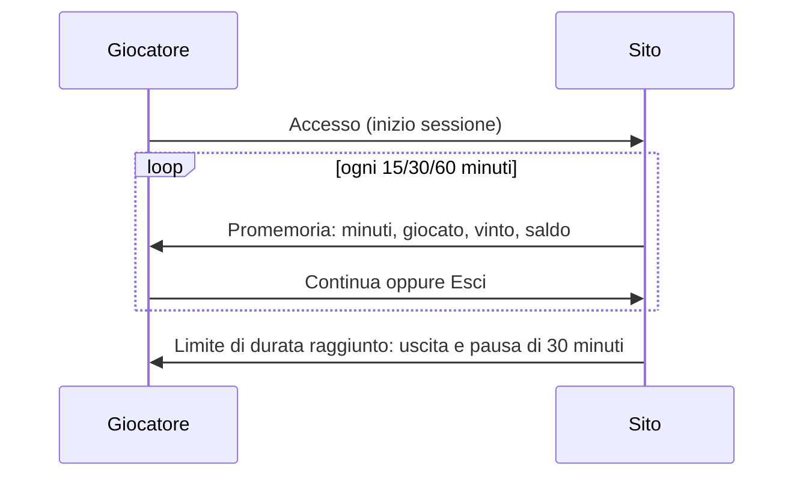

# Brief — Arena

## Concept

Sito di un operatore di gioco pubblico (scommesse sportive a quota fissa e giochi) in cui la tutela del giocatore è parte del prodotto, non una pagina in fondo al sito. Ogni schermata ricorda che il gioco è vietato ai minori e può causare dipendenza; i limiti sono attivi dal primo giorno; i dati che servono a decidere (quote, probabilità, RTP, saldo della sessione) sono sempre visibili.

## Pubblico e obiettivi

| Utente              | Obiettivo                                                     | Pagine chiave                                  |
| ------------------- | ------------------------------------------------------------- | ---------------------------------------------- |
| Visitatore          | Capire offerta, regole e tutele                               | Home, Regole e probabilità, Gioco responsabile |
| Giocatore           | Giocare entro limiti chiari, controllare saldo e movimenti    | Scommesse, Giochi, Il mio conto                |
| Giocatore a rischio | Fermarsi, chiedere aiuto                                      | Gioco responsabile                             |
| Operatore           | Verificare identità, refertare, seguire i giocatori a rischio | Pannello operatore                             |

## Mappa delle pagine

| Rotta                       | Contenuto                                                     |
| --------------------------- | ------------------------------------------------------------- |
| `/`                         | Presentazione neutra, prossimi eventi, giochi con RTP, tutele |
| `/sport`                    | Eventi per giorno e sport, quote, schedina                    |
| `/giochi`, `/giochi/[slug]` | Elenco delle slot e gioco con dati e tabella dei pagamenti    |
| `/gioco-responsabile`       | Limiti, pausa, autoesclusione, test, aiuto                    |
| `/regole`                   | Regolamento sintetico, probabilità implicite, RTP             |
| `/conto`                    | Saldo, ricarica, prelievo, movimenti, scommesse, sessioni     |
| `/accedi`, `/registrazione` | Accesso e apertura del conto                                  |
| `/termini`, `/privacy`      | Testi legali di esempio                                       |
| `/minori`                   | Uscita per chi dichiara meno di 18 anni                       |
| `/operatore/*`              | Panoramica, giocatori, eventi                                 |

## Flussi principali

### Giocata

1. Il giocatore seleziona una o più quote (un solo esito per evento: un secondo esito dello stesso evento sostituisce il primo).
2. Inserisce l'importo; la schedina mostra quota totale e vincita potenziale (con il tetto di 10.000 €).
3. Alla conferma si ricontrollano disponibilità degli eventi, importo minimo e massimo, saldo, limite di perdita e blocchi; la quota registrata è quella del momento.
4. La scommessa compare nel conto "In corso"; dopo la refertazione diventa vincente, perdente o rimborsata.

### Slot

- La puntata si sceglie tra importi fissi; prima di partire si controllano saldo, limite di perdita e blocchi.
- La giocata dura almeno 2,5 secondi, non esistono autoplay né "turbo"; il risultato è annunciato ai lettori di schermo.

### Sessione

### Limiti, pausa, autoesclusione

- Riduzioni e nuovi limiti valgono subito; aumenti e rimozioni dopo 7 giorni.
- Pausa di 1, 7 o 30 giorni e autoesclusione (30, 60, 90 giorni o indeterminata, revocabile dopo 6 mesi): bloccano gioco e ricariche, non il prelievo; non si annullano prima della scadenza, nemmeno dal pannello.

### Registrazione

Dati anagrafici, codice fiscale verificato (carattere di controllo e data di nascita), maggiore età, documento valido, limite di ricarica settimanale obbligatorio, consensi. Il conto nasce "in verifica": si gioca ma non si preleva finché l'operatore non approva il documento.

## Contenuti demo

- Operatore _Arena_ (dati di esempio), concessione segnaposto.
- Eventi di calcio, tennis e basket con squadre e giocatori inventati: due settimane concluse, una partita in corso da refertare, una settimana in programma.
- Conto demo di Davide Conti con limiti, sessioni, scommesse e giocate.
- 30 altri giocatori: 3 documenti da verificare, uno respinto, una pausa, un'autoesclusione, segnali di rischio (limiti raggiunti, gioco notturno, sessioni lunghe).
