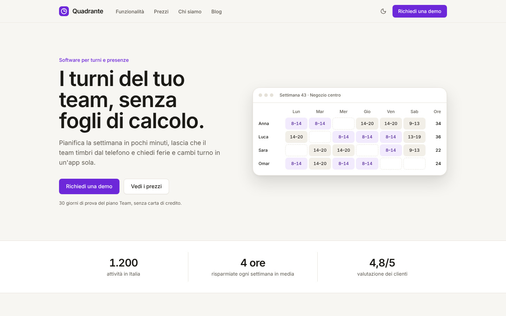
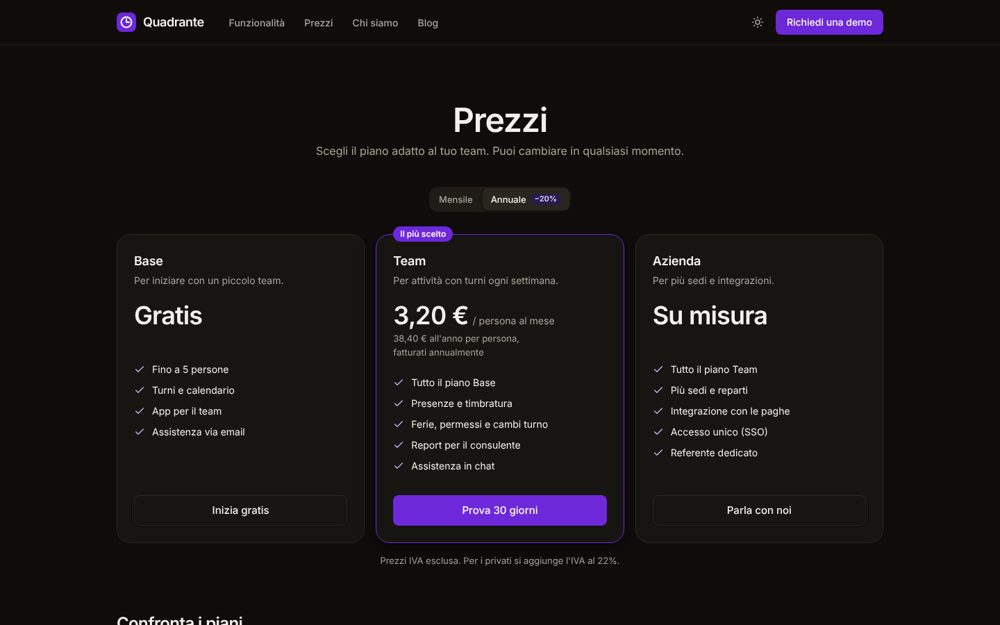
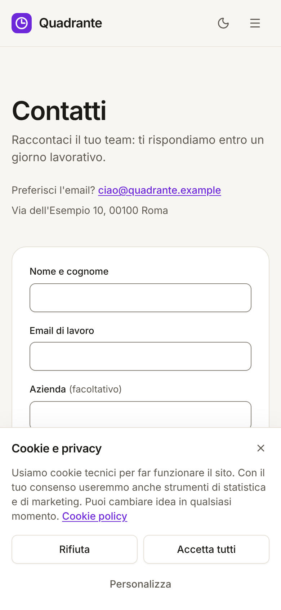
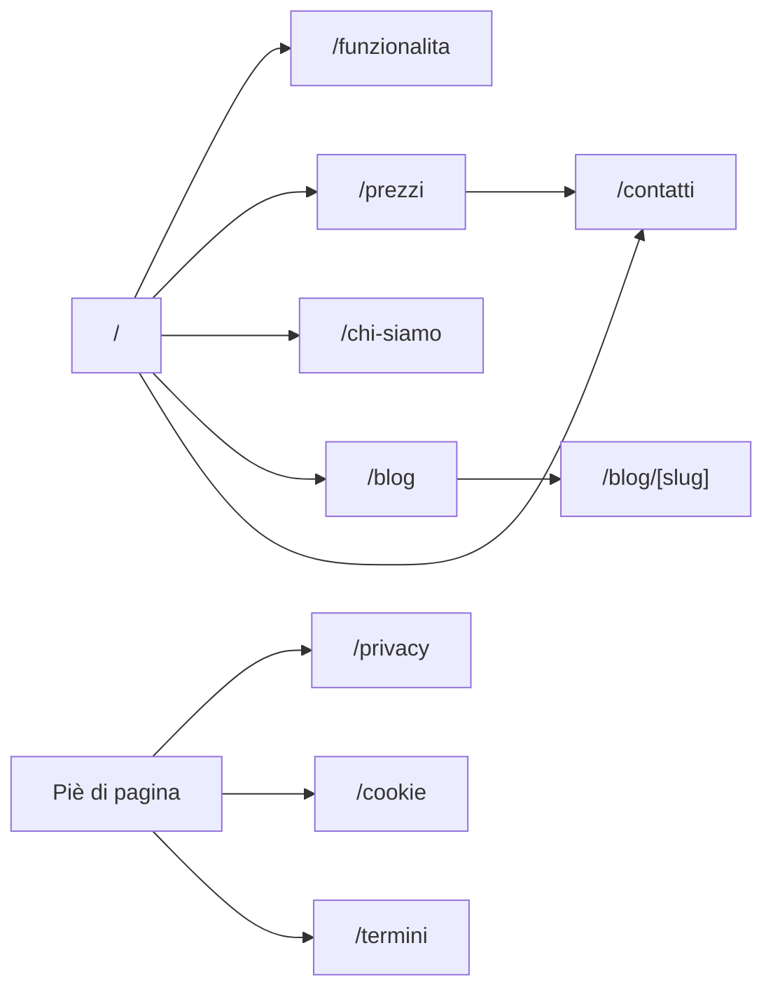

# Vetrina — landing page e sito SaaS

Template per **siti vetrina e landing page di prodotti software (SaaS)**: tutto ciò che serve per presentare un prodotto, convertire i visitatori e restare in regola. Comprende:

- **home** con proposta di valore, anteprima del prodotto, numeri, funzionalità, passi, testimonianze, prezzi, domande frequenti;
- **prezzi** con fatturazione mensile/annuale, confronto dei piani e calcolatore;
- **funzionalità**, **chi siamo**, **blog** con articoli, **contatti** con validazione lato server e antispam;
- **cookie** conformi alle Linee guida del Garante (banner, preferenze per categoria, revoca) e pagine legali di esempio;
- **SEO**: metadati e canonical per pagina, Open Graph, sitemap, robots, dati strutturati (Organization, SoftwareApplication, FAQPage, BlogPosting, BreadcrumbList).

Un solo colore d'accento, scelto tra quattro preset con contrasti verificati. Il sito è accessibile (WCAG 2.2 AA), responsive e pronto per il deploy su Vercel.



<table>
  <tr>
    <td></td>
    <td></td>
  </tr>
</table>

> **Demo pubblica:** dopo il primo deploy su Vercel inserisci qui il link della preview, es. `https://vetrina-landing.vercel.app`.

---

## Indice

1. [Concept](#concept)
2. [Funzionalità](#funzionalità)
3. [Pagine e navigazione](#pagine-e-navigazione)
4. [Stack tecnico](#stack-tecnico)
5. [Avvio rapido](#avvio-rapido)
6. [Script](#script)
7. [Struttura del progetto](#struttura-del-progetto)
8. [Variabili d'ambiente](#variabili-dambiente)
9. [Deploy su Vercel](#deploy-su-vercel)
10. [Qualità, test e accessibilità](#qualità-test-e-accessibilità)
11. [Prima di andare in produzione](#prima-di-andare-in-produzione)
12. [Documentazione](#documentazione)

## Concept

Il sito demo presenta _Quadrante_, software inventato per turni e presenze nelle piccole attività. La struttura vale per qualsiasi prodotto o servizio digitale: si sostituiscono i testi in `src/content/` e il resto (layout, prezzi, SEO, cookie, contatti) funziona già.

| Obiettivo                 | Come                                                                                                 |
| ------------------------- | ---------------------------------------------------------------------------------------------------- |
| Capire subito il prodotto | Titolo concreto, anteprima dell'interfaccia in HTML (niente immagini pesanti), funzioni in 6 blocchi |
| Fiducia                   | Numeri, testimonianze, chi siamo, pagine legali chiare (da sostituire con dati reali)                |
| Conversione               | Due inviti all'azione ripetuti, prezzi trasparenti, prova gratuita, contatto in un passo             |
| Trovabilità               | Pagine statiche veloci, metadati, sitemap e dati strutturati                                         |

## Funzionalità

| Area         | Cosa offre                                                                                                                                                                                                                 |
| ------------ | -------------------------------------------------------------------------------------------------------------------------------------------------------------------------------------------------------------------------- |
| **Prezzi**   | Piani gratuito, a persona e su misura; selettore mensile/annuale (−20%); confronto con "Incluso/Non incluso" per i lettori di schermo; calcolatore del costo annuo e del risparmio; nota IVA                               |
| **Contatti** | Validazione nel browser e di nuovo sul server (`/api/contatti`); campo trappola e tempo minimo contro i bot; limite di 5 richieste ogni 10 minuti per IP; newsletter facoltativa e separata; piano scelto precompilato     |
| **Cookie**   | Banner non bloccante con "Rifiuta" e "Accetta tutti" di pari evidenza, X = rifiuto, preferenze per categoria, scelta salvata con data e versione, nuova richiesta dopo 6 mesi, link "Preferenze cookie" sempre disponibile |
| **Blog**     | Elenco e articoli statici con categoria, autore, data, tempo di lettura, articoli correlati                                                                                                                                |
| **SEO**      | Titoli e descrizioni per pagina, canonical, Open Graph con immagine 1200×630, sitemap con gli articoli, robots, JSON-LD                                                                                                    |
| **Accento**  | `viola` (predefinito), `blu`, `verde`, `rosso`: una riga in `src/config/brand.ts`                                                                                                                                          |

## Pagine e navigazione



## Stack tecnico

| Ambito                 | Scelta                                                                     | Perché                                                    |
| ---------------------- | -------------------------------------------------------------------------- | --------------------------------------------------------- |
| Framework              | [Next.js 16](https://nextjs.org) (App Router, Cache Components, Turbopack) | Pagine statiche, route handler per il modulo              |
| UI                     | React 19, TypeScript (strict)                                              | Contenuti tipizzati                                       |
| Stile                  | Tailwind CSS 4 con design token; Inter                                     | Tema chiaro/scuro e accenti da un unico file              |
| Componenti accessibili | [Radix UI](https://www.radix-ui.com)                                       | Menu, modali e interruttori accessibili                   |
| Validazione            | [Zod 4](https://zod.dev)                                                   | Stesso schema per browser e server                        |
| Qualità                | ESLint (Next + jsx-a11y), Prettier, Vitest, Playwright + axe-core          | Analisi statica, test unitari, end-to-end e accessibilità |

## Avvio rapido

Requisiti: **Node.js 22** (vedi `.nvmrc`) e npm.

```bash
cd templates/landing
npm ci
cp .env.example .env.local   # facoltativo
npm run dev
```

Apri <http://localhost:3000>. In demo il modulo contatti viene validato dal server ma non invia nulla.

## Script

| Comando                           | Descrizione                                                                                                                          |
| --------------------------------- | ------------------------------------------------------------------------------------------------------------------------------------ |
| `npm run dev`                     | Server di sviluppo                                                                                                                   |
| `npm run build` / `start`         | Build di produzione e avvio                                                                                                          |
| `npm run lint` / `lint:fix`       | ESLint (regole Next.js, React Hooks e accessibilità jsx-a11y)                                                                        |
| `npm run typecheck`               | Genera i tipi delle rotte e controlla TypeScript                                                                                     |
| `npm run format` / `format:check` | Prettier (con ordinamento delle classi Tailwind)                                                                                     |
| `npm test`                        | Test unitari (Vitest)                                                                                                                |
| `npm run test:e2e`                | Test end-to-end e di accessibilità su desktop e mobile. Esegui prima `npm run build`; al primo uso `npx playwright install chromium` |
| `npm run check`                   | Tutti i controlli in sequenza, come in CI                                                                                            |

## Struttura del progetto

```text
src/
├── app/
│   ├── (sito)/                # Home, funzionalità, prezzi, chi siamo, blog, contatti, privacy, cookie, termini
│   ├── api/contatti/route.ts  # Ricezione del modulo: validazione, antispam, limite di frequenza
│   └── globals.css, layout.tsx, sitemap.ts, robots.ts, manifest.ts, icon.svg
├── components/
│   ├── ui/                    # Libreria di componenti condivisa con gli altri template
│   ├── site/                  # Intestazione, piè di pagina, banner e preferenze cookie, JSON-LD
│   └── marketing/             # Anteprima del prodotto, piani, confronto, calcolatore, FAQ, invito finale
├── features/contact/          # Modulo contatti
├── content/
│   ├── site.ts                # Prodotto, funzioni, piani, FAQ, chi siamo (testi da sostituire)
│   ├── posts.ts               # Articoli del blog
│   └── it.ts                  # Testi dell'interfaccia
├── lib/                       # pricing.ts, consent.ts, contact.ts, seo.ts, format.ts
└── config/                    # Marchio e accento, ambiente, navigazione
public/og.png                  # Immagine per la condivisione (1200×630)
tests/unit, tests/e2e
```

## Variabili d'ambiente

Tutte facoltative; riferimento in [`.env.example`](.env.example). Nessun segreto va mai nel repository.

| Variabile                    | Predefinito                                            | Uso                                                  |
| ---------------------------- | ------------------------------------------------------ | ---------------------------------------------------- |
| `NEXT_PUBLIC_SITE_URL`       | dominio di produzione Vercel o `http://localhost:3000` | Canonical, sitemap, Open Graph, dati strutturati     |
| `NEXT_PUBLIC_DEMO_MODE`      | `true`                                                 | Avviso che il modulo contatti non invia nulla        |
| `NEXT_PUBLIC_ALLOW_INDEXING` | `true`                                                 | `false` per gli ambienti di prova (noindex e robots) |

## Deploy su Vercel

1. Su [vercel.com/new](https://vercel.com/new) importa il repository.
2. In **Root Directory** seleziona `templates/landing`.
3. `vercel.json` imposta `npm ci`, `npm run build`, regione `fra1` e `ignoreCommand`. Premi **Deploy**.

[](https://vercel.com/new/clone?repository-url=https%3A%2F%2Fgithub.com%2Fmykytakarpenko-debug%2Fidee&root-directory=templates%2Flanding&project-name=vetrina-landing&repository-name=vetrina-landing)

Per le preview imposta `NEXT_PUBLIC_ALLOW_INDEXING=false` nell'ambiente _Preview_ di Vercel. La procedura di rilascio è in [`docs/rilascio.md`](../../docs/rilascio.md).

## Qualità, test e accessibilità

- **30 test unitari:** prezzi mensili e annuali, totale e risparmio, IVA; consenso (validità, scadenza a 6 mesi, versioni); modulo contatti (schema, antispam, limite di frequenza); dati strutturati e neutralizzazione dei tag; blog; formattazione.
- **Test end-to-end su desktop e mobile:** tutte le pagine e il 404; metadati, canonical, Open Graph, JSON-LD, sitemap e robots; banner dei cookie (rifiuto, X, accetta, preferenze e modifica dal piè di pagina, pari evidenza dei pulsanti); prezzi e calcolatore; modulo contatti con errori, invio, rivalidazione sul server, filtro antispam e limite di frequenza; accenti alternativi.
- **Accessibilità:** axe-core con le regole WCAG 2.2 AA su tutte le pagine, sul banner, sulle preferenze dei cookie e sul modulo con errori, in tema chiaro e scuro.
- **CI GitHub Actions** a ogni push e pull request.

## Prima di andare in produzione

- [ ] Sostituisci prodotto, numeri, testimonianze e persone con **dati reali e verificabili** (affermazioni non dimostrabili sono pratiche commerciali scorrette).
- [ ] Collega il modulo a email o CRM (es. Resend con `RESEND_API_KEY`) e, per la newsletter, il **double opt-in**.
- [ ] Se aggiungi statistiche o pixel, caricali **solo** con il consenso della categoria corrispondente (vedi [docs/personalizzazione.md](docs/personalizzazione.md#cookie-e-strumenti-di-terze-parti)) e aggiorna la cookie policy.
- [ ] Fai verificare informativa, cookie policy e termini da un legale; aggiungi dati societari reali nel piè di pagina.
- [ ] Imposta `NEXT_PUBLIC_SITE_URL`, verifica il dominio su Google Search Console e invia la sitemap.
- [ ] Imposta `NEXT_PUBLIC_DEMO_MODE=false` e completa [`docs/rilascio.md`](../../docs/rilascio.md).

## Documentazione

| Documento                                              | Contenuto                                                                           |
| ------------------------------------------------------ | ----------------------------------------------------------------------------------- |
| [docs/brief.md](docs/brief.md)                         | Obiettivi, pubblico, struttura delle pagine e dei messaggi                          |
| [docs/design-system.md](docs/design-system.md)         | Accenti e contrasti, tipografia, sezioni, componenti di marketing                   |
| [docs/architettura.md](docs/architettura.md)           | Pagine statiche, modulo e route handler, consenso, SEO, collegamento a CMS ed email |
| [docs/personalizzazione.md](docs/personalizzazione.md) | Testi, piani, accento, blog, cookie e strumenti di terze parti                      |
| [docs/sicurezza-privacy.md](docs/sicurezza-privacy.md) | Cookie (Garante), GDPR, antispam, header di sicurezza, pubblicità, accessibilità    |

## Licenza

[MIT](LICENSE). Il prodotto, l'azienda, le persone e le testimonianze sono interamente inventati.
