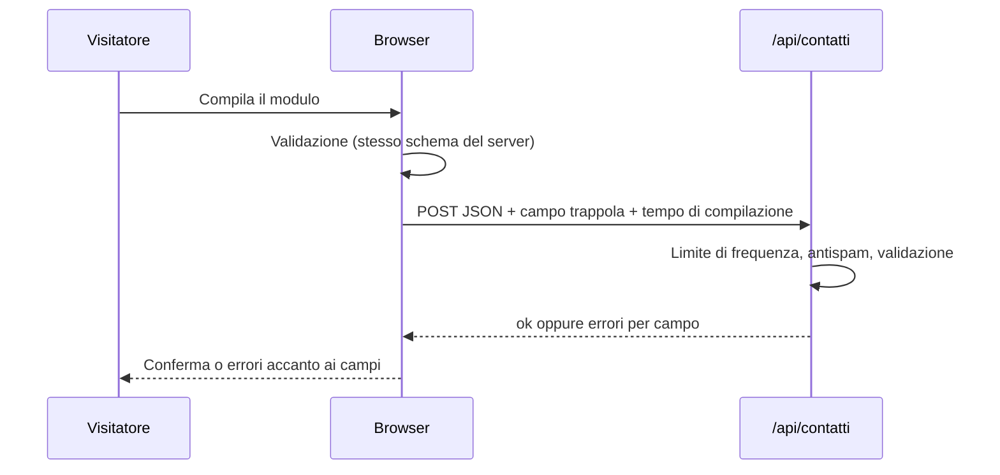

# Brief — Vetrina

## Obiettivo

Un sito che spiega un prodotto digitale in pochi secondi, risponde ai dubbi più comuni e porta a un contatto o a una prova, restando veloce, accessibile e conforme alle regole su cookie e privacy.

## Pubblico

| Visitatore              | Domanda                           | Risposta nel sito                                 |
| ----------------------- | --------------------------------- | ------------------------------------------------- |
| Titolare di un'attività | "Mi fa risparmiare tempo?"        | Titolo e anteprima, numeri, passi, testimonianze  |
| Responsabile/acquisti   | "Quanto costa per il mio team?"   | Prezzi chiari IVA esclusa, calcolatore, confronto |
| Chi valuta la sicurezza | "Dove sono i dati? È affidabile?" | FAQ, privacy, termini, chi siamo                  |
| Chi cerca informazioni  | "Come organizzo i turni?"         | Blog con guide pratiche (porta traffico organico) |

## Struttura dei messaggi (home)

1. **Promessa concreta** nel titolo, sottotitolo con le tre funzioni principali, due inviti all'azione.
2. **Prova visiva:** anteprima dell'interfaccia.
3. **Credibilità:** tre numeri (da sostituire con dati reali).
4. **Funzioni** in sei blocchi brevi, con link alla pagina completa.
5. **Come si inizia** in tre passi.
6. **Testimonianze** (di esempio).
7. **Prezzi** con il piano consigliato in evidenza.
8. **Domande frequenti** che tolgono gli ultimi dubbi.
9. **Invito finale** a richiedere una demo.

## Pagine

| Rotta                             | Scopo                                            |
| --------------------------------- | ------------------------------------------------ |
| `/`                               | Presentazione e conversione                      |
| `/funzionalita`                   | Dettaglio delle funzioni con i punti chiave      |
| `/prezzi`                         | Piani, fatturazione, confronto, calcolatore, FAQ |
| `/chi-siamo`                      | Storia, principi, team                           |
| `/blog`, `/blog/[slug]`           | Contenuti utili e traffico organico              |
| `/contatti`                       | Richiesta di demo o informazioni                 |
| `/privacy`, `/cookie`, `/termini` | Informazioni legali (esempi)                     |

## Flusso di contatto

## Tono

Diretto, concreto, in seconda persona; frasi brevi; nessun superlativo non dimostrabile.
