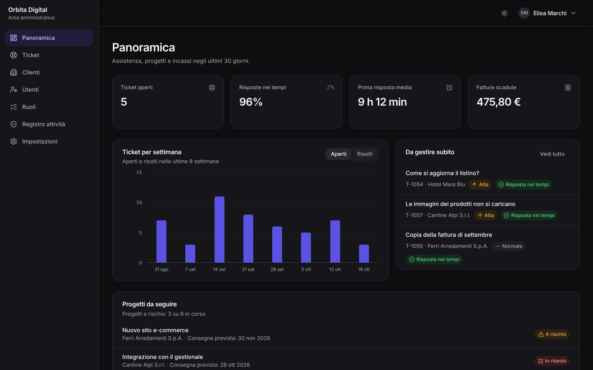
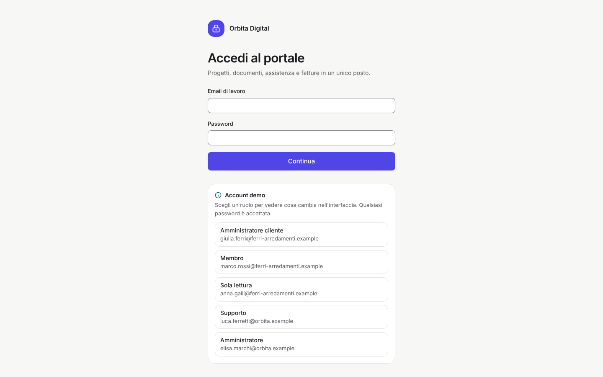
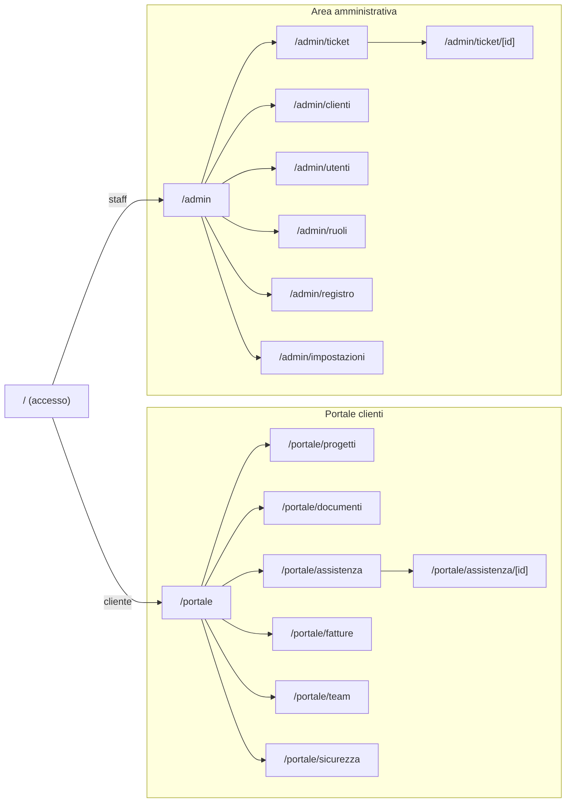

# Portale — area clienti e amministrazione

Template per **aziende di servizi** (agenzie digitali, software house, studi di consulenza, IT gestito) che vogliono dare ai clienti un'area riservata e al proprio team un pannello di gestione. Comprende:

- **portale clienti:** panoramica, progetti con milestone, documenti, assistenza con ticket, fatture, team e sicurezza dell'account;
- **area amministrativa:** indicatori, coda dei ticket ordinata per SLA, clienti, utenti, matrice di ruoli e permessi, registro attività, impostazioni;
- **accesso in due passaggi** con blocco dopo 5 tentativi e chiusura della sessione per inattività.

Cinque ruoli (tre lato cliente, due lato fornitore) cambiano navigazione, pagine e azioni disponibili. Il sito è accessibile (WCAG 2.2 AA), responsive e pronto per il deploy su Vercel.


<table>
  <tr>
    <td></td>
    <td></td>
  </tr>
</table>

> **Demo pubblica:** dopo il primo deploy su Vercel inserisci qui il link della preview, es. `https://portale-clienti.vercel.app`.

---

## Indice

1. [Concept e pubblico](#concept-e-pubblico)
2. [Funzionalità](#funzionalità)
3. [Ruoli e permessi](#ruoli-e-permessi)
4. [Pagine e navigazione](#pagine-e-navigazione)
5. [Stack tecnico](#stack-tecnico)
6. [Avvio rapido](#avvio-rapido)
7. [Script](#script)
8. [Struttura del progetto](#struttura-del-progetto)
9. [Variabili d'ambiente](#variabili-dambiente)
10. [Deploy su Vercel](#deploy-su-vercel)
11. [Qualità, test e accessibilità](#qualità-test-e-accessibilità)
12. [Prima di andare in produzione](#prima-di-andare-in-produzione)
13. [Documentazione](#documentazione)

## Concept e pubblico

**Portale** sostituisce email sparse, cartelle condivise e fogli di calcolo con un unico posto in cui il cliente trova lo stato del lavoro e il fornitore misura il servizio.

| Pubblico                 | Cosa offre                                                                                                                        |
| ------------------------ | --------------------------------------------------------------------------------------------------------------------------------- |
| **Cliente**              | Vede avanzamento e scadenze, scarica documenti e fatture, apre ticket e segue le risposte, gestisce chi della sua azienda accede. |
| **Supporto** (fornitore) | Lavora la coda ordinata per urgenza, assegna, risponde, scrive note interne che il cliente non vede.                              |
| **Amministratore**       | Controlla tempi di risposta e incassi, gestisce clienti, utenti e ruoli, consulta il registro attività, imposta SLA e sicurezza.  |

La demo è _Orbita Digital_, agenzia inventata, con 6 aziende clienti, progetti con milestone (uno in ritardo), documenti, circa due mesi di ticket con SLA, 10 mesi di fatture (una scaduta) e un registro attività di 30 giorni.

## Funzionalità

| Area                        | Cosa offre                                                                                                                                                                                |
| --------------------------- | ----------------------------------------------------------------------------------------------------------------------------------------------------------------------------------------- |
| **Accesso**                 | Email e password, poi codice a 6 cifre. Blocco di 15 minuti dopo 5 codici errati, errori registrati. Account disattivati e aziende sospese non entrano. Uscita automatica per inattività. |
| **Panoramica** (cliente)    | Progetti in corso, ticket aperti, importo da pagare (solo a chi può vedere le fatture), prossime scadenze, referente, ticket e documenti recenti.                                         |
| **Progetti**                | Stato e salute, avanzamento per milestone (barra con valore annunciato), periodo, referente, milestone completate, da completare o in ritardo (icona + testo, mai solo colore).           |
| **Documenti**               | Cartelle, ricerca, versione, dimensione, autore. Caricamento con nome validato e collegamento a un progetto; ogni download finisce nel registro.                                          |
| **Assistenza**              | Ticket aperti/chiusi/tutti, ricerca, nuovo ticket con tipo e priorità. Conversazione, risposta, chiusura o riapertura di un ticket risolto.                                               |
| **Fatture**                 | Da pagare e scaduto, elenco con stato, data di pagamento e download registrato.                                                                                                           |
| **Team**                    | Inviti, permessi modificabili in riga, disattivazione con conferma, reset della verifica in due passaggi. Sempre almeno un amministratore attivo per azienda; nessuno modifica sé stesso. |
| **Sicurezza**               | Verifica in due passaggi (bloccata se obbligatoria), ultimi accessi con IP anonimizzato, durata della sessione.                                                                           |
| **Panoramica** (admin)      | Ticket aperti e oltre lo SLA, risposte nei tempi, prima risposta media, fatture scadute, grafico settimanale aperti/risolti, ticket da gestire subito, progetti da seguire.               |
| **Ticket** (admin)          | Coda per SLA superato → a rischio → priorità → anzianità; filtri "assegnati a me" e "non assegnati". Assegnazione, cambi di stato, note interne, scadenza della prima risposta.           |
| **Clienti**                 | Utenti, ticket aperti, progetti e importi da incassare. Scheda con piano, referente, accesso attivo e fatture da segnare come pagate.                                                     |
| **Utenti, ruoli, registro** | Tutti gli utenti con filtri per azienda e ruolo; matrice dei permessi; registro filtrabile ed esportabile in CSV con conservazione configurabile.                                         |
| **Impostazioni**            | Nome del fornitore, email del supporto, ore di prima risposta per priorità, verifica obbligatoria, timeout della sessione, conservazione del registro, ripristino della demo.             |

## Ruoli e permessi

| Permesso                                       | Amministratore cliente | Membro | Sola lettura | Supporto | Amministratore |
| ---------------------------------------------- | :--------------------: | :----: | :----------: | :------: | :------------: |
| Portale: progetti, documenti, ticket           |           ✓            |   ✓    |      ✓       |          |                |
| Caricare documenti, aprire ticket              |           ✓            |   ✓    |              |          |                |
| Fatture                                        |           ✓            |        |              |          |                |
| Gestire il team della propria azienda          |           ✓            |        |              |          |                |
| Area admin: coda ticket, note interne, clienti |                        |        |              |    ✓     |       ✓        |
| Utenti e ruoli, registro, impostazioni         |                        |        |              |          |       ✓        |

La matrice è definita una sola volta in [`src/lib/domain/rbac.ts`](src/lib/domain/rbac.ts) e usata da navigazione, pagine (`RequirePermission`) e azioni dello store, che ricontrollano i permessi prima di ogni modifica. In produzione gli stessi controlli vanno sul server: vedi [docs/sicurezza-privacy.md](docs/sicurezza-privacy.md).

## Pagine e navigazione



| Schermo               | Navigazione                                                                     |
| --------------------- | ------------------------------------------------------------------------------- |
| Desktop e tablet      | Sidebar con le sole voci consentite al ruolo; menu dell'account in alto         |
| Smartphone (< 768 px) | Barra inferiore con 4 voci e "Altro"; colonne secondarie nascoste nelle tabelle |

Il brief completo è in [docs/brief.md](docs/brief.md).

## Stack tecnico

| Ambito                 | Scelta                                                                     | Perché                                                                  |
| ---------------------- | -------------------------------------------------------------------------- | ----------------------------------------------------------------------- |
| Framework              | [Next.js 16](https://nextjs.org) (App Router, Cache Components, Turbopack) | Shell delle pagine prerenderizzata, dati caricati nel browser           |
| UI                     | React 19, TypeScript (strict)                                              | Tipi su dominio, ruoli e permessi                                       |
| Stile                  | Tailwind CSS 4 con design token; Inter                                     | Tema chiaro/scuro e branding da un unico file                           |
| Componenti accessibili | [Radix UI](https://www.radix-ui.com)                                       | Focus, tastiera e ARIA corretti in menu, modali e interruttori          |
| Stato                  | [Zustand](https://zustand.docs.pmnd.rs) con salvataggio locale             | Portale e area admin condividono i dati demo; uscita in tutte le schede |
| Validazione            | [Zod 4](https://zod.dev)                                                   | Stessi schemi riutilizzabili lato server                                |
| Qualità                | ESLint (Next + jsx-a11y), Prettier, Vitest, Playwright + axe-core          | Analisi statica, test unitari, end-to-end e accessibilità               |

## Avvio rapido

Requisiti: **Node.js 22** (vedi `.nvmrc`) e npm.

```bash
cd templates/portale
npm ci
cp .env.example .env.local   # facoltativo
npm run dev
```

Apri <http://localhost:3000>, scegli un account demo (qualsiasi password) e inserisci il codice **246810**.

| Ruolo                  | Email                                    | Arriva su  |
| ---------------------- | ---------------------------------------- | ---------- |
| Amministratore cliente | `giulia.ferri@ferri-arredamenti.example` | `/portale` |
| Membro                 | `marco.rossi@ferri-arredamenti.example`  | `/portale` |
| Sola lettura           | `anna.galli@ferri-arredamenti.example`   | `/portale` |
| Supporto               | `luca.ferretti@orbita.example`           | `/admin`   |
| Amministratore         | `elisa.marchi@orbita.example`            | `/admin`   |

I dati demo restano **solo nel browser** e si ripristinano da _Impostazioni → Dati demo_ (account amministratore).

## Script

| Comando                           | Descrizione                                                                                                                          |
| --------------------------------- | ------------------------------------------------------------------------------------------------------------------------------------ |
| `npm run dev`                     | Server di sviluppo                                                                                                                   |
| `npm run build` / `start`         | Build di produzione e avvio                                                                                                          |
| `npm run lint` / `lint:fix`       | ESLint (regole Next.js, React Hooks e accessibilità jsx-a11y)                                                                        |
| `npm run typecheck`               | Genera i tipi delle rotte e controlla TypeScript                                                                                     |
| `npm run format` / `format:check` | Prettier (con ordinamento delle classi Tailwind)                                                                                     |
| `npm test`                        | Test unitari della logica di dominio (Vitest)                                                                                        |
| `npm run test:e2e`                | Test end-to-end e di accessibilità su desktop e mobile. Esegui prima `npm run build`; al primo uso `npx playwright install chromium` |
| `npm run check`                   | Tutti i controlli in sequenza, come in CI                                                                                            |

## Struttura del progetto

```text
src/
├── app/
│   ├── (accesso)/             # Accesso in due passaggi, informativa privacy
│   ├── portale/               # Panoramica, progetti, documenti, assistenza, fatture, team, sicurezza
│   ├── admin/                 # Panoramica, ticket, clienti, utenti, ruoli, registro, impostazioni
│   └── globals.css, layout.tsx, manifest.ts, robots.ts, icon.svg
├── components/
│   ├── ui/                    # Libreria di componenti condivisa con gli altri template
│   ├── charts/                # Istogramma, barra di avanzamento, barre orizzontali
│   ├── panel/panel-shell.tsx  # Struttura, navigazione per permesso, timeout, RequirePermission
│   └── badges.tsx             # Stati di ticket, priorità, SLA, progetti, fatture, utenti
├── features/auth | portal | tickets | users | admin
├── lib/
│   ├── domain/
│   │   ├── rbac.ts            # Ruoli, matrice dei permessi, chi può gestire chi, ultimo amministratore
│   │   ├── tickets.ts         # SLA, coda, transizioni di stato, note interne
│   │   ├── billing.ts         # Fatture, importi da incassare, avanzamento dei progetti
│   │   ├── auth.ts            # Tentativi e blocco, codice, confronto a tempo costante, IP anonimizzato
│   │   └── analytics.ts, dates.ts, schemas.ts, types.ts
│   ├── demo/seed.ts           # Dati demo deterministici
│   └── format.ts, csv.ts
├── store/                     # Dati (con registro attività), sessione demo, interfaccia
└── content/it.ts              # Tutti i testi dell'interfaccia
tests/unit, tests/e2e
```

## Variabili d'ambiente

Tutte facoltative; riferimento in [`.env.example`](.env.example). Nessun segreto va mai nel repository.

| Variabile               | Predefinito                                            | Uso                                                       |
| ----------------------- | ------------------------------------------------------ | --------------------------------------------------------- |
| `NEXT_PUBLIC_SITE_URL`  | dominio di produzione Vercel o `http://localhost:3000` | URL assoluti nei metadata                                 |
| `NEXT_PUBLIC_DEMO_MODE` | `true`                                                 | Account demo e codice di verifica nella pagina di accesso |

Il portale non è mai indicizzabile: `robots.txt` blocca tutto e ogni pagina ha `noindex`.

## Deploy su Vercel

1. Su [vercel.com/new](https://vercel.com/new) importa il repository.
2. In **Root Directory** seleziona `templates/portale`.
3. `vercel.json` imposta `npm ci`, `npm run build`, regione `fra1` e `ignoreCommand`. Premi **Deploy**.

[](https://vercel.com/new/clone?repository-url=https%3A%2F%2Fgithub.com%2Fmykytakarpenko-debug%2Fidee&root-directory=templates%2Fportale&project-name=portale-clienti&repository-name=portale-clienti)

La procedura di rilascio è in [`docs/rilascio.md`](../../docs/rilascio.md).

## Qualità, test e accessibilità

- **49 test unitari:**
  - separazione tra area cliente e area admin, permessi per ruolo, ruoli assegnabili;
  - chi può gestire chi, protezione dell'ultimo amministratore;
  - blocco dopo 5 tentativi e sblocco, normalizzazione del codice, IP anonimizzati;
  - scadenza e stato dello SLA, conformità, tempo medio di risposta, ordine della coda;
  - transizioni del cliente, note interne nascoste, volumi settimanali;
  - IVA e stato delle fatture, avanzamento dei progetti, filtri e conservazione del registro;
  - coerenza e realismo dei dati demo, schemi dei moduli.
- **Test end-to-end su desktop e mobile:**
  - accesso con codice errato e corretto, blocco, sessione scaduta, uscita;
  - pagine e voci di menu per ogni ruolo, accesso negato fuori dal proprio ruolo;
  - ticket del cliente con risposta; nota interna dello staff invisibile al cliente; assegnazione e risoluzione;
  - caricamento e download di documenti, fatture;
  - invito, cambio permessi, disattivazione, ultimo amministratore;
  - cliente sospeso che non può più accedere, fattura segnata come pagata, registro filtrato ed esportato, impostazioni validate, ripristino della demo.
- **Accessibilità:** axe-core con le regole WCAG 2.2 AA su tutte le pagine di ogni area, sul codice errato, sulle modali e sulla scheda cliente, in tema chiaro e scuro, più `prefers-reduced-motion`.
- **CI GitHub Actions** a ogni push e pull request.

## Prima di andare in produzione

- [ ] **Autenticazione vera** con un provider (Auth.js, Clerk, WorkOS, Keycloak, Entra ID): password con hash, TOTP o passkey verificati sul server, sessioni in cookie `HttpOnly`. Vedi [docs/sicurezza-privacy.md](docs/sicurezza-privacy.md).
- [ ] **Database e API** con controllo dei permessi e filtro per azienda **a ogni richiesta** (es. Row Level Security): vedi [docs/architettura.md](docs/architettura.md#collegare-un-backend).
- [ ] **Storage privato** per i documenti: antivirus, link firmati a scadenza, limiti di dimensione e tipo.
- [ ] **Email transazionali:** inviti, nuove risposte ai ticket, fatture in scadenza.
- [ ] **Registro attività** scritto dal server, non modificabile, con conservazione automatica.
- [ ] **Fatture** dal gestionale o dal sistema di fatturazione elettronica (SdI).
- [ ] **Revisione legale** dell'informativa e del contratto di nomina a responsabile del trattamento (art. 28).
- [ ] Imposta `NEXT_PUBLIC_DEMO_MODE=false` e completa [`docs/rilascio.md`](../../docs/rilascio.md).

## Documentazione

| Documento                                              | Contenuto                                                                                 |
| ------------------------------------------------------ | ----------------------------------------------------------------------------------------- |
| [docs/brief.md](docs/brief.md)                         | Concept, pubblico, pagine, flussi di accesso, ticket e gestione del team                  |
| [docs/design-system.md](docs/design-system.md)         | Palette indaco e contrasti, tipografia, stati con icona e testo, grafici, componenti      |
| [docs/architettura.md](docs/architettura.md)           | Ruoli e controlli a più livelli, store, registro, collegamento a backend e autenticazione |
| [docs/personalizzazione.md](docs/personalizzazione.md) | Fornitore, colori, ruoli e permessi, SLA, cartelle, testi                                 |
| [docs/sicurezza-privacy.md](docs/sicurezza-privacy.md) | Accesso, sessioni, isolamento dei dati, registro, GDPR, conservazione, accessibilità      |

## Licenza

[MIT](LICENSE). Il fornitore, le aziende, le persone e i dati demo sono interamente inventati.
