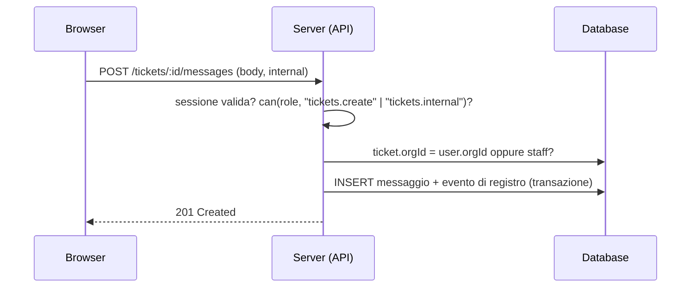

# Architettura — Portale

## Panoramica

```text
Browser
 ├─ Pagine (App Router): shell prerenderizzata, contenuto client
 ├─ PanelShell ── controlla sessione, area (cliente/staff), inattività, voci di menu per permesso
 ├─ RequirePermission ── controllo per pagina
 ├─ Viste (features/*) ── leggono lo store con useData, chiamano le azioni
 └─ Store Zustand
     ├─ data-store: aziende, utenti, progetti, documenti, ticket, fatture, registro, impostazioni
     │   └─ ogni azione ricontrolla i permessi e scrive nel registro
     └─ session-store: utente, accesso in sospeso, tentativi, ultima attività
```

In demo tutto vive nel browser (`localStorage`, scrittura ritardata). Le regole stanno in `src/lib/domain/` come **funzioni pure** testate, pronte da riusare sul server.

## Controlli a più livelli

| Livello     | Dove                                   | Cosa fa                                                                     |
| ----------- | -------------------------------------- | --------------------------------------------------------------------------- |
| Area        | `PanelShell`                           | Staff solo in `/admin`, clienti solo in `/portale`                          |
| Navigazione | `config/navigation.ts`                 | Ogni voce dichiara il permesso richiesto                                    |
| Pagina      | `RequirePermission` in ogni `page.tsx` | Blocca l'apertura diretta via URL                                           |
| Dati        | viste                                  | Il cliente vede solo i dati della propria azienda (es. ticket per `orgId`)  |
| Azione      | `store/data-store.ts`                  | `can()`, `canManageUser()`, `wouldRemoveLastAdmin()` prima di ogni modifica |

**In produzione l'unico livello che conta è il server.** I controlli nel browser servono all'esperienza; il server deve rifare gli stessi controlli a ogni richiesta, con le stesse funzioni di `lib/domain/rbac.ts`.

## Registro attività

Eventi: accessi e uscite, codici errati, inviti, cambi di ruolo, disattivazioni, reset della verifica, ticket aperti, risposte, cambi di stato e assegnazioni, caricamenti e download, modifiche a clienti e impostazioni, cambi della verifica in due passaggi.

Ogni evento ha istante, autore, azione, oggetto, azienda e IP **anonimizzato** (ultimo ottetto rimosso). `expiredAudit()` individua gli eventi oltre la conservazione configurata.

## Rendering

- Le pagine sono statiche (shell) e i dati arrivano dallo store nel browser: niente dati riservati nell'HTML.
- I dettagli dei ticket (`/[id]`) leggono `params` dentro `<Suspense>` (Cache Components).
- Nessuna chiamata a `new Date()` durante il render: `useNow()` fornisce l'ora dopo l'idratazione.

## Collegare un backend

1. **Autenticazione:** un provider (Auth.js, Clerk, WorkOS, Keycloak, Entra ID) con password con hash, TOTP o passkey e sessioni in cookie `HttpOnly`, `Secure`, `SameSite=Lax`. Sostituisci `session-store` con la sessione del provider e `LoginView` con il suo flusso.
2. **Protezione delle rotte:** in `src/proxy.ts` controlla la sessione per `/portale/*` e `/admin/*` e reindirizza all'accesso; il ruolo si verifica comunque nelle API.
3. **Database:** le tabelle seguono `lib/domain/types.ts`. Filtra sempre per `orgId` dell'utente (o usa Row Level Security, es. Postgres/Supabase) e restituisci le note interne solo a chi ha `tickets.internal`.
4. **API / Server Actions:** sostituisci le azioni di `data-store` con chiamate al server che: validano con gli schemi di `lib/domain/schemas.ts`, controllano i permessi, scrivono nel registro nella stessa transazione.
5. **Documenti:** storage privato (S3, R2, Supabase Storage) con upload firmato, antivirus, link di download firmati e a scadenza breve.
6. **Notifiche:** email per inviti, nuove risposte, ticket a rischio di SLA, fatture in scadenza (es. Resend); job pianificati per lo SLA.
7. **Fatture:** sincronizzazione dal gestionale o dal sistema di fatturazione elettronica.


