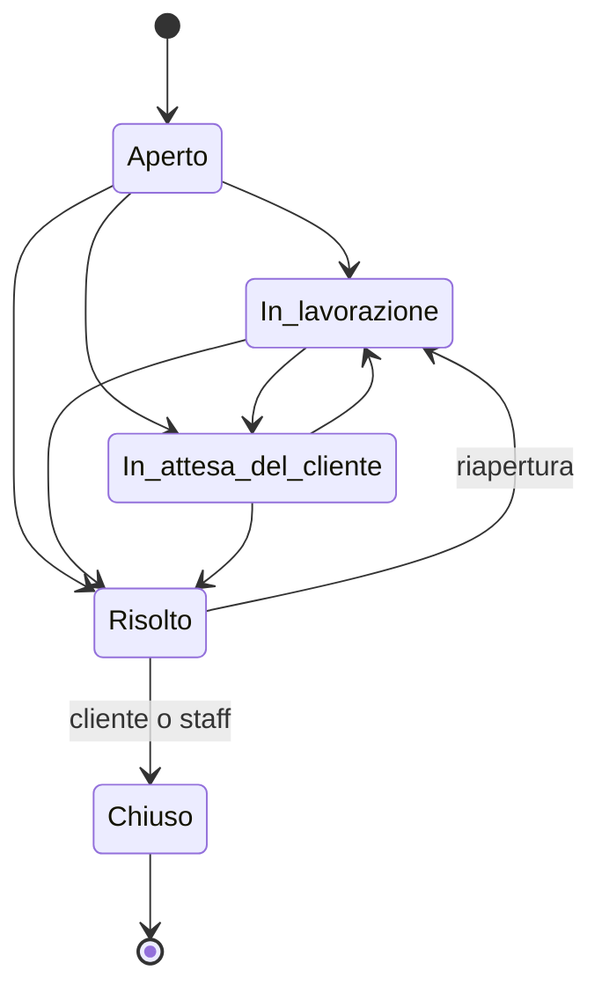

# Brief — Portale

## Concept

Un'area riservata unica per un fornitore di servizi e i suoi clienti. Il cliente trova in un posto solo lo stato dei progetti, i documenti, l'assistenza e le fatture; il fornitore lavora i ticket con tempi di risposta misurati e controlla chi accede a cosa.

Principi:

- **ogni ruolo vede solo ciò che gli serve:** navigazione, pagine e pulsanti cambiano con i permessi;
- **lo stato è sempre leggibile:** badge con icona e testo per ticket, priorità, SLA, progetti, fatture e utenti;
- **ogni azione rilevante lascia traccia** nel registro attività, con IP anonimizzato;
- **sicuro per impostazione predefinita:** verifica in due passaggi obbligatoria, blocco dopo troppi tentativi, uscita per inattività, nessuna indicizzazione.

## Pubblico e obiettivi

| Utente                 | Obiettivo principale                                            | Pagine chiave                         |
| ---------------------- | --------------------------------------------------------------- | ------------------------------------- |
| Amministratore cliente | Sapere a che punto è il lavoro, pagare, gestire il proprio team | Panoramica, Progetti, Fatture, Team   |
| Membro                 | Chiedere assistenza, condividere materiali                      | Assistenza, Documenti                 |
| Sola lettura           | Consultare senza modificare                                     | Progetti, Documenti, Assistenza       |
| Supporto               | Rispondere in tempo, non perdere ticket                         | Ticket (coda), dettaglio del ticket   |
| Amministratore         | Qualità del servizio, clienti, utenti e sicurezza               | Panoramica, Clienti, Utenti, Registro |

## Mappa delle pagine

| Rotta                      | Contenuto                                              | Permesso          |
| -------------------------- | ------------------------------------------------------ | ----------------- |
| `/`                        | Accesso: email e password, poi codice                  | pubblico          |
| `/privacy`                 | Informativa                                            | pubblico          |
| `/portale`                 | Panoramica del cliente                                 | `portal.access`   |
| `/portale/progetti`        | Progetti e milestone                                   | `projects.view`   |
| `/portale/documenti`       | Documenti per cartella, caricamento                    | `documents.view`  |
| `/portale/assistenza`      | Ticket dell'azienda, nuovo ticket                      | `tickets.view`    |
| `/portale/assistenza/[id]` | Conversazione e risposta                               | `tickets.view`    |
| `/portale/fatture`         | Fatture e importi da pagare                            | `invoices.view`   |
| `/portale/team`            | Utenti dell'azienda, inviti                            | `team.view`       |
| `/portale/sicurezza`       | Verifica in due passaggi, accessi recenti              | `portal.access`   |
| `/admin`                   | Indicatori, grafico, coda urgente, progetti da seguire | `admin.access`    |
| `/admin/ticket`, `/[id]`   | Coda e dettaglio con note interne                      | `tickets.manage`  |
| `/admin/clienti`           | Clienti e scheda                                       | `clients.manage`  |
| `/admin/utenti`            | Tutti gli utenti                                       | `users.manage`    |
| `/admin/ruoli`             | Matrice dei permessi                                   | `users.manage`    |
| `/admin/registro`          | Registro attività, esportazione CSV                    | `audit.view`      |
| `/admin/impostazioni`      | Fornitore, SLA, sicurezza, dati demo                   | `settings.manage` |

Un utente che apre una pagina fuori dal proprio ruolo vede "Accesso non consentito" con il link alla propria area; senza sessione torna all'accesso.

## Flussi principali

### Accesso

1. Email e password → se l'account è invitato o sconosciuto: "Email o password non corrette" (nessun indizio su quali email esistono); se è disattivato o l'azienda è sospesa: messaggio dedicato.
2. Codice a 6 cifre (spazi ammessi). Ogni errore viene registrato; al quinto il codice è bloccato per 15 minuti.
3. Accesso completato → registro "Accesso" e arrivo su `/portale` o `/admin` in base al ruolo.
4. Dopo il tempo di inattività impostato (30 minuti in demo) la sessione si chiude con il messaggio "Sessione scaduta". L'uscita vale per tutte le schede.

### Ticket

- Il cliente apre il ticket con oggetto, tipo, priorità e descrizione; può rispondere finché non è chiuso e, quando è risolto, chiuderlo o riaprirlo.
- Lo staff assegna, cambia stato, risponde o scrive **note interne** che il cliente non riceve mai.
- **SLA di prima risposta** per priorità (in demo: urgente 4 h, alta 8 h, normale 24 h, bassa 48 h). Stati: nei tempi, a rischio (ultimo quarto del tempo), superato, risposta nei tempi.
- La coda admin mette prima i ticket aperti con SLA superato, poi a rischio, poi per priorità e anzianità.

### Team

- L'amministratore cliente invita (nome, email, ruolo tra i tre ruoli cliente), cambia permessi, disattiva o riattiva, azzera la verifica in due passaggi.
- Non può modificare sé stesso né utenti dello staff; deve restare almeno un amministratore attivo per azienda.
- L'amministratore del fornitore fa lo stesso per tutte le aziende e può creare utenti staff.

## Contenuti demo

- Fornitore: _Orbita Digital_; 4 persone dello staff.
- 6 aziende clienti con piani Base, Pro, Enterprise; _Ferri Arredamenti_ è l'azienda degli account demo.
- Progetti con milestone (uno a rischio con una milestone in ritardo), documenti in 4 cartelle.
- Ticket degli ultimi 60 giorni, più alcuni di oggi; fatture mensili degli ultimi 10 mesi, una scaduta.
- Registro attività degli ultimi 30 giorni.

Tutti i dati sono generati in modo deterministico rispetto alla data di oggi (`src/lib/demo/seed.ts`).
