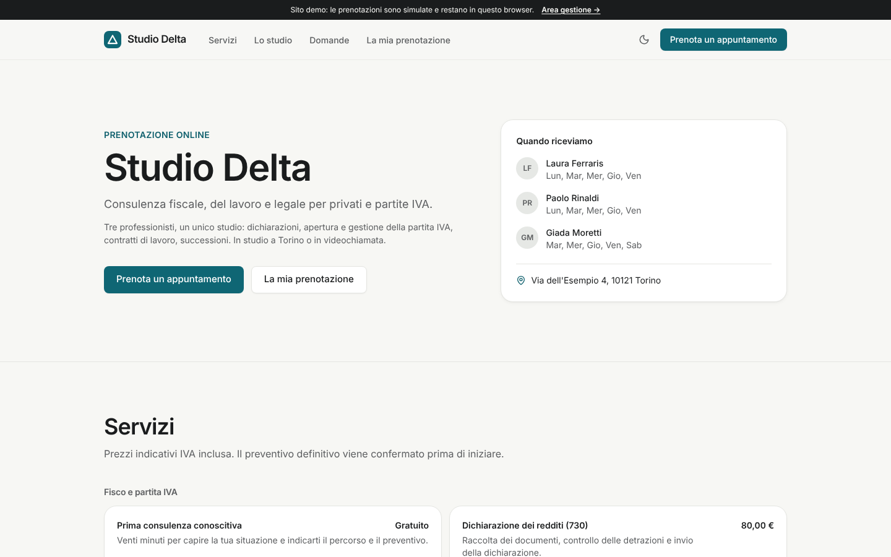
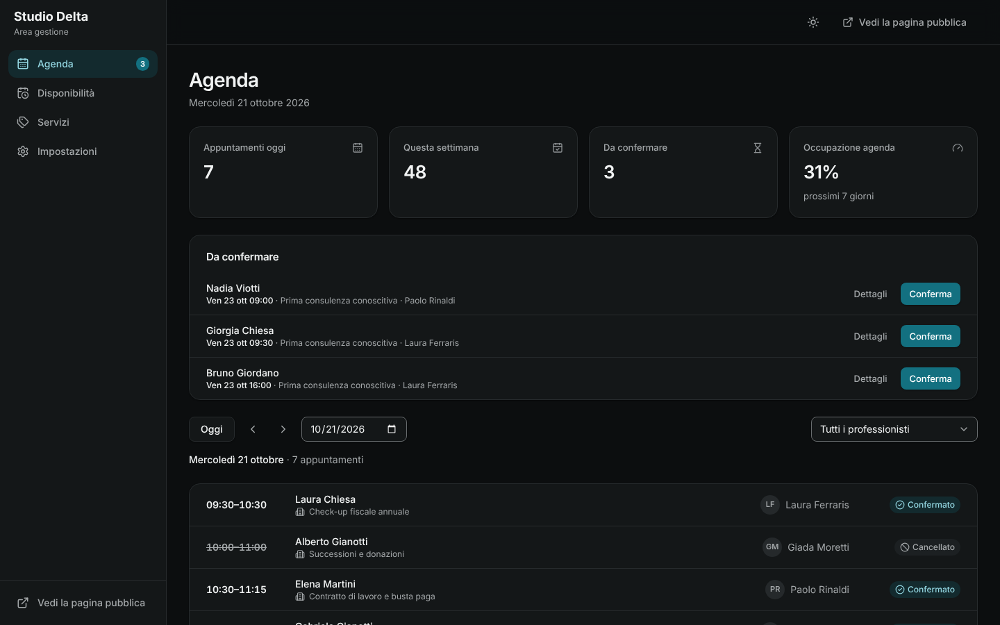
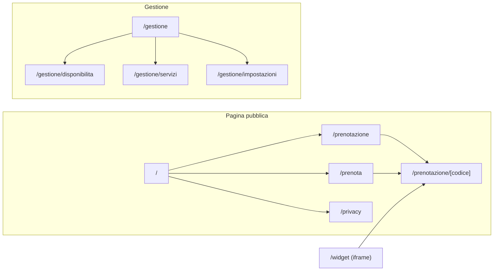

# Agenda — prenotazioni online per studi e professionisti

Template per **studi professionali e attività su appuntamento** (commercialisti, consulenti, avvocati, studi medici e di benessere, saloni, agenzie) con tre parti collegate:

- **pagina pubblica** con servizi, professionisti e domande frequenti;
- **prenotazione online** in quattro passi, anche come **widget** da incorporare in un altro sito;
- **area gestione** per lo studio: agenda del giorno, richieste da confermare, orari, assenze, servizi e regole.

Il cliente può spostare o cancellare da solo l'appuntamento con il codice ricevuto. Accessibile (WCAG 2.2 AA), responsive e pronto per il deploy su Vercel.



<table>
  <tr>
    <td></td>
    <td></td>
  </tr>
</table>

> **Demo pubblica:** dopo il primo deploy su Vercel inserisci qui il link della preview, es. `https://agenda-prenotazioni.vercel.app`.

---

## Indice

1. [Concept e pubblico](#concept-e-pubblico)
2. [Funzionalità](#funzionalità)
3. [Pagine e navigazione](#pagine-e-navigazione)
4. [Stack tecnico](#stack-tecnico)
5. [Avvio rapido](#avvio-rapido)
6. [Script](#script)
7. [Struttura del progetto](#struttura-del-progetto)
8. [Variabili d'ambiente](#variabili-dambiente)
9. [Deploy su Vercel](#deploy-su-vercel)
10. [Qualità, test e accessibilità](#qualità-test-e-accessibilità)
11. [Prima di andare in produzione](#prima-di-andare-in-produzione)
12. [Documentazione](#documentazione)

## Concept e pubblico

**Agenda** toglie allo studio le telefonate per fissare, spostare e disdire appuntamenti. I clienti vedono solo gli orari davvero liberi, calcolati da orari di lavoro, pause, assenze, appuntamenti già presi, tempo di preparazione tra un appuntamento e l'altro, anticipo minimo e orizzonte di prenotazione.

- **Cliente:** sceglie servizio, professionista (o "primo disponibile") e modalità (in studio o videochiamata), prenota in meno di un minuto, aggiunge l'appuntamento al calendario, lo sposta o lo cancella dal link ricevuto.
- **Segreteria e professionisti:** vedono l'agenda del giorno per persona, confermano o rifiutano le richieste, segnano i conclusi e i non presentati, aggiornano orari e assenze.
- **Titolare:** decide cosa si prenota online, a che prezzo e con quali regole; incorpora il widget nel sito esistente.

La demo usa uno studio inventato di Torino, _Studio Delta_, con:

- 3 professionisti (commercialista, consulente del lavoro, avvocata) con orari e pause diversi;
- 8 servizi in 3 categorie, uno gratuito che richiede la conferma dello studio;
- circa 350 appuntamenti su due mesi (passati, di oggi e futuri) e un'assenza programmata.

## Funzionalità

| Area                    | Cosa offre                                                                                                                                                                               |
| ----------------------- | ---------------------------------------------------------------------------------------------------------------------------------------------------------------------------------------- |
| **Home**                | Presentazione dello studio, giorni di ricevimento, servizi per categoria con durata, modalità e prezzo, team, FAQ; dati strutturati `schema.org/ProfessionalService` con `ReserveAction` |
| **Prenotazione**        | Servizio → professionista e modalità → giorno e orario → dati; riepilogo sempre visibile, controllo della disponibilità al momento della conferma, consensi separati                     |
| **Calendario**          | Mese con i soli giorni prenotabili evidenziati, orari del giorno come gruppo di scelte, "primo disponibile" che assegna il professionista meno carico                                    |
| **Conferma**            | Codice `AG-XXXXXX`, file `.ics` per Google, Apple e Outlook, link alla gestione; per i servizi su approvazione lo stato è "Da confermare"                                                |
| **La mia prenotazione** | Ricerca per codice, dettaglio, spostamento con lo stesso calendario, cancellazione con conferma, cronologia; blocco online entro il limite di ore impostato                              |
| **Widget**              | Pagina `/widget` senza intestazione da mettere in un `iframe`, incorporabile solo dai domini autorizzati                                                                                 |
| **Agenda** (pannello)   | Appuntamenti di oggi e della settimana, richieste da confermare, occupazione dei prossimi 7 giorni; giorno per giorno con filtro per professionista e scheda di ogni appuntamento        |
| **Disponibilità**       | Orario settimanale di ogni professionista con più fasce al giorno (pause), validazione delle sovrapposizioni; assenze e chiusure dello studio con avviso sugli appuntamenti coinvolti    |
| **Servizi**             | Durata, pausa dopo, prezzo (o gratuito), modalità, professionisti abilitati, conferma dello studio; attivazione e disattivazione della prenotazione online                               |
| **Impostazioni**        | Dati dello studio, passo degli orari, anticipo minimo, orizzonte, limite per spostare o cancellare, "primo disponibile", codice del widget, ripristino dei dati demo                     |

## Pagine e navigazione



| Schermo               | Pagina pubblica e prenotazione                         | Pannello                                |
| --------------------- | ------------------------------------------------------ | --------------------------------------- |
| Desktop (≥ 1024 px)   | Barra superiore; prenotazione con riepilogo laterale   | Sidebar con contatore delle richieste   |
| Tablet (768–1023 px)  | Barra superiore; riepilogo sotto i passi               | Sidebar                                 |
| Smartphone (< 768 px) | Menu a scomparsa; calendario e orari uno sotto l'altro | Barra inferiore a 4 voci e menu "Altro" |

Il brief completo è in [docs/brief.md](docs/brief.md).

## Stack tecnico

| Ambito                 | Scelta                                                                                       | Perché                                                                   |
| ---------------------- | -------------------------------------------------------------------------------------------- | ------------------------------------------------------------------------ |
| Framework              | [Next.js 16](https://nextjs.org) (App Router, Cache Components, Turbopack)                   | Pagina pubblica prerenderizzata, intestazioni di sicurezza per rotta     |
| UI                     | React 19, TypeScript (strict)                                                                | Tipi su tutto il dominio                                                 |
| Stile                  | Tailwind CSS 4 con design token; Inter                                                       | Tema chiaro/scuro e branding da un unico file                            |
| Componenti accessibili | [Radix UI](https://www.radix-ui.com)                                                         | Focus, tastiera e ARIA corretti                                          |
| Stato                  | [Zustand](https://zustand.docs.pmnd.rs) con salvataggio locale e sincronizzazione tra schede | Pagina pubblica, widget e pannello condividono i dati                    |
| Validazione            | [Zod 4](https://zod.dev)                                                                     | Stessi schemi riutilizzabili lato server                                 |
| Qualità                | ESLint (Next + jsx-a11y), Prettier, Vitest, Playwright + axe-core                            | Formattazione, analisi statica, test unitari, end-to-end e accessibilità |

## Avvio rapido

Requisiti: **Node.js 22** (vedi `.nvmrc`) e npm.

```bash
cd templates/prenotazioni
npm ci
cp .env.example .env.local   # facoltativo
npm run dev
```

- Pagina pubblica: <http://localhost:3000>.
- Prenotazione: <http://localhost:3000/prenota>; widget: <http://localhost:3000/widget>.
- Pannello: <http://localhost:3000/gestione>.

I dati demo restano **solo nel browser** e si ripristinano da _Impostazioni → Dati demo_.

## Script

| Comando                           | Descrizione                                                                                                                          |
| --------------------------------- | ------------------------------------------------------------------------------------------------------------------------------------ |
| `npm run dev`                     | Server di sviluppo                                                                                                                   |
| `npm run build` / `start`         | Build di produzione e avvio                                                                                                          |
| `npm run lint` / `lint:fix`       | ESLint (regole Next.js, React Hooks e accessibilità jsx-a11y)                                                                        |
| `npm run typecheck`               | Genera i tipi delle rotte e controlla TypeScript                                                                                     |
| `npm run format` / `format:check` | Prettier (con ordinamento delle classi Tailwind)                                                                                     |
| `npm test`                        | Test unitari della logica di dominio (Vitest)                                                                                        |
| `npm run test:e2e`                | Test end-to-end e di accessibilità su desktop e mobile. Esegui prima `npm run build`; al primo uso `npx playwright install chromium` |
| `npm run check`                   | Tutti i controlli in sequenza, come in CI                                                                                            |

## Struttura del progetto

```text
src/
├── app/
│   ├── (sito)/                # Home, prenota, la mia prenotazione (+ [codice]), privacy
│   ├── widget/                # Prenotazione da incorporare (intestazioni di sicurezza dedicate)
│   ├── gestione/              # Agenda, disponibilità, servizi, impostazioni
│   └── globals.css, layout.tsx, manifest.ts, robots.ts, sitemap.ts, icon.svg
├── components/
│   ├── ui/                    # Libreria di componenti condivisa con gli altri template
│   ├── site/, panel/          # Strutture della pagina pubblica e del pannello
│   └── status-badge.tsx       # Stato dell'appuntamento (icona + testo)
├── features/
│   ├── site/                  # Home, prenotazione a passi, calendario degli orari, gestione del cliente
│   └── panel/                 # Agenda, scheda appuntamento, disponibilità, servizi, impostazioni
├── lib/
│   ├── domain/
│   │   ├── availability.ts    # Orari liberi, primo disponibile, occupazione, regole di modifica
│   │   └── dates.ts, schemas.ts, types.ts
│   ├── demo/seed.ts           # Dati demo deterministici, generati con le stesse regole
│   └── ics.ts, seo.ts, format.ts
├── store/                     # Dati (persistiti e sincronizzati) e stato dell'interfaccia
└── content/it.ts              # Tutti i testi dell'interfaccia
tests/unit, tests/e2e
```

## Variabili d'ambiente

Tutte facoltative; riferimento in [`.env.example`](.env.example). Nessun segreto va mai nel repository.

| Variabile                    | Predefinito                                            | Uso                                                                           |
| ---------------------------- | ------------------------------------------------------ | ----------------------------------------------------------------------------- |
| `NEXT_PUBLIC_SITE_URL`       | dominio di produzione Vercel o `http://localhost:3000` | URL assoluti, sitemap, dati strutturati, codice del widget                    |
| `NEXT_PUBLIC_DEMO_MODE`      | `true`                                                 | Banner demo e ripristino dei dati                                             |
| `NEXT_PUBLIC_ALLOW_INDEXING` | `false`                                                | Indicizzazione della pagina pubblica (pannello, widget e prenotazioni mai)    |
| `WIDGET_FRAME_ANCESTORS`     | vuota = solo lo stesso dominio                         | Domini che possono incorporare `/widget`, separati da spazi. Letta alla build |

## Deploy su Vercel

1. Su [vercel.com/new](https://vercel.com/new) importa il repository.
2. In **Root Directory** seleziona `templates/prenotazioni`.
3. Se il widget va incorporato in un altro sito, aggiungi `WIDGET_FRAME_ANCESTORS` (es. `https://www.studiodelta.it`).
4. `vercel.json` imposta `npm ci`, `npm run build`, regione `fra1` e `ignoreCommand`. Premi **Deploy**.

Ogni pull request genera una **preview**; il branch di produzione aggiorna la demo definitiva.

[](https://vercel.com/new/clone?repository-url=https%3A%2F%2Fgithub.com%2Fmykytakarpenko-debug%2Fidee&root-directory=templates%2Fprenotazioni&project-name=agenda-prenotazioni&repository-name=agenda-prenotazioni)

La procedura di rilascio è in [`docs/rilascio.md`](../../docs/rilascio.md).

## Qualità, test e accessibilità

- **66 test unitari:**
  - orari di lavoro, pause, assenze e chiusure;
  - orari liberi con passo, durata, pausa dopo (del servizio prenotato e di quelli già in agenda), anticipo minimo e orizzonte;
  - primo disponibile, giorni prenotabili, occupazione, validazione delle fasce, conflitti con le assenze;
  - regole per spostare e cancellare, codice di prenotazione;
  - coerenza dei dati demo (nessuna sovrapposizione, stati coerenti con il tempo), schemi dei moduli, `.ics` e JSON-LD.
- **Test end-to-end su desktop e mobile:**
  - navigazione, 404, SEO, `noindex`, intestazioni che permettono l'`iframe` solo al widget;
  - prenotazione completa con validazione, spostamento e cancellazione dal codice;
  - un orario prenotato non viene più proposto;
  - richiesta su approvazione confermata o rifiutata dal pannello;
  - prenotazione dal widget visibile nell'agenda;
  - assenza che blocca i giorni, validazione degli orari, servizi disattivati o nuovi, regola "primo disponibile", ripristino dei dati.
- **Accessibilità:** axe-core con le regole WCAG 2.2 AA su tutte le pagine, sui passi della prenotazione (anche con errori), sulla scheda appuntamento e sul modulo servizio, in tema chiaro e scuro; navigazione da tastiera e `prefers-reduced-motion`.
- **CI GitHub Actions** a ogni push e pull request.

## Prima di andare in produzione

- [ ] **Autenticazione** per il pannello, con ruoli (segreteria, professionista, titolare): vedi [docs/architettura.md](docs/architettura.md#collegare-un-backend).
- [ ] **Database e API** al posto dello store locale. Ricalcola **lato server** la disponibilità alla conferma, con un vincolo che impedisca due appuntamenti sovrapposti per la stessa persona.
- [ ] **Codici e link sicuri:** in produzione il link di gestione deve contenere un token lungo e casuale, non solo il codice di 6 caratteri.
- [ ] **Email e promemoria** (conferma, richiesta ricevuta, approvazione, spostamento, promemoria il giorno prima) e, se serve, sincronizzazione con Google Calendar o Outlook.
- [ ] **Videochiamate:** genera il link della riunione alla conferma (es. Google Meet, Teams, Zoom).
- [ ] **Pagamenti o caparre** solo se necessari, con un PSP (es. Stripe), e condizioni di cancellazione chiare.
- [ ] **Verifiche legali e deontologiche** del settore (segreto professionale, dati sanitari se studio medico). Vedi [docs/sicurezza-privacy.md](docs/sicurezza-privacy.md).
- [ ] Imposta `NEXT_PUBLIC_DEMO_MODE=false`, `WIDGET_FRAME_ANCESTORS` e completa [`docs/rilascio.md`](../../docs/rilascio.md).

## Documentazione

| Documento                                              | Contenuto                                                                                        |
| ------------------------------------------------------ | ------------------------------------------------------------------------------------------------ |
| [docs/brief.md](docs/brief.md)                         | Concept, pubblico, pagine, flussi e regole di disponibilità                                      |
| [docs/design-system.md](docs/design-system.md)         | Palette petrolio e contrasti, tipografia, calendario e componenti specifici, stati               |
| [docs/architettura.md](docs/architettura.md)           | Calcolo della disponibilità, store condiviso, widget, collegamento a un backend                  |
| [docs/personalizzazione.md](docs/personalizzazione.md) | Studio, servizi, orari, regole, testi, adattamento a studi medici, saloni, consulenze            |
| [docs/sicurezza-privacy.md](docs/sicurezza-privacy.md) | Sicurezza, `iframe` e CSP, GDPR e consensi, dati sanitari, tutela del consumatore, accessibilità |

## Licenza

[MIT](LICENSE). Lo studio, le persone e i dati demo sono interamente inventati.
