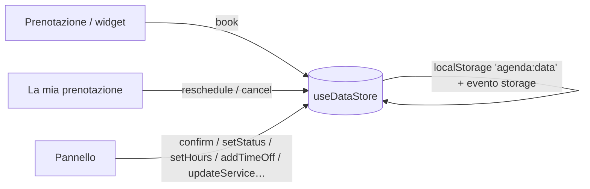

# Architettura — Agenda

## Panoramica

Un'unica app Next.js 16 con tre ingressi sugli stessi dati:

| Area            | Cartella        | Rendering                                                                  | Indicizzazione                                   |
| --------------- | --------------- | -------------------------------------------------------------------------- | ------------------------------------------------ |
| Pagina pubblica | `app/(sito)/`   | Prerenderizzata; servizi, team e dati dello studio nell'HTML               | Solo su richiesta (`NEXT_PUBLIC_ALLOW_INDEXING`) |
| Widget          | `app/widget/`   | Statico, senza intestazione; CSP che permette l'`iframe` dai domini scelti | Mai                                              |
| Pannello        | `app/gestione/` | Guscio statico con sidebar, dati nel browser                               | Mai                                              |

La pagina di gestione della prenotazione (`/prenotazione/[codice]`) legge il codice in un componente dentro `<Suspense>` (rotta parzialmente prerenderizzata) e non è indicizzata.



Il widget aperto in un'altra scheda e l'agenda dello studio si aggiornano a vicenda grazie all'evento `storage`.

## Disponibilità (`lib/domain/availability.ts`)

Funzioni pure, senza React, coperte da test unitari. Sono le stesse da eseguire sul server.

| Funzione               | Responsabilità                                                                                                |
| ---------------------- | ------------------------------------------------------------------------------------------------------------- |
| `workingIntervals`     | Fasce di lavoro di una persona in una data, vuote se assente o studio chiuso                                  |
| `staffSlots`           | Orari di inizio liberi: passo, durata, pausa dopo, appuntamenti attivi con la loro pausa, anticipo, orizzonte |
| `availableSlots`       | Unione per il "primo disponibile" (ogni orario porta l'elenco dei professionisti liberi)                      |
| `pickStaff`            | Assegna il professionista meno carico quel giorno                                                             |
| `availableDays`        | Giorni da evidenziare nel calendario                                                                          |
| `occupancy`            | Minuti prenotati / minuti di apertura nei prossimi giorni                                                     |
| `rangesValid`          | Fasce orarie che finiscono dopo l'inizio e non si sovrappongono                                               |
| `conflictsWithTimeOff` | Appuntamenti attivi che cadono in una nuova assenza                                                           |
| `manageability`        | Se il cliente può ancora spostare o cancellare, e perché no                                                   |

Tutto il calcolo usa l'ora locale del browser, che in demo coincide con quella dello studio. In produzione fissa il fuso dello studio (es. `Europe/Rome`) sul server e mostra al cliente un avviso se il suo fuso è diverso.

### Dati demo coerenti

`lib/demo/seed.ts` genera gli appuntamenti giorno per giorno **chiamando `availableSlots`**: la demo rispetta le stesse regole della prenotazione online, quindi non ci sono sovrapposizioni (un test lo verifica, pause comprese). Il generatore è deterministico (stesso seme, stessa data → stessi dati).

## Flusso dei dati in demo

1. `DataBootstrap` (in tutti i layout) reidrata lo store o genera i dati con l'ora corrente.
2. `book` ricontrolla la disponibilità al momento della conferma: se l'orario non è più libero restituisce `slot_taken` e il cliente torna al calendario.
3. Le azioni aggiornano lo stato in modo immutabile; il salvataggio è differito (150 ms) e forzato alla chiusura della pagina.
4. I dati demo non scorrono con il tempo: tornando dopo qualche settimana, usa _Impostazioni → Ripristina dati demo_.

### Next.js 16: note pratiche

- Nessuna lettura di `new Date()` durante il rendering: `useNow()` restituisce `null` sul server e l'ora reale nel browser.
- I selettori dello store non creano array nuovi (`filter`/`map` si fanno fuori dal selettore, con `useMemo`).
- Intestazioni per rotta in `next.config.ts`: tutte le pagine con `frame-ancestors 'none'` e `X-Frame-Options: DENY`, il solo `/widget` con `frame-ancestors` preso da `WIDGET_FRAME_ANCESTORS` (valutato alla build).

## Il widget

Il codice proposto in _Impostazioni_ è un `iframe` verso `/widget`:

```html
<iframe
  src="https://prenota.studiodelta.it/widget"
  title="Prenota con Studio Delta"
  style="width:100%;min-height:760px;border:0"
  loading="lazy"
></iframe>
```

1. Imposta `WIDGET_FRAME_ANCESTORS="https://www.studiodelta.it"` (più domini separati da spazi) e ripeti la build.
2. Le prenotazioni dal widget hanno origine `widget`, visibile nella scheda dell'appuntamento: utile per capire da dove arrivano i clienti.
3. L'altezza è fissa (`min-height`). Per adattarla al contenuto puoi aggiungere al widget un `postMessage` con la propria altezza e uno script nel sito ospite che la applica, verificando sempre `event.origin`.

## Collegare un backend

1. **Database** in UE (Postgres) con tabelle per studio, categorie, servizi, professionisti, orari, assenze, clienti, appuntamenti e cronologia.
2. **Prenotazioni concorrenti:** riesegui `availableSlots` lato server dentro una transazione e aggiungi un vincolo che impedisca la sovrapposizione per la stessa persona (in Postgres: `EXCLUDE USING gist (staff_id WITH =, tstzrange(start, end_with_buffer) WITH &&) WHERE (status IN ('pending','confirmed'))`).
3. **Link di gestione sicuri:** il codice `AG-XXXXXX` serve a dettarlo al telefono; il link nell'email deve contenere un **token casuale lungo** (es. 128 bit) salvato come hash, con scadenza dopo l'appuntamento. Limita i tentativi sulla ricerca per codice (rate limiting e, se serve, verifica dell'email).
4. **Autenticazione dello staff** con ruoli: segreteria (agenda e richieste), professionista (la propria agenda e i propri orari), titolare (servizi, regole, widget). Proteggi `/gestione` con `proxy.ts` e controlla i permessi in ogni Server Action.
5. **Notifiche:** email di conferma o richiesta ricevuta, approvazione o rifiuto, spostamento e cancellazione, promemoria 24 ore prima (job pianificato, es. Vercel Cron). Allegato `.ics` già pronto in `lib/ics.ts`.
6. **Calendari esterni:** sincronizzazione bidirezionale con Google Calendar o Microsoft 365 per bloccare anche gli impegni personali dei professionisti (le assenze diventano eventi "occupato").
7. **Videochiamate:** alla conferma di un appuntamento online genera il link della riunione e inseriscilo nell'email e nel file `.ics`.
8. **Pagamenti o caparre** (facoltativi): sessione di pagamento prima della conferma, rimborso automatico se la cancellazione rientra nei termini.
