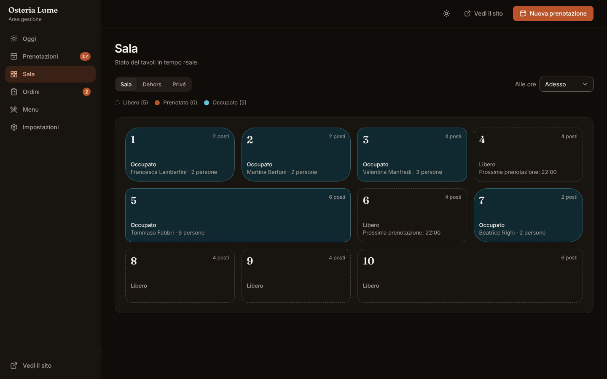
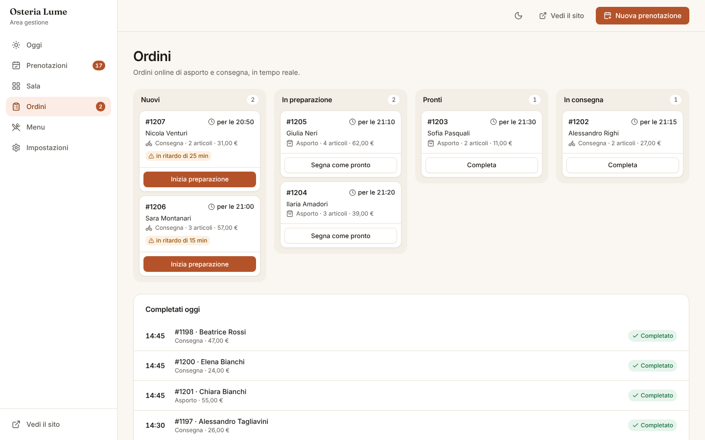
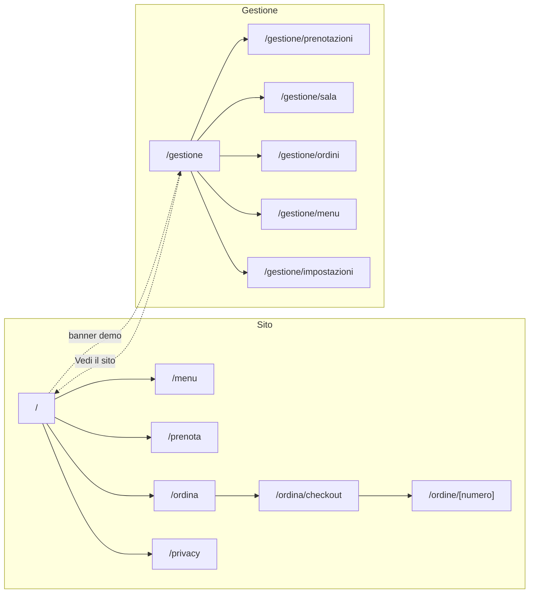

# Tavola — sito e gestione per ristoranti

Template per **ristoranti, osterie, pizzerie e bar** con sito pubblico (menu con allergeni, prenotazione tavoli, ordini d'asporto e consegna, tracking dell'ordine) e **pannello di gestione** per sala e cucina (prenotazioni, mappa dei tavoli, ordini in tempo reale, menu e impostazioni). Accessibile (WCAG 2.2 AA), responsive e pronto per il deploy su Vercel.


<table>
  <tr>
    <td></td>
    <td></td>
  </tr>
</table>

> **Demo pubblica:** dopo il primo deploy su Vercel inserisci qui il link della preview, es. `https://tavola-ristorante.vercel.app`.

---

## Indice

1. [Concept e pubblico](#concept-e-pubblico)
2. [Funzionalità](#funzionalità)
3. [Pagine e navigazione](#pagine-e-navigazione)
4. [Stack tecnico](#stack-tecnico)
5. [Avvio rapido](#avvio-rapido)
6. [Script](#script)
7. [Struttura del progetto](#struttura-del-progetto)
8. [Variabili d'ambiente](#variabili-dambiente)
9. [Deploy su Vercel](#deploy-su-vercel)
10. [Qualità, test e accessibilità](#qualità-test-e-accessibilità)
11. [Prima di andare in produzione](#prima-di-andare-in-produzione)
12. [Documentazione](#documentazione)

## Concept e pubblico

**Tavola** collega in un unico prodotto ciò che il cliente vede e ciò che lo staff gestisce: una prenotazione fatta dal sito compare subito nel pannello, un ordine avanzato dalla cucina aggiorna la pagina di tracking del cliente.

- **Clienti del locale:** consultano il menu (anche filtrando per dieta e allergeni), prenotano in meno di un minuto da smartphone, ordinano d'asporto o a domicilio.
- **Titolare e staff:** al banco o in sala su tablet, in cucina su uno schermo: vedono arrivi, tavoli, ordini da preparare e possono segnare un piatto come esaurito con un tocco.

La demo usa un'osteria fittizia di Bologna, _Osteria Lume_: 6 categorie e 30 piatti, 15 tavoli in tre zone, cinque settimane di prenotazioni e ordini generati rispetto alla data di oggi.

## Funzionalità

| Area                | Cosa offre                                                                                                                                                                                         |
| ------------------- | -------------------------------------------------------------------------------------------------------------------------------------------------------------------------------------------------- |
| **Home**            | Stato "aperto ora / apre alle…", orari di pranzo e cena, punti di forza, piatti in evidenza, dove siamo, inviti a prenotare e ordinare; dati strutturati `schema.org/Restaurant` per la ricerca    |
| **Menu**            | Categorie con indice, prezzi, diete (vegetariano, vegano, piccante), **14 allergeni UE** per piatto, filtri per dieta, "senza glutine" ed esclusione allergeni, piatti esauriti, ricerca           |
| **Prenota**         | Persone, giorno, orari per servizio calcolati su **tavoli realmente liberi**, anticipo minimo e ultimo arrivo; dati e consensi separati; conferma con codice e file **.ics** per il calendario     |
| **Ordina**          | Menu ordinabile, carrello persistente, asporto o consegna, ordine minimo e consegna gratuita oltre soglia, CAP serviti, "prima possibile" o orario scelto, pagamento alla consegna o online (demo) |
| **Tracking**        | Pagina dell'ordine con stato che si aggiorna da solo quando la cucina lo avanza                                                                                                                    |
| **Oggi** (pannello) | Coperti previsti per servizio, prenotazioni da confermare, ordini in corso, incasso ordini, prossimi arrivi con "Fai accomodare", grafico dei coperti a 14 giorni                                  |
| **Prenotazioni**    | Giorno per giorno, filtro per servizio e stato, ricerca per nome/telefono/codice, assegnazione del tavolo solo tra quelli liberi, cambi di stato con annullamento                                  |
| **Sala**            | Mappa dei tavoli per zona (sala, dehors, privé) a un orario scelto: liberi, prenotati, occupati; clienti senza prenotazione, liberazione del tavolo, nuova prenotazione sul tavolo                 |
| **Ordini**          | Bacheca per stato (nuovi, in preparazione, pronti, in consegna) con orario di avvio della cucina e ritardi evidenziati; completati del giorno; dettaglio e annullamento con conferma               |
| **Menu** (pannello) | Piatti per categoria, disponibilità del giorno con un interruttore, creazione e modifica con allergeni e caratteristiche, eliminazione con conferma                                                |
| **Impostazioni**    | Dati del locale, servizi di pranzo e cena per ogni giorno, regole delle prenotazioni, asporto e consegna (minimo, costi, tempi, CAP), ripristino dei dati demo                                     |
| **Trasversali**     | Tema chiaro/scuro, sincronizzazione tra schede aperte, toast con annullamento, scheletri di caricamento, 404 ed error boundary, PWA installabile sul tablet di sala                                |

## Pagine e navigazione



| Schermo               | Sito pubblico                                                  | Pannello                                                            |
| --------------------- | -------------------------------------------------------------- | ------------------------------------------------------------------- |
| Desktop (≥ 1024 px)   | Barra superiore con menu, carrello, tema e "Prenota un tavolo" | Sidebar con contatori (da confermare, nuovi ordini) e barra in alto |
| Tablet (768–1023 px)  | Come desktop; carrello sotto il menu                           | Sidebar; la bacheca ordini va in colonna                            |
| Smartphone (< 768 px) | Menu a scomparsa, barra fissa "Vedi ordine" con totale         | Barra inferiore (Oggi, Prenotazioni, Sala, Ordini, Altro)           |

Il brief completo, con flussi e criteri, è in [docs/brief.md](docs/brief.md).

## Stack tecnico

| Ambito                 | Scelta                                                                                       | Perché                                                                      |
| ---------------------- | -------------------------------------------------------------------------------------------- | --------------------------------------------------------------------------- |
| Framework              | [Next.js 16](https://nextjs.org) (App Router, Cache Components, Turbopack)                   | Sito prerenderizzato (menu nell'HTML per la SEO), deploy nativo su Vercel   |
| UI                     | React 19, TypeScript (strict)                                                                | Tipi su tutto il dominio                                                    |
| Stile                  | Tailwind CSS 4 con design token in CSS; Inter + Fraunces (titoli)                            | Tema chiaro/scuro e branding da un unico file                               |
| Componenti accessibili | [Radix UI](https://www.radix-ui.com) (dialog, menu, popover, toggle group, switch, toast)    | Focus, tastiera e ARIA corretti                                             |
| Stato                  | [Zustand](https://zustand.docs.pmnd.rs) con salvataggio locale e sincronizzazione tra schede | Sito e pannello condividono i dati; azioni con firme pronte per un backend  |
| Validazione            | [Zod 4](https://zod.dev)                                                                     | Stessi schemi riutilizzabili lato server                                    |
| Date e icone           | date-fns (italiano), lucide-react                                                            | Leggere e affidabili                                                        |
| Qualità                | ESLint (Next + jsx-a11y), Prettier, Vitest, Playwright + axe-core                            | Formattazione, analisi statica, test unitari, end-to-end e di accessibilità |

## Avvio rapido

Requisiti: **Node.js 22** (vedi `.nvmrc`) e npm.

```bash
cd templates/ristorante
npm ci
cp .env.example .env.local   # facoltativo: i valori predefiniti vanno già bene
npm run dev
```

Apri <http://localhost:3000> per il sito e <http://localhost:3000/gestione> per il pannello. Prova il giro completo: prenota un tavolo o invia un ordine dal sito, poi apri il pannello in un'altra scheda. I dati demo restano **solo nel browser**; puoi ripristinarli da _Impostazioni → Dati demo_.

## Script

| Comando                           | Descrizione                                                                                                                          |
| --------------------------------- | ------------------------------------------------------------------------------------------------------------------------------------ |
| `npm run dev`                     | Server di sviluppo                                                                                                                   |
| `npm run build`                   | Build di produzione (include il controllo dei tipi)                                                                                  |
| `npm run start`                   | Avvia la build di produzione                                                                                                         |
| `npm run lint` / `lint:fix`       | ESLint (regole Next.js, React Hooks e accessibilità jsx-a11y)                                                                        |
| `npm run typecheck`               | Genera i tipi delle rotte e controlla TypeScript                                                                                     |
| `npm run format` / `format:check` | Prettier (con ordinamento delle classi Tailwind)                                                                                     |
| `npm test`                        | Test unitari della logica di dominio (Vitest)                                                                                        |
| `npm run test:e2e`                | Test end-to-end e di accessibilità su desktop e mobile. Esegui prima `npm run build`; al primo uso `npx playwright install chromium` |
| `npm run check`                   | Tutti i controlli in sequenza, come in CI                                                                                            |

## Struttura del progetto

```text
src/
├── app/
│   ├── (sito)/               # Sito pubblico: home, menu, prenota, ordina, checkout, tracking, privacy
│   ├── gestione/             # Pannello: oggi, prenotazioni, sala, ordini, menu, impostazioni
│   ├── globals.css           # Design token (terracotta, neutri caldi, movimento)
│   ├── layout.tsx            # Font, metadati, tema senza lampeggio
│   └── manifest.ts, robots.ts, sitemap.ts, icon.svg, apple-icon.png
├── components/
│   ├── ui/                   # Libreria di componenti condivisa con gli altri template
│   ├── site/                 # Header, footer, banner demo, sezioni del sito
│   ├── panel/                # Shell del pannello, contatori, modali globali
│   └── charts/, layout/, status-badges.tsx
├── features/
│   ├── site/                 # Viste del sito: menu, prenotazione, carrello, checkout, tracking
│   └── panel/                # Viste e modali del pannello
├── lib/
│   ├── domain/               # Tipi, schemi Zod e logica pura testata: orari, tavoli, ordini, filtri
│   ├── demo/                 # Generatore deterministico dei dati demo
│   ├── ics.ts, seo.ts        # Evento calendario e dati strutturati
│   └── format.ts, utils.ts, theme.ts
├── store/                    # Dati (persistiti e sincronizzati), carrello, UI
├── hooks/                    # useNow, useData, useSiteData, useZodForm
├── config/                   # Brand, rotte e navigazione, variabili d'ambiente
└── content/it.ts             # Tutti i testi dell'interfaccia
tests/
├── unit/                     # Vitest: orari, tavoli, ordini, filtri, schemi, dati demo, .ics, JSON-LD
└── e2e/                      # Playwright: navigazione, flussi sito ↔ pannello, accessibilità
```

## Variabili d'ambiente

Tutte facoltative; il file di riferimento è [`.env.example`](.env.example). Nessun segreto va mai nel repository.

| Variabile                    | Predefinito                                            | Uso                                                                                      |
| ---------------------------- | ------------------------------------------------------ | ---------------------------------------------------------------------------------------- |
| `NEXT_PUBLIC_SITE_URL`       | dominio di produzione Vercel o `http://localhost:3000` | URL assoluti, sitemap, dati strutturati                                                  |
| `NEXT_PUBLIC_DEMO_MODE`      | `true`                                                 | Banner demo con link al pannello                                                         |
| `NEXT_PUBLIC_ALLOW_INDEXING` | `false`                                                | Indicizzazione del sito pubblico. Il pannello e il tracking non sono **mai** indicizzati |

## Deploy su Vercel

1. Su [vercel.com/new](https://vercel.com/new) importa il repository GitHub.
2. In **Root Directory** seleziona `templates/ristorante` (framework rilevato: Next.js).
3. Lascia i comandi predefiniti: `vercel.json` imposta `npm ci`, `npm run build` e la regione `fra1` (Francoforte).
4. Aggiungi le variabili d'ambiente se vuoi cambiare i predefiniti, poi **Deploy**.

Ogni pull request genera una **preview** con URL dedicato; ogni push sul branch di produzione aggiorna la **produzione**; `ignoreCommand` salta le build quando il commit non tocca questa cartella.

[](https://vercel.com/new/clone?repository-url=https%3A%2F%2Fgithub.com%2Fmykytakarpenko-debug%2Fidee&root-directory=templates%2Fristorante&project-name=tavola-ristorante&repository-name=tavola-ristorante)

La procedura di rilascio (preview → verifica → produzione) è in [`docs/rilascio.md`](../../docs/rilascio.md).

## Qualità, test e accessibilità

- **56 test unitari** sulla logica di dominio: servizi e orari, assegnazione dei tavoli e disponibilità, totali del carrello e consegna, flusso degli stati e ritardi della cucina, filtri del menu, schemi dei moduli, coerenza dei dati demo, `.ics` e JSON-LD.
- **Test end-to-end** su desktop e mobile (Pixel 7): navigazione, 404, SEO, filtri, tema; prenotazione dal sito ritrovata nel pannello; ordine → cucina → tracking aggiornato in un'altra scheda; consegna fuori zona; piatto esaurito; clienti senza prenotazione; impostazioni che cambiano il sito.
- **Accessibilità automatica:** axe-core su tutte le pagine, sulla modale di prenotazione e sul tracking, in tema chiaro e scuro, con le regole **WCAG 2.2 AA**; verifica di `prefers-reduced-motion`.
- **CI GitHub Actions:** formattazione, lint, tipi, unit test, build, e2e e accessibilità a ogni push e pull request.

## Prima di andare in produzione

La demo salva i dati nel browser. Per un uso reale:

- [ ] Proteggi `/gestione` con **autenticazione** e ruoli (titolare, sala, cucina): vedi [docs/architettura.md](docs/architettura.md#collegare-un-backend).
- [ ] Sostituisci lo store locale con **database e API**, riusa gli schemi Zod lato server e invia gli aggiornamenti in tempo reale (SSE/WebSocket) a pannello e tracking.
- [ ] Invia **conferme e promemoria** (email/SMS) delle prenotazioni e degli ordini.
- [ ] Per il pagamento online usa un **PSP** (es. Stripe Checkout) senza gestire dati di carta; per scontrini e corrispettivi un **provider certificato**.
- [ ] Verifica con il consulente **informativa privacy**, condizioni di vendita, **allergeni** (Reg. UE 1169/2011) e requisiti di accessibilità (EAA): vedi [docs/sicurezza-privacy.md](docs/sicurezza-privacy.md).
- [ ] Imposta `NEXT_PUBLIC_DEMO_MODE=false` e, quando il sito è pronto, `NEXT_PUBLIC_ALLOW_INDEXING=true`.
- [ ] Completa la checklist in [`docs/rilascio.md`](../../docs/rilascio.md).

## Documentazione

| Documento                                              | Contenuto                                                                            |
| ------------------------------------------------------ | ------------------------------------------------------------------------------------ |
| [docs/brief.md](docs/brief.md)                         | Concept, pubblico, pagine, funzionalità, flussi principali e regole di business      |
| [docs/design-system.md](docs/design-system.md)         | Palette terracotta e contrasti, tipografia, componenti specifici, stati, movimento   |
| [docs/architettura.md](docs/architettura.md)           | Sito e pannello sullo stesso store, sincronizzazione, SEO, collegamento a un backend |
| [docs/personalizzazione.md](docs/personalizzazione.md) | Branding, menu, tavoli, orari, testi, adattamento a pizzeria, bar o delivery         |
| [docs/sicurezza-privacy.md](docs/sicurezza-privacy.md) | Sicurezza, GDPR, allergeni, vendita a distanza, accessibilità, prestazioni           |

## Licenza

[MIT](LICENSE): puoi usare, modificare e distribuire il template anche in progetti commerciali. Il locale, le persone e i dati demo sono interamente inventati.
