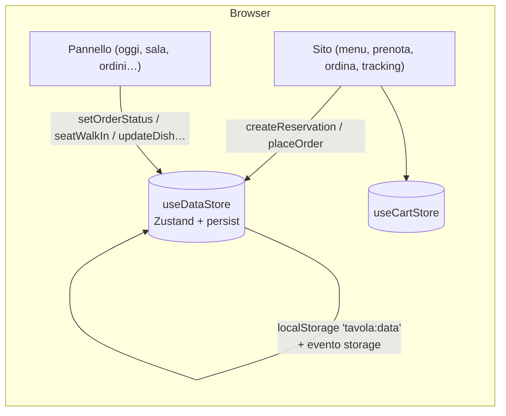

# Architettura — Tavola

## Panoramica

Un'unica app Next.js 16 contiene due aree:

- **`app/(sito)/`**: il sito pubblico. Le pagine sono prerenderizzate staticamente; il menu e le impostazioni del locale sono già nell'HTML (SEO e caricamento immediato), poi diventano interattive.
- **`app/gestione/`**: il pannello, con la sua shell (sidebar, barra in alto, tab bar mobile, modali globali) e `noindex`.

Entrambe leggono e scrivono lo **stesso store** dei dati. In demo lo store vive nel browser; in produzione le sue azioni diventano chiamate al backend senza cambiare i componenti.

## Livelli

| Livello                | Dove                              | Responsabilità                                                                                                                                                                                                      |
| ---------------------- | --------------------------------- | ------------------------------------------------------------------------------------------------------------------------------------------------------------------------------------------------------------------- |
| Dominio                | `lib/domain/`                     | Tipi, schemi Zod e **funzioni pure**: orari (`hours.ts`), tavoli e disponibilità (`booking.ts`), carrello, consegna e stati (`orders.ts`), filtri (`menu.ts`). Nessuna dipendenza da React; coperti da test unitari |
| Dati demo              | `lib/demo/seed.ts`                | Menu, tavoli e impostazioni statiche; `createDemoData(now)` genera prenotazioni e ordini coerenti con l'ora attuale, in modo deterministico                                                                         |
| Stato                  | `store/`                          | `data-store` (dati del locale, persistiti), `cart-store` (carrello del cliente), `ui-store` (modali del pannello)                                                                                                   |
| Hook                   | `hooks/`                          | `useNow` (ora corrente senza errori di idratazione), `useData`, `useSiteData` (fallback statico per l'SSR), `useZodForm`                                                                                            |
| Viste                  | `features/site`, `features/panel` | Composizione di componenti e chiamate alle azioni dello store                                                                                                                                                       |
| Componenti             | `components/ui`                   | Libreria condivisa con gli altri template della libreria                                                                                                                                                            |
| Testi e configurazione | `content/it.ts`, `config/`        | Tutto ciò che si personalizza senza toccare la logica                                                                                                                                                               |

## Flusso dei dati in demo

1. `DataBootstrap` (montato in entrambi i layout) chiama `init()`: reidrata lo store da `localStorage` o genera i dati demo con l'ora corrente.
2. Le azioni (`createReservation`, `placeOrder`, `setOrderStatus`…) aggiornano lo stato in modo immutabile; il salvataggio su `localStorage` è **differito di 150 ms** per non bloccare l'interfaccia.
3. `init()` ascolta l'evento `storage`: quando un'altra scheda salva, lo store si reidrata. Così il tracking del cliente si aggiorna quando la cucina avanza l'ordine in un'altra scheda, e il pannello vede subito la nuova prenotazione.
4. Le viste calcolano dati derivati (coperti, tavoli liberi, ritardi) con `useMemo` a partire dallo stato e da `useNow()`.

### Perché `useNow`

Next.js 16 con Cache Components prerenderizza le pagine: leggere `new Date()` durante il rendering produrrebbe HTML con un orario "congelato" e differenze di idratazione. `useNow()` restituisce `null` sul server e l'ora reale nel browser (aggiornata ogni minuto); le viste mostrano scheletri finché non è disponibile.

### SEO del sito

- `useSiteData()` usa `STATIC_MENU` e `DEMO_SETTINGS` finché lo store non è pronto: l'HTML prerenderizzato contiene tutti i piatti e gli orari.
- La home include **JSON-LD `Restaurant`** (`lib/seo.ts`) con indirizzo, telefono, orari per servizio e link al menu; la serializzazione neutralizza `<` per evitare iniezioni nel tag `script`.
- `sitemap.ts` elenca le pagine pubbliche; `robots.ts` le apre solo con `NEXT_PUBLIC_ALLOW_INDEXING=true` ed esclude sempre `/gestione`, `/ordina/checkout` e `/ordine/`.

### Next.js 16: note pratiche

- La rotta dinamica `/ordine/[numero]` legge `params` in un componente asincrono dentro `<Suspense>` (rendering parziale: guscio statico, contenuto in streaming).
- I componenti che usano `usePathname` (navigazione attiva) sono dentro `<Suspense>` con un fallback senza voce attiva.
- Con l'Activity di Next.js 16 le ultime pagine visitate restano montate ma nascoste: per questo gli ID sono generati con `useId` e i test usano ruoli ed etichette.

## Collegare un backend

Le azioni dello store hanno già le firme di un'API. Un percorso consigliato:

1. **Database** (es. Postgres su Neon o Supabase, regione UE) con tabelle `restaurants`, `categories`, `dishes`, `tables`, `reservations`, `orders`, `order_items`, `opening_hours`. I tipi sono in `lib/domain/types.ts`.
2. **Autenticazione** per `/gestione` (es. Auth.js o Clerk) con ruoli: titolare (tutto), sala (prenotazioni, sala), cucina (ordini, disponibilità piatti). Proteggi le rotte con `proxy.ts` e **verifica i permessi in ogni Server Action**.
3. **Server Actions** che riusano gli schemi Zod (`bookingFormSchema`, `checkoutFormSchema`…) e **ricalcolano lato server** disponibilità (`bookingSlots`, `assignTable`) e totali (`cartTotals`): il browser non è affidabile.
4. **Concorrenza:** crea la prenotazione in una transazione con un vincolo di non sovrapposizione per tavolo (in Postgres un `EXCLUDE USING gist` su `tstzrange`) e rispondi con "L'orario non è più disponibile" (`copy.booking.slotTaken`) in caso di conflitto.
5. **Tempo reale:** sostituisci l'evento `storage` con Server-Sent Events o un servizio come Pusher/Ably/Supabase Realtime per aggiornare bacheca ordini, sala e tracking.
6. **Tracking sicuro:** in produzione l'URL dell'ordine deve contenere un token non indovinabile (es. `/ordine/1234?t=<token>` o un ID casuale), non solo il numero progressivo.
7. **Notifiche:** email/SMS di conferma e promemoria (es. Resend, Twilio) dopo il salvataggio, con link per annullare.
8. **Pagamenti online:** Stripe Checkout o Payment Element; registra l'ordine come "in attesa di pagamento" e conferma solo al webhook `checkout.session.completed`.

In `useSiteData` sostituisci il fallback statico con i dati letti lato server (Server Component + `cacheLife`/`cacheTag`, invalidati quando il menu cambia), così il sito resta veloce e aggiornato.
